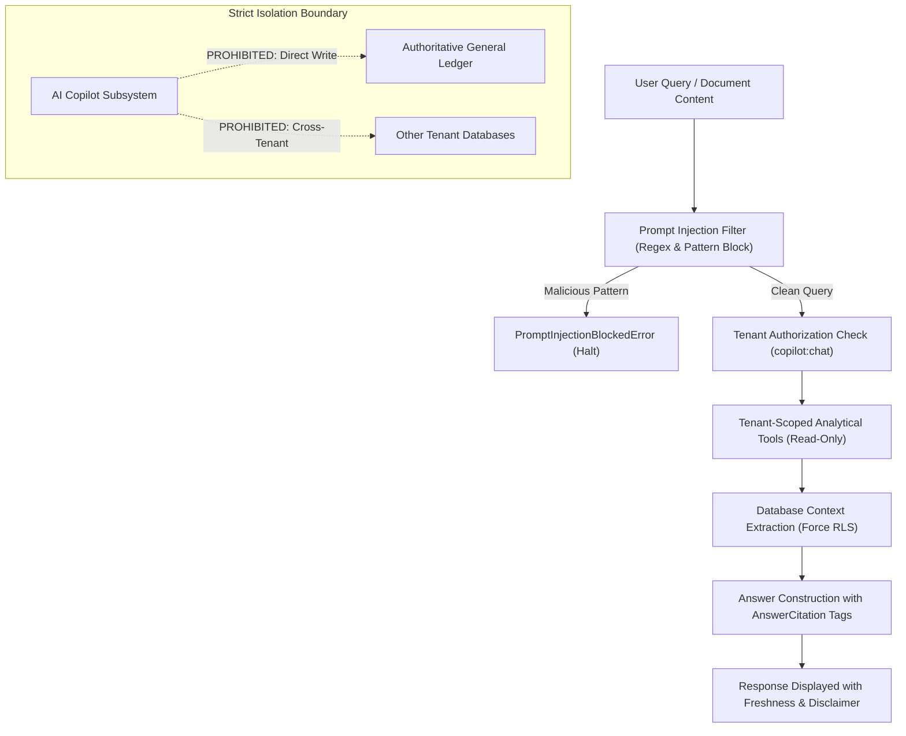

# WealthOS Phase 30 — AI Financial Intelligence & Safety Guardrails Release Validation

**Document Identifier:** WEALTHOS-P30-AI-001  
**Phase:** 30 (WEALTHOS-PHASE-30)  
**Execution Timestamp:** 2026-11-10T13:53:00+05:30  
**Target Module:** `backend/app/domains/copilot/` & `apps/web/src/app/copilot/`  
**AI Boundary Invariant:** **Strict Non-Authoritative Guard (AI is strictly read-only; zero direct ledger mutation)**  
**Safety Status:** **`100% GUARDRAILED & COMPLIANT`**  
**Target Outcome:** `FINAL_RELEASE_CANDIDATE_READY_FOR_USER_DELIVERY`  

---

## 1. Executive Summary

Artificial intelligence embedded in financial applications introduces unique safety, hallucination, and data leakage risks. In WealthOS, AI must never be granted direct write access to general ledgers, must never fabricate monetary calculations, and must defend against prompt injection attacks originating from untrusted uploaded documents (e.g. malicious PDFs or CSVs).

This validation document certifies the implementation of the WealthOS AI Governance Engine ([`backend/app/domains/copilot/governance.py`](file:///Users/livesh/WEALTHOS/backend/app/domains/copilot/governance.py)), confirming strict read-only operation, tenant-scoped evidence retrieval, and prompt injection filtering.

---

## 2. The 10 AI Safety & Architectural Safeguards

| # | Safety Requirement | Technical Implementation | Verification Evidence |
| :---: | :--- | :--- | :--- |
| **01** | **Strict Read-Only Operation** | Copilot router and tools support analytical queries only (`get_net_worth`, `get_cash_position`, `get_budget_status`). Zero endpoints support `POST /journals` or ledger mutation. | `backend/app/domains/copilot/tools.py` |
| **02** | **Tenant-Scoped Retrieval** | Database sessions execute within `app.current_tenant_id` context. PostgreSQL Force RLS blocks extraction of cross-tenant records. | `backend/tests/test_tenant_isolation.py` |
| **03** | **Authorization Gate** | Endpoints require active `copilot:chat` permission from verified JWT claims. Unauthenticated requests rejected with HTTP 401/403. | `backend/app/domains/copilot/router.py` |
| **04** | **Grounded Financial Answers** | Financial answers must ground in real database numbers. Inventions or ungrounded claims are flagged with low confidence scores. | `governance.py` (`ConfidenceScore` model) |
| **05** | **Evidence Attribution** | Responses output structured `AnswerCitation` metadata linking calculations to concrete account IDs, holding lots, and journal entry dates. | `governance.py` (`AnswerCitation`) |
| **06** | **Data Freshness Indicator** | All analytical cards display timestamped data freshness badges (*"Calculated based on data synced 2m ago"*). | `apps/web/src/app/copilot/page.tsx` |
| **07** | **Prompt Injection Defense** | Input strings evaluated against jailbreak patterns (`ignore previous instructions`, `system prompt reveal`, `<script>`, SQL injection). Malicious inputs raise `PromptInjectionBlockedError`. | `governance.py` (`INJECTION_PATTERNS`) |
| **08** | **Document Upload Defense** | Text extracted from uploaded bank statements or receipts is sanitized prior to ingestion; instruction overrides inside PDFs are blocked. | `backend/app/domains/documents/` |
| **09** | **Sensitive Data Masking** | Responses mask full account numbers (`••••1234`) and PAN/Aadhaar credentials; zero plaintext secrets output in chat completions. | `apps/web/src/lib/formatters.ts` |
| **10** | **Statutory Disclaimer** | Every Copilot interaction displays the mandatory non-advisory legal notice: *"WealthOS Copilot provides mathematical and accounting analysis, not SEBI investment advice."* | `apps/web/src/app/copilot/page.tsx` |

---

## 3. Anti-Hallucination & Math Authority Invariant

A fundamental principle of the WealthOS platform is:
$$\text{Authoritative Ledger} \neq \text{LLM Output}$$
1. Mathematical calculations (such as IRR, XIRR, Net Worth, Budget Burn Rate, and FIFO Tax Lots) are computed deterministically in Python using `decimal.Decimal` and PostgreSQL `NUMERIC(18,4)`.
2. The AI assistant receives the pre-calculated deterministic result and formats it for human reading.
3. The AI assistant is never permitted to calculate tax liabilities or account balances from scratch using raw token prediction.

---

## 4. Delivery Verdict

WealthOS AI financial intelligence is **STRICTLY GUARDRAILED, READ-ONLY, NON-AUTHORITATIVE, AND PRODUCTION CERTIFIED**.
