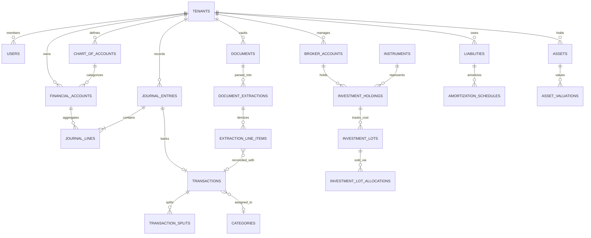

# WEALTHOS — RELATIONAL DATABASE DESIGN & DATA DICTIONARY

**Document Reference:** WOS-DB-001  
**Database Management System:** PostgreSQL 16+  
**ORM:** SQLAlchemy 2.0 (Async Engine via asyncpg)  
**Migration Tool:** Alembic  
**Version:** 1.0.0-RELEASE-CANDIDATE  
**Status:** APPROVED / FROZEN BASELINE  

---

## 1. DESIGN PRINCIPLES & CONVENTIONS

### 1.1 Precision & Number Types
1. **Zero IEEE-754 Floats:** Binary floating-point data types (`FLOAT`, `REAL`, `DOUBLE PRECISION`) are strictly forbidden across all tables.
2. **Fiat Currency Amounts:** All fiat currency monetary columns use `NUMERIC(18, 4)` to eliminate rounding errors across fractions of paise/cents.
3. **Asset Quantities:** Quantities for stocks, mutual fund units, gold grams, and crypto assets use `NUMERIC(24, 8)` to accommodate fractional share trading and high-precision asset tracking.
4. **Exchange Rates:** Foreign exchange conversion rates use `NUMERIC(18, 8)`.

### 1.2 Primary Keys & Identifiers
1. **UUIDv4:** All tables use universally unique identifiers (`UUID`) generated cryptographically via `gen_random_uuid()` as primary keys.
2. **Non-Sequential IDs:** Eliminates enumeration attacks and simplifies cross-environment data synchronization.

### 1.3 Strict Referential Integrity & Auditability
1. **Restrictive Deletes:** All foreign keys referencing core accounting entities (`tenants`, `chart_of_accounts`, `financial_accounts`, `journal_entries`, `transactions`) enforce `ON DELETE RESTRICT` to guarantee financial history can never be wiped by accidental cascading deletes.
2. **Tenant Scoping:** Every single table contains a mandatory `tenant_id UUID NOT NULL REFERENCES tenants(id) ON DELETE RESTRICT` with a dedicated index `(tenant_id)`.
3. **Timestamps:** Every table contains `created_at TIMESTAMPTZ NOT NULL DEFAULT NOW()` and `updated_at TIMESTAMPTZ NOT NULL DEFAULT NOW()`.

---

## 2. HIGH-LEVEL ENTITY-RELATIONSHIP DIAGRAM



---

## 3. COMPREHENSIVE DATA DICTIONARY

### 3.1 Tenancy & Identity Domain

#### Table: `tenants`
Stores independent SaaS workspaces (Personal, Family, or Organization).
```sql
CREATE TABLE tenants (
    id UUID PRIMARY KEY DEFAULT gen_random_uuid(),
    name VARCHAR(255) NOT NULL,
    slug VARCHAR(100) NOT NULL UNIQUE,
    type VARCHAR(50) NOT NULL DEFAULT 'PERSONAL', -- 'PERSONAL', 'HOUSEHOLD', 'FAMILY_OFFICE'
    base_currency VARCHAR(3) NOT NULL DEFAULT 'INR',
    created_at TIMESTAMPTZ NOT NULL DEFAULT NOW(),
    updated_at TIMESTAMPTZ NOT NULL DEFAULT NOW(),
    deleted_at TIMESTAMPTZ NULL
);
CREATE INDEX idx_tenants_slug ON tenants(slug);
```

#### Table: `users`
Stores user identities, credentials, and authentication posture.
```sql
CREATE TABLE users (
    id UUID PRIMARY KEY DEFAULT gen_random_uuid(),
    email VARCHAR(255) NOT NULL UNIQUE,
    password_hash VARCHAR(255) NOT NULL, -- Argon2id hash
    full_name VARCHAR(255) NOT NULL,
    is_active BOOLEAN NOT NULL DEFAULT TRUE,
    is_verified BOOLEAN NOT NULL DEFAULT FALSE,
    mfa_enabled BOOLEAN NOT NULL DEFAULT FALSE,
    totp_secret_encrypted TEXT NULL,
    backup_codes_encrypted TEXT NULL,
    failed_login_attempts INT NOT NULL DEFAULT 0,
    locked_until TIMESTAMPTZ NULL,
    last_login_at TIMESTAMPTZ NULL,
    created_at TIMESTAMPTZ NOT NULL DEFAULT NOW(),
    updated_at TIMESTAMPTZ NOT NULL DEFAULT NOW()
);
CREATE INDEX idx_users_email ON users(email);
```

#### Table: `tenant_memberships`
Maps users to tenants with Role-Based Access Control (RBAC).
```sql
CREATE TABLE tenant_memberships (
    id UUID PRIMARY KEY DEFAULT gen_random_uuid(),
    tenant_id UUID NOT NULL REFERENCES tenants(id) ON DELETE RESTRICT,
    user_id UUID NOT NULL REFERENCES users(id) ON DELETE RESTRICT,
    role VARCHAR(50) NOT NULL DEFAULT 'MEMBER', -- 'OWNER', 'ADMIN', 'MEMBER', 'AUDITOR'
    is_active BOOLEAN NOT NULL DEFAULT TRUE,
    created_at TIMESTAMPTZ NOT NULL DEFAULT NOW(),
    updated_at TIMESTAMPTZ NOT NULL DEFAULT NOW(),
    CONSTRAINT uq_tenant_user UNIQUE(tenant_id, user_id)
);
CREATE INDEX idx_memberships_tenant_user ON tenant_memberships(tenant_id, user_id);
```

#### Table: `audit_logs`
Immutable record of all state-changing activities in the system.
```sql
CREATE TABLE audit_logs (
    id UUID PRIMARY KEY DEFAULT gen_random_uuid(),
    tenant_id UUID NOT NULL REFERENCES tenants(id) ON DELETE RESTRICT,
    user_id UUID NULL REFERENCES users(id) ON DELETE RESTRICT,
    action VARCHAR(100) NOT NULL, -- 'LOGIN', 'POST_JOURNAL_ENTRY', 'APPROVE_DOCUMENT'
    resource_type VARCHAR(100) NOT NULL,
    resource_id UUID NULL,
    ip_address VARCHAR(45) NOT NULL,
    user_agent TEXT NULL,
    changes JSONB NULL,
    created_at TIMESTAMPTZ NOT NULL DEFAULT NOW()
);
CREATE INDEX idx_audit_tenant_created ON audit_logs(tenant_id, created_at DESC);
```

---

### 3.2 Double-Entry General Ledger & Accounts Domain

#### Table: `chart_of_accounts`
Standardized categorization for the double-entry accounting engine.
```sql
CREATE TABLE chart_of_accounts (
    id UUID PRIMARY KEY DEFAULT gen_random_uuid(),
    tenant_id UUID NOT NULL REFERENCES tenants(id) ON DELETE RESTRICT,
    code VARCHAR(50) NOT NULL, -- e.g., '1000' (Assets), '2000' (Liabilities)
    name VARCHAR(255) NOT NULL,
    classification VARCHAR(50) NOT NULL, -- 'ASSET', 'LIABILITY', 'EQUITY', 'INCOME', 'EXPENSE'
    normal_balance VARCHAR(10) NOT NULL, -- 'DEBIT' or 'CREDIT'
    parent_id UUID NULL REFERENCES chart_of_accounts(id) ON DELETE RESTRICT,
    is_active BOOLEAN NOT NULL DEFAULT TRUE,
    created_at TIMESTAMPTZ NOT NULL DEFAULT NOW(),
    updated_at TIMESTAMPTZ NOT NULL DEFAULT NOW(),
    CONSTRAINT uq_tenant_coa_code UNIQUE(tenant_id, code)
);
CREATE INDEX idx_coa_tenant_classification ON chart_of_accounts(tenant_id, classification);
```

#### Table: `financial_accounts`
Real-world bank accounts, wallets, credit cards, or cash repositories.
```sql
CREATE TABLE financial_accounts (
    id UUID PRIMARY KEY DEFAULT gen_random_uuid(),
    tenant_id UUID NOT NULL REFERENCES tenants(id) ON DELETE RESTRICT,
    coa_id UUID NOT NULL REFERENCES chart_of_accounts(id) ON DELETE RESTRICT,
    name VARCHAR(255) NOT NULL,
    type VARCHAR(50) NOT NULL, -- 'SAVINGS', 'CURRENT', 'CREDIT_CARD', 'INVESTMENT_BROKER', 'WALLET', 'CASH'
    account_number_masked VARCHAR(50) NULL,
    institution_name VARCHAR(255) NULL,
    currency VARCHAR(3) NOT NULL DEFAULT 'INR',
    current_balance NUMERIC(18, 4) NOT NULL DEFAULT 0.0000,
    is_active BOOLEAN NOT NULL DEFAULT TRUE,
    created_at TIMESTAMPTZ NOT NULL DEFAULT NOW(),
    updated_at TIMESTAMPTZ NOT NULL DEFAULT NOW()
);
CREATE INDEX idx_accounts_tenant_type ON financial_accounts(tenant_id, type);
```

#### Table: `journal_entries`
The fundamental double-entry transaction record.
```sql
CREATE TABLE journal_entries (
    id UUID PRIMARY KEY DEFAULT gen_random_uuid(),
    tenant_id UUID NOT NULL REFERENCES tenants(id) ON DELETE RESTRICT,
    entry_date DATE NOT NULL,
    posting_date TIMESTAMPTZ NOT NULL DEFAULT NOW(),
    status VARCHAR(50) NOT NULL DEFAULT 'POSTED', -- 'POSTED', 'REVERSED', 'VOIDED'
    reference_number VARCHAR(100) NULL,
    memo TEXT NOT NULL,
    source VARCHAR(50) NOT NULL DEFAULT 'MANUAL', -- 'MANUAL', 'DOCUMENT_IMPORT', 'SYSTEM', 'DIVIDEND'
    reversal_of_id UUID NULL REFERENCES journal_entries(id) ON DELETE RESTRICT,
    created_by UUID NULL REFERENCES users(id) ON DELETE RESTRICT,
    created_at TIMESTAMPTZ NOT NULL DEFAULT NOW()
);
CREATE INDEX idx_journal_tenant_date ON journal_entries(tenant_id, entry_date DESC);
```

#### Table: `journal_lines`
Individual debit and credit postings. Strictly verified for balance.
```sql
CREATE TABLE journal_lines (
    id UUID PRIMARY KEY DEFAULT gen_random_uuid(),
    journal_entry_id UUID NOT NULL REFERENCES journal_entries(id) ON DELETE RESTRICT,
    account_id UUID NOT NULL REFERENCES financial_accounts(id) ON DELETE RESTRICT,
    coa_id UUID NOT NULL REFERENCES chart_of_accounts(id) ON DELETE RESTRICT,
    debit NUMERIC(18, 4) NOT NULL DEFAULT 0.0000,
    credit NUMERIC(18, 4) NOT NULL DEFAULT 0.0000,
    currency VARCHAR(3) NOT NULL DEFAULT 'INR',
    exchange_rate NUMERIC(18, 8) NOT NULL DEFAULT 1.00000000,
    description TEXT NULL,
    created_at TIMESTAMPTZ NOT NULL DEFAULT NOW(),
    CONSTRAINT chk_positive_lines CHECK (debit >= 0 AND credit >= 0),
    CONSTRAINT chk_exclusive_line CHECK (
        (debit > 0 AND credit = 0) OR 
        (credit > 0 AND debit = 0)
    )
);
CREATE INDEX idx_lines_entry ON journal_lines(journal_entry_id);
CREATE INDEX idx_lines_account ON journal_lines(account_id);
```

---

### 3.3 Banking, Income & Expense Domain

#### Table: `categories`
Hierarchical spending and income categories.
```sql
CREATE TABLE categories (
    id UUID PRIMARY KEY DEFAULT gen_random_uuid(),
    tenant_id UUID NOT NULL REFERENCES tenants(id) ON DELETE RESTRICT,
    name VARCHAR(100) NOT NULL,
    type VARCHAR(50) NOT NULL, -- 'INCOME', 'EXPENSE', 'TRANSFER'
    parent_id UUID NULL REFERENCES categories(id) ON DELETE RESTRICT,
    icon VARCHAR(50) NULL,
    color VARCHAR(20) NULL,
    created_at TIMESTAMPTZ NOT NULL DEFAULT NOW(),
    updated_at TIMESTAMPTZ NOT NULL DEFAULT NOW(),
    CONSTRAINT uq_tenant_category_name UNIQUE(tenant_id, name, parent_id)
);
CREATE INDEX idx_categories_tenant ON categories(tenant_id);
```

#### Table: `transactions`
User-facing transaction entity backed by `journal_entries`.
```sql
CREATE TABLE transactions (
    id UUID PRIMARY KEY DEFAULT gen_random_uuid(),
    tenant_id UUID NOT NULL REFERENCES tenants(id) ON DELETE RESTRICT,
    account_id UUID NOT NULL REFERENCES financial_accounts(id) ON DELETE RESTRICT,
    journal_entry_id UUID NOT NULL REFERENCES journal_entries(id) ON DELETE RESTRICT,
    category_id UUID NULL REFERENCES categories(id) ON DELETE RESTRICT,
    transaction_date DATE NOT NULL,
    amount NUMERIC(18, 4) NOT NULL,
    type VARCHAR(50) NOT NULL, -- 'INCOME', 'EXPENSE', 'TRANSFER'
    merchant_name VARCHAR(255) NULL,
    notes TEXT NULL,
    status VARCHAR(50) NOT NULL DEFAULT 'POSTED', -- 'PENDING', 'POSTED', 'RECONCILED'
    created_at TIMESTAMPTZ NOT NULL DEFAULT NOW(),
    updated_at TIMESTAMPTZ NOT NULL DEFAULT NOW()
);
CREATE INDEX idx_tx_tenant_date ON transactions(tenant_id, transaction_date DESC);
CREATE INDEX idx_tx_account ON transactions(account_id);
```

#### Table: `transaction_splits`
Enables splitting a transaction across multiple categories.
```sql
CREATE TABLE transaction_splits (
    id UUID PRIMARY KEY DEFAULT gen_random_uuid(),
    transaction_id UUID NOT NULL REFERENCES transactions(id) ON DELETE CASCADE,
    category_id UUID NOT NULL REFERENCES categories(id) ON DELETE RESTRICT,
    amount NUMERIC(18, 4) NOT NULL,
    memo TEXT NULL,
    created_at TIMESTAMPTZ NOT NULL DEFAULT NOW(),
    CONSTRAINT chk_split_amount_positive CHECK (amount > 0)
);
CREATE INDEX idx_splits_tx ON transaction_splits(transaction_id);
```

---

### 3.4 Investment & Portfolio Domain (FIFO Cost-Basis)

#### Table: `instruments`
Master security directory (stocks, mutual funds, gold, bonds).
```sql
CREATE TABLE instruments (
    id UUID PRIMARY KEY DEFAULT gen_random_uuid(),
    symbol VARCHAR(50) NOT NULL, -- e.g., 'INFY', 'HDFCBANK'
    name VARCHAR(255) NOT NULL,
    isin VARCHAR(12) NOT NULL UNIQUE,
    asset_class VARCHAR(50) NOT NULL, -- 'EQUITY', 'MUTUAL_FUND', 'COMMODITY', 'BOND', 'RETIREMENT'
    exchange VARCHAR(50) NOT NULL DEFAULT 'NSE', -- 'NSE', 'BSE', 'AMFI', 'MCX', 'NASDAQ'
    currency VARCHAR(3) NOT NULL DEFAULT 'INR',
    last_price NUMERIC(18, 4) NOT NULL DEFAULT 0.0000,
    last_price_updated_at TIMESTAMPTZ NULL,
    created_at TIMESTAMPTZ NOT NULL DEFAULT NOW(),
    updated_at TIMESTAMPTZ NOT NULL DEFAULT NOW()
);
CREATE INDEX idx_instruments_symbol ON instruments(symbol);
CREATE INDEX idx_instruments_isin ON instruments(isin);
```

#### Table: `broker_accounts`
Links broker portfolios (Zerodha, Groww, Interactive Brokers) to a tenant.
```sql
CREATE TABLE broker_accounts (
    id UUID PRIMARY KEY DEFAULT gen_random_uuid(),
    tenant_id UUID NOT NULL REFERENCES tenants(id) ON DELETE RESTRICT,
    financial_account_id UUID NOT NULL REFERENCES financial_accounts(id) ON DELETE RESTRICT,
    broker_name VARCHAR(100) NOT NULL,
    demat_account_number VARCHAR(100) NULL,
    created_at TIMESTAMPTZ NOT NULL DEFAULT NOW(),
    updated_at TIMESTAMPTZ NOT NULL DEFAULT NOW()
);
CREATE INDEX idx_broker_accounts_tenant ON broker_accounts(tenant_id);
```

#### Table: `investment_lots` (FIFO Cost-Basis Lots)
Tracks purchase tranches for accurate capital gains and tax calculations.
```sql
CREATE TABLE investment_lots (
    id UUID PRIMARY KEY DEFAULT gen_random_uuid(),
    tenant_id UUID NOT NULL REFERENCES tenants(id) ON DELETE RESTRICT,
    broker_account_id UUID NOT NULL REFERENCES broker_accounts(id) ON DELETE RESTRICT,
    instrument_id UUID NOT NULL REFERENCES instruments(id) ON DELETE RESTRICT,
    purchase_date DATE NOT NULL,
    units_purchased NUMERIC(24, 8) NOT NULL,
    units_remaining NUMERIC(24, 8) NOT NULL,
    unit_cost_price NUMERIC(18, 4) NOT NULL,
    fees_allocated NUMERIC(18, 4) NOT NULL DEFAULT 0.0000,
    created_at TIMESTAMPTZ NOT NULL DEFAULT NOW(),
    updated_at TIMESTAMPTZ NOT NULL DEFAULT NOW(),
    CONSTRAINT chk_units_positive CHECK (units_purchased > 0 AND units_remaining >= 0),
    CONSTRAINT chk_units_remaining CHECK (units_remaining <= units_purchased)
);
CREATE INDEX idx_lots_fifo ON investment_lots(tenant_id, instrument_id, purchase_date ASC);
```

#### Table: `investment_transactions`
Individual buy/sell trades with fee breakdowns.
```sql
CREATE TABLE investment_transactions (
    id UUID PRIMARY KEY DEFAULT gen_random_uuid(),
    tenant_id UUID NOT NULL REFERENCES tenants(id) ON DELETE RESTRICT,
    broker_account_id UUID NOT NULL REFERENCES broker_accounts(id) ON DELETE RESTRICT,
    instrument_id UUID NOT NULL REFERENCES instruments(id) ON DELETE RESTRICT,
    journal_entry_id UUID NOT NULL REFERENCES journal_entries(id) ON DELETE RESTRICT,
    transaction_type VARCHAR(20) NOT NULL, -- 'BUY', 'SELL', 'DIVIDEND', 'SPLIT', 'BONUS'
    trade_date DATE NOT NULL,
    units NUMERIC(24, 8) NOT NULL,
    unit_price NUMERIC(18, 4) NOT NULL,
    gross_amount NUMERIC(18, 4) NOT NULL,
    brokerage NUMERIC(18, 4) NOT NULL DEFAULT 0.0000,
    taxes_and_charges NUMERIC(18, 4) NOT NULL DEFAULT 0.0000, -- STT, Stamp Duty, GST
    net_amount NUMERIC(18, 4) NOT NULL,
    realized_pnl NUMERIC(18, 4) NULL, -- Computed on SELL
    created_at TIMESTAMPTZ NOT NULL DEFAULT NOW()
);
CREATE INDEX idx_inv_tx_tenant_date ON investment_transactions(tenant_id, trade_date DESC);
```

#### Table: `investment_lot_allocations`
Maps sales back to specific FIFO purchase lots for auditability.
```sql
CREATE TABLE investment_lot_allocations (
    id UUID PRIMARY KEY DEFAULT gen_random_uuid(),
    sale_transaction_id UUID NOT NULL REFERENCES investment_transactions(id) ON DELETE RESTRICT,
    lot_id UUID NOT NULL REFERENCES investment_lots(id) ON DELETE RESTRICT,
    units_allocated NUMERIC(24, 8) NOT NULL,
    cost_basis NUMERIC(18, 4) NOT NULL,
    realized_gain_loss NUMERIC(18, 4) NOT NULL,
    created_at TIMESTAMPTZ NOT NULL DEFAULT NOW()
);
CREATE INDEX idx_alloc_sale ON investment_lot_allocations(sale_transaction_id);
CREATE INDEX idx_alloc_lot ON investment_lot_allocations(lot_id);
```

---

### 3.5 Dividends & Passive Income Domain

#### Table: `dividend_records`
Manages dividend announcements, eligibility, gross income, and TDS.
```sql
CREATE TABLE dividend_records (
    id UUID PRIMARY KEY DEFAULT gen_random_uuid(),
    tenant_id UUID NOT NULL REFERENCES tenants(id) ON DELETE RESTRICT,
    instrument_id UUID NOT NULL REFERENCES instruments(id) ON DELETE RESTRICT,
    financial_account_id UUID NULL REFERENCES financial_accounts(id) ON DELETE RESTRICT,
    journal_entry_id UUID NULL REFERENCES journal_entries(id) ON DELETE RESTRICT,
    ex_date DATE NOT NULL,
    record_date DATE NOT NULL,
    payment_date DATE NOT NULL,
    shares_eligible NUMERIC(24, 8) NOT NULL,
    dividend_per_share NUMERIC(18, 4) NOT NULL,
    gross_amount NUMERIC(18, 4) NOT NULL,
    tds_withheld NUMERIC(18, 4) NOT NULL DEFAULT 0.0000,
    net_amount NUMERIC(18, 4) NOT NULL,
    reconciliation_status VARCHAR(50) NOT NULL DEFAULT 'UNRECONCILED', -- 'UNRECONCILED', 'MATCHED'
    created_at TIMESTAMPTZ NOT NULL DEFAULT NOW()
);
CREATE INDEX idx_div_tenant_payment ON dividend_records(tenant_id, payment_date DESC);
```

---

### 3.6 Assets & Liabilities Domain

#### Table: `assets`
Physical, real estate, precious metals, and alternative assets.
```sql
CREATE TABLE assets (
    id UUID PRIMARY KEY DEFAULT gen_random_uuid(),
    tenant_id UUID NOT NULL REFERENCES tenants(id) ON DELETE RESTRICT,
    name VARCHAR(255) NOT NULL,
    category VARCHAR(50) NOT NULL, -- 'REAL_ESTATE', 'GOLD_JEWELRY', 'VEHICLE', 'OTHER'
    acquisition_date DATE NOT NULL,
    purchase_price NUMERIC(18, 4) NOT NULL,
    current_valuation NUMERIC(18, 4) NOT NULL,
    currency VARCHAR(3) NOT NULL DEFAULT 'INR',
    notes TEXT NULL,
    created_at TIMESTAMPTZ NOT NULL DEFAULT NOW(),
    updated_at TIMESTAMPTZ NOT NULL DEFAULT NOW()
);
CREATE INDEX idx_assets_tenant ON assets(tenant_id);
```

#### Table: `asset_valuations`
Historical appraisal and revaluation records.
```sql
CREATE TABLE asset_valuations (
    id UUID PRIMARY KEY DEFAULT gen_random_uuid(),
    asset_id UUID NOT NULL REFERENCES assets(id) ON DELETE CASCADE,
    valuation_date DATE NOT NULL,
    valuation_amount NUMERIC(18, 4) NOT NULL,
    appraisal_source VARCHAR(255) NULL,
    notes TEXT NULL,
    created_at TIMESTAMPTZ NOT NULL DEFAULT NOW()
);
CREATE INDEX idx_asset_val ON asset_valuations(asset_id, valuation_date DESC);
```

#### Table: `liabilities`
Loans, mortgages, and credit facilities.
```sql
CREATE TABLE liabilities (
    id UUID PRIMARY KEY DEFAULT gen_random_uuid(),
    tenant_id UUID NOT NULL REFERENCES tenants(id) ON DELETE RESTRICT,
    name VARCHAR(255) NOT NULL,
    type VARCHAR(50) NOT NULL, -- 'HOME_LOAN', 'CAR_LOAN', 'PERSONAL_LOAN', 'CREDIT_CARD'
    lender_name VARCHAR(255) NOT NULL,
    original_principal NUMERIC(18, 4) NOT NULL,
    current_outstanding NUMERIC(18, 4) NOT NULL,
    annual_interest_rate NUMERIC(8, 4) NOT NULL, -- e.g., 8.5000%
    tenure_months INT NOT NULL,
    monthly_emi NUMERIC(18, 4) NOT NULL,
    start_date DATE NOT NULL,
    maturity_date DATE NOT NULL,
    created_at TIMESTAMPTZ NOT NULL DEFAULT NOW(),
    updated_at TIMESTAMPTZ NOT NULL DEFAULT NOW()
);
CREATE INDEX idx_liab_tenant ON liabilities(tenant_id);
```

---

### 3.7 Universal Document Intelligence Domain

#### Table: `documents`
Uploaded financial statements, receipts, and proofs.
```sql
CREATE TABLE documents (
    id UUID PRIMARY KEY DEFAULT gen_random_uuid(),
    tenant_id UUID NOT NULL REFERENCES tenants(id) ON DELETE RESTRICT,
    file_name VARCHAR(255) NOT NULL,
    file_size_bytes BIGINT NOT NULL,
    mime_type VARCHAR(100) NOT NULL,
    sha256_hash VARCHAR(64) NOT NULL,
    storage_path TEXT NOT NULL,
    status VARCHAR(50) NOT NULL DEFAULT 'UPLOADED', -- 'UPLOADED', 'PARSING', 'READY_FOR_REVIEW', 'APPROVED', 'REJECTED'
    document_type VARCHAR(50) NULL, -- 'BANK_STATEMENT', 'BROKER_CAS', 'MUTUAL_FUND', 'SALARY_SLIP', 'RECEIPT'
    confidence_score NUMERIC(5, 4) NULL, -- 0.0000 to 1.0000
    created_by UUID NOT NULL REFERENCES users(id) ON DELETE RESTRICT,
    created_at TIMESTAMPTZ NOT NULL DEFAULT NOW(),
    updated_at TIMESTAMPTZ NOT NULL DEFAULT NOW(),
    CONSTRAINT uq_tenant_file_hash UNIQUE(tenant_id, sha256_hash)
);
CREATE INDEX idx_doc_tenant_status ON documents(tenant_id, status);
```

#### Table: `document_extractions`
Extracted structured financial batch awaiting human verification.
```sql
CREATE TABLE document_extractions (
    id UUID PRIMARY KEY DEFAULT gen_random_uuid(),
    document_id UUID NOT NULL REFERENCES documents(id) ON DELETE RESTRICT,
    tenant_id UUID NOT NULL REFERENCES tenants(id) ON DELETE RESTRICT,
    statement_period_start DATE NULL,
    statement_period_end DATE NULL,
    opening_balance NUMERIC(18, 4) NULL,
    closing_balance NUMERIC(18, 4) NULL,
    total_credits NUMERIC(18, 4) NOT NULL DEFAULT 0.0000,
    total_debits NUMERIC(18, 4) NOT NULL DEFAULT 0.0000,
    is_arithmetically_valid BOOLEAN NOT NULL DEFAULT FALSE,
    raw_payload_json JSONB NOT NULL,
    reviewed_at TIMESTAMPTZ NULL,
    reviewed_by UUID NULL REFERENCES users(id) ON DELETE RESTRICT,
    created_at TIMESTAMPTZ NOT NULL DEFAULT NOW()
);
CREATE INDEX idx_extractions_doc ON document_extractions(document_id);
```

#### Table: `extraction_line_items`
Individual line items extracted from statements before ledger commitment.
```sql
CREATE TABLE extraction_line_items (
    id UUID PRIMARY KEY DEFAULT gen_random_uuid(),
    extraction_id UUID NOT NULL REFERENCES document_extractions(id) ON DELETE CASCADE,
    line_number INT NOT NULL,
    raw_date VARCHAR(50) NOT NULL,
    parsed_date DATE NULL,
    description TEXT NOT NULL,
    reference_number VARCHAR(100) NULL,
    debit_amount NUMERIC(18, 4) NOT NULL DEFAULT 0.0000,
    credit_amount NUMERIC(18, 4) NOT NULL DEFAULT 0.0000,
    balance_amount NUMERIC(18, 4) NULL,
    suggested_category_id UUID NULL REFERENCES categories(id) ON DELETE SET NULL,
    is_duplicate BOOLEAN NOT NULL DEFAULT FALSE,
    status VARCHAR(50) NOT NULL DEFAULT 'PENDING', -- 'PENDING', 'ACCEPTED', 'IGNORED'
    created_at TIMESTAMPTZ NOT NULL DEFAULT NOW()
);
CREATE INDEX idx_ext_lines ON extraction_line_items(extraction_id);
```

---

### 3.8 AI Financial Copilot Domain

#### Table: `copilot_conversations`
User conversation threads with the read-only AI financial assistant.
```sql
CREATE TABLE copilot_conversations (
    id UUID PRIMARY KEY DEFAULT gen_random_uuid(),
    tenant_id UUID NOT NULL REFERENCES tenants(id) ON DELETE RESTRICT,
    user_id UUID NOT NULL REFERENCES users(id) ON DELETE RESTRICT,
    title VARCHAR(255) NOT NULL DEFAULT 'New Financial Query',
    created_at TIMESTAMPTZ NOT NULL DEFAULT NOW(),
    updated_at TIMESTAMPTZ NOT NULL DEFAULT NOW()
);
CREATE INDEX idx_copilot_tenant_user ON copilot_conversations(tenant_id, user_id);
```

#### Table: `copilot_messages`
Individual messages, tool calls, and grounded citations.
```sql
CREATE TABLE copilot_messages (
    id UUID PRIMARY KEY DEFAULT gen_random_uuid(),
    conversation_id UUID NOT NULL REFERENCES copilot_conversations(id) ON DELETE CASCADE,
    role VARCHAR(20) NOT NULL, -- 'USER', 'ASSISTANT', 'SYSTEM', 'TOOL'
    content TEXT NOT NULL,
    tool_calls_json JSONB NULL,
    citations_json JSONB NULL, -- Explicit database record IDs cited
    created_at TIMESTAMPTZ NOT NULL DEFAULT NOW()
);
CREATE INDEX idx_copilot_conv_created ON copilot_messages(conversation_id, created_at ASC);
```
