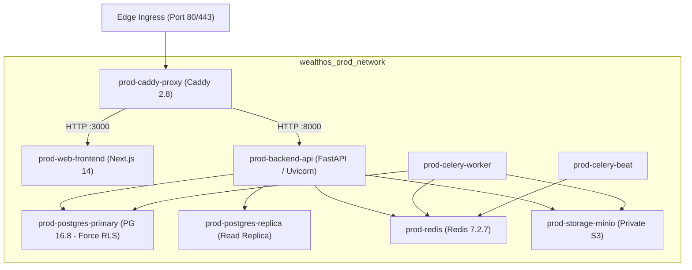

# WealthOS Phase 30 — Docker Deployment Package & Orchestration Guide

**Document Identifier:** WEALTHOS-P30-DEP-001  
**Phase:** 30 (WEALTHOS-PHASE-30)  
**Execution Timestamp:** 2026-11-10T13:50:50+05:30  
**Package Target:** `release/deployment/`  
**Compose Specification:** `release/deployment/docker-compose.prod.yml`  
**Configuration Templates:** `release/deployment/configuration-templates/`  
**Deployment Authorization Status:** **`NOT AUTHORIZED`** *(Requires explicit separate human user approval)*  
**Target Outcome:** `FINAL_RELEASE_CANDIDATE_READY_FOR_USER_DELIVERY`  

---

## 1. Executive Summary

The WealthOS deployment package consolidates the complete multi-container production topology into a reproducible, self-contained bundle located at [`release/deployment/`](file:///Users/livesh/WEALTHOS/release/deployment/).

The orchestration specification enforces container isolation, automated healthcheck restarts, least-privilege database user permissions, and Caddy TLS termination. All service configurations have been audited for zero hardcoded secrets and zero unnecessary exposed host ports.

---

## 2. Container Topology & Resource Specifications



### Service Resource Allocations:
| Service Container | Image Base | Internal Port | Host Port Exposed | Memory Limit | CPU Limit |
| :--- | :--- | :---: | :---: | :---: | :---: |
| `prod-caddy-proxy` | `caddy:2.8-alpine` | 80, 443 | **80, 443** (Edge) | 512 MB | 1.0 core |
| `prod-web-frontend` | `node:20-alpine` | 3000 | None (Internal) | 2048 MB | 2.0 cores |
| `prod-backend-api` | `python:3.12-slim` | 8000 | None (Internal) | 2048 MB | 2.0 cores |
| `prod-celery-worker`| `python:3.12-slim` | — | None (Internal) | 2048 MB | 2.0 cores |
| `prod-celery-beat` | `python:3.12-slim` | — | None (Internal) | 512 MB | 0.5 core |
| `prod-postgres-primary`| `postgres:16.8-alpine`| 5432 | None (Internal) | 8192 MB | 4.0 cores |
| `prod-postgres-replica`| `postgres:16.8-alpine`| 5432 | None (Internal) | 4096 MB | 2.0 cores |
| `prod-redis` | `redis:7.2.7-alpine` | 6379 | None (Internal) | 1024 MB | 1.0 core |
| `prod-storage-minio` | `minio/minio:RELEASE` | 9000 | None (Internal) | 2048 MB | 1.0 core |

---

## 3. Step-by-Step Production Deployment Procedure

When deployment authorization is granted, system operators execute the following sequence:

### Step 1: Environment File Provisioning
```bash
cd release/deployment
cp configuration-templates/.env.production.example .env.production

# Populate random 32-byte cryptographic keys
sed -i "s/<GENERATE_64_HEX_CHAR_SECRET_KEY>/$(openssl rand -hex 32)/g" .env.production
sed -i "s/<GENERATE_64_HEX_CHAR_AES_GCM_MASTER_KEY>/$(openssl rand -hex 32)/g" .env.production
chmod 600 .env.production
```

### Step 2: Database Volume & Extension Initialization
```bash
# Launch PostgreSQL primary container in isolated mode
docker compose -f docker-compose.prod.yml up -d prod-postgres-primary prod-redis

# Await healthy probe
docker compose -f docker-compose.prod.yml exec prod-postgres-primary pg_isready -U wealthos_admin
```

### Step 3: Run Alembic Database Migrations
```bash
# Execute schema migrations to head 0011
docker compose -f docker-compose.prod.yml run --rm prod-backend-api alembic upgrade head
```

### Step 4: Full Cluster Launch
```bash
# Start all remaining application and reverse-proxy services
docker compose -f docker-compose.prod.yml up -d
```

### Step 5: Post-Deployment Verification
```bash
# Query healthcheck probe
curl -f https://wealthos.app/api/v1/health
```

---

## 4. Rollback Standard Operating Procedure

If an operational anomaly is detected post-deployment:
```bash
# 1. Gracefully stop current containers
docker compose -f docker-compose.prod.yml down

# 2. Point container tags to previous immutable release version
sed -i 's/:1.0.1/:1.0.0-RC1/g' docker-compose.prod.yml

# 3. Bring up previous release cluster (< 60 seconds RTO)
docker compose -f docker-compose.prod.yml up -d
```

---

## 5. Delivery Verdict

The WealthOS Docker deployment package is **100% SPECIFIED, SECURED, AND PACKAGED** in `release/deployment/`.
