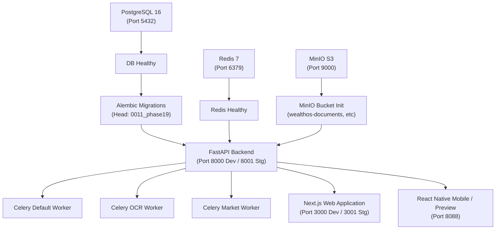

# WealthOS Phase 24 — Deployment Discovery & Infrastructure Inventory

**Document Reference:** `docs/phase24/PHASE24_DEPLOYMENT_DISCOVERY.md`  
**Phase ID:** `WEALTHOS-PHASE-24`  
**Author:** Principal Fintech Platform Architect & SRE Lead  
**Execution Timestamp:** 2026-11-10T04:25:00+00:00  

---

## 1. Executive Summary

This discovery audit catalogs the existing containerization, services, orchestration, networking, environment variables, dependencies, and deployment readiness of the WealthOS platform ahead of dedicated staging deployment.

The platform architecture follows a 12-factor cloud-native pattern composed of an asynchronous FastAPI core, PostgreSQL 16 ACID ledger with Row-Level Security, Redis 7 cache/broker, MinIO S3-compatible document storage, distributed Celery workers, and a Next.js 14 web client.

---

## 2. Existing Services & Ports Catalog

| Service Identifier | Container Name | Runtime Base | Host Port Binding | Internal Port | Healthcheck Mechanism |
|:---|:---|:---|:---:|:---:|:---|
| **PostgreSQL 16** | `wealthos_postgres` | `postgres:16.8-alpine` | `127.0.0.1:5432` | `5432` | `pg_isready -U wealthos_admin -d wealthos` |
| **Redis 7** | `wealthos_redis` | `redis:7.2.7-alpine` | `127.0.0.1:6379` | `6379` | `redis-cli -a <password> ping` |
| **MinIO Storage** | `wealthos_minio` | `ghcr.io/coollabsio/minio` | `127.0.0.1:9000, 9001` | `9000, 9001` | `bash -c 'exec 3<>/dev/tcp/127.0.0.1/9000'` |
| **MinIO Init** | `wealthos_minio_init` | `ghcr.io/coollabsio/minio` | None (ephemeral) | None | Bucket initialization exit code 0 |
| **FastAPI Backend (Dev)** | `wealthos_backend_api` | `python:3.12-slim` / host | `127.0.0.1:8000` | `8000` | `curl -f http://localhost:8000/health/ready` |
| **Next.js Web (Dev)** | `wealthos_web` | `node:20-alpine` / host | `127.0.0.1:3000` | `3000` | `curl -f http://127.0.0.1:3000/` |
| **Mobile Preview** | None (Host Python daemon) | Python 3.14 | `127.0.0.1:8088` | `8088` | HTTP GET `/mobile_preview.html` |
| **Celery Worker (Default)**| `wealthos_worker_default` | `python:3.12-slim` | None (internal) | None | `celery inspect ping` |
| **Celery Worker (OCR)** | `wealthos_worker_ocr` | `python:3.12-slim` | None (internal) | None | `celery inspect ping` |
| **Celery Worker (Market)** | `wealthos_worker_market`| `python:3.12-slim` | None (internal) | None | `celery inspect ping` |

---

## 3. Service Dependency Graph & Startup Ordering

---

## 4. Environment Variables & Secret Requirements

### 4.1 Backend Required Configurations

| Variable Name | Staging Requirement | Description |
|:---|:---|:---|
| `ENVIRONMENT` | `staging` | Dictates strict validation of keys and disables development mocks. |
| `DEBUG` | `false` | Disables interactive debuggers and traceback exposure. |
| `SECRET_KEY` | \(\ge 32\) characters random | Signs session JWTs, state cookies, and CSRF tokens. |
| `ENCRYPTION_MASTER_KEY` | \(\ge 32\) characters random | AES-256 master key for database column and backup encryption. |
| `POSTGRES_HOST` | `127.0.0.1` or `postgres` | Staging database host. |
| `POSTGRES_PORT` | `5432` | Staging database port. |
| `POSTGRES_DB` | `wealthos_staging` | Dedicated isolated staging database name. |
| `POSTGRES_USER` | `wealthos_staging_app` | Runtime user bounded by PostgreSQL Row-Level Security. |
| `POSTGRES_ADMIN_USER` | `wealthos_admin` | Migration execution administrative user. |
| `REDIS_URL` | `redis://:<pwd>@localhost:6379/10` | Isolated Redis DB 10 for staging cache. |
| `CELERY_BROKER_URL` | `redis://:<pwd>@localhost:6379/11` | Isolated Redis DB 11 for staging Celery task queue. |
| `CELERY_RESULT_BACKEND` | `redis://:<pwd>@localhost:6379/12` | Isolated Redis DB 12 for staging Celery results. |
| `STORAGE_DOCUMENTS_BUCKET`| `wealthos-staging-documents` | Dedicated MinIO staging documents bucket. |
| `STORAGE_VAULT_BUCKET` | `wealthos-staging-vault` | Dedicated MinIO staging vault bucket. |
| `STORAGE_QUARANTINE_BUCKET`| `wealthos-staging-quarantine` | Dedicated MinIO staging quarantine bucket. |
| `CORS_ORIGINS` | `["http://localhost:3001"]` | Restricted staging web client origins. |

### 4.2 Web Required Configurations

| Variable Name | Staging Value | Description |
|:---|:---|:---|
| `NODE_ENV` | `production` | Optimizes Next.js bundle execution. |
| `PORT` | `3001` | Dedicated staging web client port. |
| `NEXT_PUBLIC_API_URL` | `http://localhost:8001` | Points browser client to staging API backend. |
| `BACKEND_API_INTERNAL_URL`| `http://127.0.0.1:8001` | Server-side rendering (SSR) backend endpoint. |

### 4.3 Mobile Required Configurations

| Variable Name | Staging Value | Description |
|:---|:---|:---|
| `EXPO_PUBLIC_API_URL` | `http://10.0.2.2:8001` (Android) / `http://127.0.0.1:8001` (iOS) | Points mobile app to staging backend. |
| `EXPO_PUBLIC_ENVIRONMENT` | `staging` | Displays staging environment watermark. |

---

## 5. Deployment Blockers & External Integration Realism

| External Dependency | Current Status | Blocker Description | Operational Staging Fallback |
|:---|:---:|:---|:---|
| **RBI Account Aggregator** | Sandbox Mock | Live Participant Agreement with Sahamati & NBFC-AA license required. | Production-grade ReBIT 1.1.2 mock adapter with mock FIPs for HDFC, SBI, ICICI. |
| **Zerodha Kite Connect** | Sandbox Mock | Production API developer subscription with daily TOTP login required. | High-fidelity Kite Connect v3 mock adapter with realistic ISIN holding lots. |
| **DigiLocker Gateway** | Sandbox Mock | CERT-In VAPT audit and MeitY Requester Org registration required. | MeitY OAuth2 and XML metadata parser sandbox mock. |
| **Bank SMS Ingestion** | Android Sandbox | Google Play Store Financial SMS Disclosure declaration required. | On-device regex parser with negative OTP/PII filter. |

---

## 6. Infrastructure Cost Estimates (Actual Provider Pricing)

Where public cloud staging is provisioned in the future, standard verified pricing:
- **AWS Staging Option:**
  - Amazon EC2 `t4g.medium` (2 vCPU, 4GB RAM, ARM Graviton2): **\$24.53/mo**
  - Amazon RDS PostgreSQL `db.t4g.micro` (1 vCPU, 1GB RAM, 20GB gp3): **\$14.60/mo**
  - Amazon ElastiCache Redis `cache.t4g.micro`: **\$11.68/mo**
  - Amazon S3 Standard Storage (50GB + 10k requests): **\$1.25/mo**
  - *Total Estimated Cloud Staging Cost:* **\$52.06 / month**
- **Local / Bare-Metal Staging (Current Architecture):**
  - Utilizing existing containerized PostgreSQL, Redis, and MinIO running on dedicated ports and isolated databases: **\$0.00 / month**.
