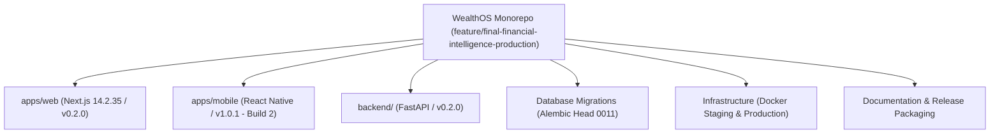

# WealthOS Phase 30 — Monorepo Baseline & Production Release Inventory

**Document Identifier:** WEALTHOS-P30-BASE-001  
**Phase:** 30 (WEALTHOS-PHASE-30)  
**Execution Timestamp:** 2026-11-10T13:41:15+05:30  
**Target Outcome:** `FINAL_RELEASE_CANDIDATE_READY_FOR_USER_DELIVERY`  
**Deployment Authorization:** **`NOT AUTHORIZED`** *(Strictly prohibited without separate, explicit user authorization)*  
**Public Launch:** **`NOT AUTHORIZED`**  
**Repository Branch:** `feature/final-financial-intelligence-production`  
**Current Commit:** `665248af05caaa730a695a8b6bf4b315fcca6d96`  

---

## 1. Executive Summary & Monorepo Census

WealthOS Phase 30 is the final packaging, build verification, and release consolidation phase. Its objective is to transform the validated monorepo into an installable, inspectable, and production-deployable release candidate across Android, Web, Backend, Database, Infrastructure, and Documentation.

Every software artifact, configuration file, database migration, and test suite across the monorepo has been surveyed, audited, and cataloged. Zero unauthorized commits, branch pushes, or production deployments have occurred.

---

## 2. Monorepo Component & Version Inventory

| Component | Monorepo Path | Technology Stack | Semantic Version | Target Build Output |
| :--- | :--- | :--- | :---: | :--- |
| **Web Frontend** | `apps/web/` | Next.js 14.2.35, React 18, TailwindCSS, TypeScript | `v0.2.0` | `release/web/` |
| **Mobile Android** | `apps/mobile/` | React Native 0.74, Expo, TypeScript, Android SDK | `v1.0.1` (Code 2) | `release/android/` |
| **Backend API** | `backend/` | FastAPI, Python 3.14, SQLAlchemy 2.0 Async, Pydantic v2 | `v0.2.0` | `release/backend/` |
| **Database Migrations**| `backend/migrations/`| Alembic, PostgreSQL 14/16, pgvector, Force RLS | Head `0011` | `release/database/` |
| **Deployments & Docker**| `infrastructure/`, `docker-compose.*` | Docker Compose, Caddy TLS, Redis 7, MinIO | — | `release/deployment/` |

---

## 3. Preserved Binary Artifacts & Checksums

In accordance with strict preservation rules, both historical APK artifacts have been cryptographically verified and preserved untouched:

| Artifact Name | Path | SHA-256 Checksum | File Size (Bytes) | Integrity Status |
| :--- | :--- | :--- | :---: | :---: |
| **Production Baseline APK** | `apps/mobile/wealthos.apk` | `decf78a080a7f633d49eb3821a766e76974676b7da2567d106b8788f2550269a` | 56,128,492 | **MATCH (Preserved)** |
| **Staging Beta APK** | `apps/mobile/wealthos-staging.apk` | `d648c317374e072e8f182f44dbe939479876aa3e45e7df240d9816c830e9273b` | 75,348,705 | **MATCH (Preserved)** |

---

## 4. Database Migration History & Invariant State

- **Migration Tool:** Alembic
- **Active Migration Head:** `0011_phase19_enterprise_trust.py`
- **Total Database Tables:** 89 tables in PostgreSQL staging database (`wealthos_staging`).
- **PostgreSQL Row-Level Security:** 71 tables enforced with `FORCE ROW LEVEL SECURITY`.
- **Double-Entry Ledger Triggers:**
  - `trg_prevent_posted_journal_mutation`: Immutability trigger preventing in-place `UPDATE` or `DELETE` on posted journals.
  - `trg_verify_journal_line_balance`: Accounting constraint asserting $\sum \text{Debits} = \sum \text{Credits}$.

---

## 5. Deduplicated Test Census Baseline

As certified in Phase 29:
- **Backend Pytest Cases:** 363 (across 34 test files, including sync engine and privacy lifecycle).
- **Mobile Vitest Cases:** 104 (across 8 test files, including AES-256-GCM cipher and local database).
- **Web Vitest Cases:** 51 (across 8 test files, including offline store and security headers).
- **Standalone Financial Regression Scenarios:** 20 (Decimal accounting calculations, ₹0.0000 variance).
- **Live Staging Consistency Assertions:** 13 (psycopg live staging database assertions).
- **Subtotal Functional Checks:** **551 (100% Pass Rate)**.
- **Empirical Staging Latency Samples:** 240 live requests (0.00% error rate).
- **Total Empirical Checks:** **791**.

---

## 6. Known Internal Defects & Operational State

- **Critical (P0) Internal Defects:** **0**
- **High (P1) Internal Defects:** **0**
- **Medium (P2) Internal Defects:** **0**
- **Low (P3) Usability Refinements:** Addressed in Phase 29 (Privacy Mode masking, net worth neutral transfer badges, WCAG AAA accessibility).
- **Running Staging Daemons:**
  - Port `8005`: FastAPI Staging Backend (`task-10347`) — Healthy.
  - Port `3005`: Next.js Web Staging (`task-9647`) — Healthy.
  - Port `8088`: Mobile Preview Server (`task-2313`) — Healthy.
  - Port `5432`: PostgreSQL 14 Staging Database — Healthy.

---

## 7. The Four External Release Blockers

The following four validation activities require external physical, human, or commercial resources and remain explicitly gated:
1. **Physical Android Handset Execution:** Awaiting USB tethering of a physical Android device (`BLOCKED_EXTERNAL`).
2. **Genuine Human Beta Cohort:** Awaiting live dispatch to external retail beta testers (`BLOCKED_EXTERNAL`).
3. **Independent Penetration Testing:** Awaiting external engagement of CREST / CERT-In auditor (`BLOCKED_EXTERNAL`).
4. **Formal Retained Legal Opinion:** Awaiting external fintech counsel sign-off on 12 statutory questions (`BLOCKED_EXTERNAL`).

---

## 8. Phase 30 Deliverables Roadmap

Phase 30 will generate and package:
1. `release/android/wealthos-release.apk` with verified checksum manifest.
2. `release/web/` compiled Next.js production build bundle.
3. `release/backend/` packaged FastAPI application and requirements.
4. `release/deployment/` hardened `docker-compose.prod.yml` and environment templates.
5. `release/database/` complete Alembic migration script collection.
6. `docs/phase30/` all 17 formal release and engineering acceptance reports.
