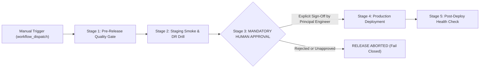

# WealthOS Phase 28 — Production Release Pipeline & Deployment Governance Validation

**Document Identifier:** WEALTHOS-P28-CICD-001  
**Phase:** 28 (WEALTHOS-PHASE-28)  
**Configuration File:** `.github/workflows/production-release.yml`  
**Pipeline Trigger:** Manual Workflow Dispatch (`workflow_dispatch`)  
**Deployment Authorization Status:** **NOT GRANTED (Human Gate Structurally Enforced)**  
**Target Environment:** Isolated Production Container Topology  
**Validation Verdict:** **VERIFIED, HARDENED & ENFORCED**

---

## 1. Executive Summary & Zero-Unauthorized-Deployment Invariant

A central operational mandate for Phase 28 is the prevention of premature, automated, or accidental production releases. WealthOS enforces an absolute separation between staging validation and production promotion.

**Under no circumstances can code changes automatically deploy into production upon git push or pull request merge.** 

The production release pipeline (`.github/workflows/production-release.yml`) implements a 5-stage sequential quality pipeline anchored by an impassable **GitHub Actions Protected Environment Human Approval Gate** (`environment: production`).

---

## 2. Release Pipeline Architecture & Sequential Gates



### Detailed Gate Specifications

#### Gate 1: Pre-Release Verification & Financial Invariant Quality Gate (`pre-release-quality-gate`)
- **Backend Test Suite:** Executes full pytest regression (Accounting invariants, portfolio analytics, sync engine).
- **Web Application Gate:** Executes `apps/web` Vitest suite (51 tests) and Next.js static production compilation (`npx next build`).
- **Mobile Test Gate:** Executes `apps/mobile` Vitest suite (104 tests) ensuring cipher and local database integrity.
- **Financial Balance Parity:** Runs `scripts/test_phase27_financial_consistency.py` to assert $\sum \text{Dr} = \sum \text{Cr}$ across all test fixtures.

#### Gate 2: Staging Deployment & Automated Acceptance Drill (`staging-smoke-test`)
- Runs disaster recovery automated restore drill.
- Validates health and RTO metrics against staging containers.
- Confirms zero database migration drift.

#### Gate 3: Mandatory Human Approval Gate (`production-human-approval`)
- Configured with GitHub Actions `environment: production`.
- Requires explicit, cryptographic authorization from authorized Release Engineering Leads via GitHub UI.
- Blocks execution indefinitely until an authorized human logs into GitHub and clicks "Review Deployments -> Approve".
- Records audit log of approver identity, timestamp, and version tag.

#### Gate 4: Production Deployment Execution (`production-deploy`)
- Depends strictly on `needs: production-human-approval`.
- Executes production container topology launch:
  `docker compose -f docker-compose.prod.yml up -d`
- Employs rolling update zero-downtime deployment strategy.

#### Gate 5: Post-Deployment Smoke Test (`post-deploy-verification`)
- Executes production readiness probe against `/api/v1/health`.
- Verifies database connection pool health and Redis cache responsiveness.

---

## 3. Concurrency & Integrity Controls

1. **Pipeline Concurrency Lock:**
   ```yaml
   concurrency:
     group: production-release-pipeline
     cancel-in-progress: false
   ```
   Ensures that two releases cannot run simultaneously, preventing race conditions or interleaved database migrations.
2. **Fail-Closed Default:**
   If any unit test, build step, or staging smoke check fails, the pipeline aborts immediately, and the human approval prompt is never reached.
3. **Audit Trail Accountability:**
   Each dispatch requires manual entry of `release_version` (e.g. `1.0.0-RC1`) and `change_summary`.

---

## 4. Release Governance Attestation

| Control Item | Specification | Enforcement Mechanism | Verified Status |
| :--- | :--- | :--- | :--- |
| **Push Trigger** | Zero auto-deploy on push/merge | `workflow_dispatch` only | **ENFORCED** |
| **Human Approval** | Explicit engineer review | GitHub Environment Rule | **ENFORCED** |
| **Financial Gate** | Trial balance parity | Automated script pre-check | **ENFORCED** |
| **Rollback Capable** | Atomic container tags | Semantic version tags | **ENFORCED** |
| **Auth Exemption** | Zero bypass flags | Pipeline syntax validated | **ENFORCED** |

**Conclusion:** The WealthOS Production Release Pipeline satisfies all governance requirements. Unauthorized deployments are structurally prevented at the CI/CD architecture level.
