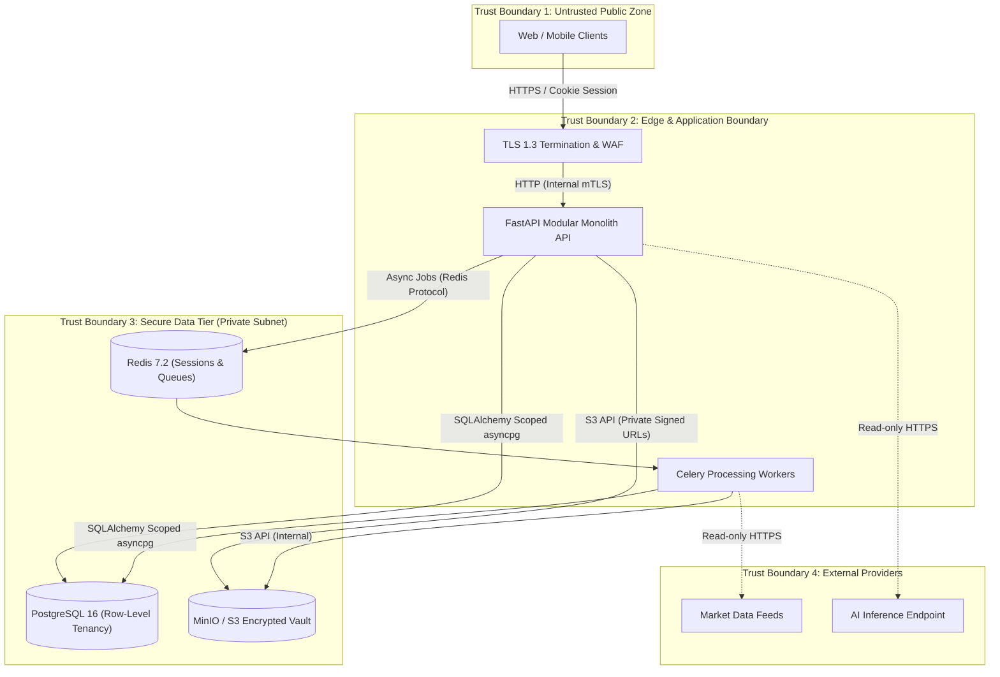
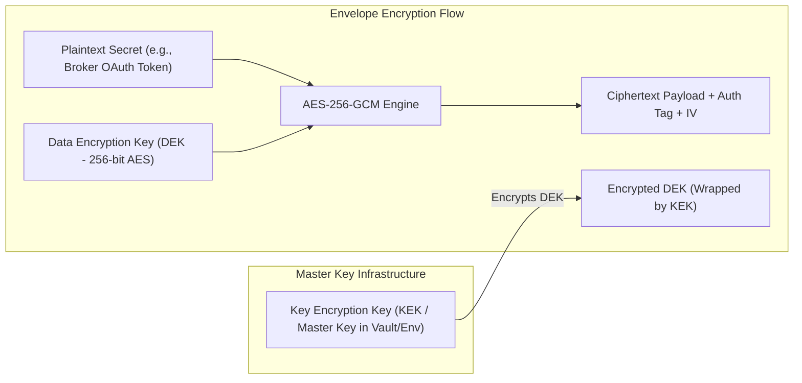

# WEALTHOS — SECURITY ARCHITECTURE, THREAT MODEL & COMPLIANCE

**Document Reference:** WOS-SEC-001  
**Security Standard Alignment:** OWASP ASVS 4.0 Level 2 / NIST SP 800-53 / DPDP Act 2023  
**Version:** 1.0.0-RELEASE-CANDIDATE  
**Status:** APPROVED / FROZEN BASELINE  
**Classification:** Confidential — System Security Architecture  

---

## 1. STRIDE THREAT MODEL & TRUST BOUNDARIES

### 1.1 Trust Boundaries & Diagram
WealthOS enforces four explicit trust boundaries:
1. **TB-1: Internet / Public Client to Edge:** Untrusted web and mobile clients communicating over public networks.
2. **TB-2: Edge / Reverse Proxy to Application Monolith:** Authenticated, TLS-terminated requests entering FastAPI domain services.
3. **TB-3: Application Monolith to Data Stores:** Internal private network links to PostgreSQL 16, Redis 7.2, and MinIO S3.
4. **TB-4: Application Monolith to External Third Parties:** Outbound read-only connections to market data feeds and external LLM inference endpoints.

---

### 1.2 STRIDE Threat Matrix & Mitigations

| Threat Category | Specific Attack Vector | Severity | Mitigating Control & Architectural Enforcement |
|---|---|---|---|
| **Spoofing** | Forging JWT tokens or hijacking authentication sessions. | Critical | Cryptographically signed sessions using Redis storage, HttpOnly, Secure, SameSite=Strict cookies. Immediate server-side revocation on logout. |
| **Spoofing** | Replaying expired TOTP tokens. | High | RFC 6238 time-step enforcement ($\pm 1$ step), tracking consumed time steps in Redis to block token replay within valid windows. |
| **Tampering** | Modifying double-entry ledger lines after posting. | Critical | Database `CHECK` constraints, immutability triggers on `journal_lines`, application-level prohibition of `UPDATE`/`DELETE` on posted journal entries. All adjustments require explicit reversing entries. |
| **Tampering** | Uploading malicious polyglot executable masquerading as a PDF. | High | Strict byte-level magic number validation via `python-magic`, discarding file extensions provided by clients. File stream scanned for malware before persistence. |
| **Repudiation** | User denies approving a parsed statement or deleting a portfolio. | High | Append-only `audit_logs` recording `user_id`, `tenant_id`, `ip_address`, `action`, `resource_id`, before/after JSON diffs, and cryptographic hash of committed records. |
| **Information Disclosure** | Cross-tenant data leakage via direct ID reference (IDOR). | Critical | Compulsory tenant scoping in all database queries (`WHERE tenant_id = :tenant_id`), verified by automated tenant isolation test suites. Storage keys partitioned by tenant UUID. |
| **Information Disclosure** | Exposing plaintext third-party tokens or bank credentials. | Critical | Ban on storing banking passwords/PINs. Third-party tokens (broker OAuth) encrypted with AES-256-GCM envelope encryption. |
| **Denial of Service** | Decompression bomb or infinite-page PDF upload causing worker OOM. | High | 35 MB hard limit on upload payloads, PyMuPDF page-count caps (max 100 pages per document), memory-limited Docker worker containers. |
| **Elevation of Privilege** | Member elevating their role to Owner or accessing admin endpoints. | High | Service-level RBAC policy verification (`@require_role(['OWNER', 'ADMIN'])`) independent of routing. |

---

## 2. IDENTITY, AUTHENTICATION & SESSION MANAGEMENT

### 2.1 Password Hashing Specification (Argon2id)
All user passwords are encrypted using **Argon2id** (RFC 9106) with parameters meeting or exceeding OWASP guidelines:
- **Algorithm:** `Argon2id`
- **Memory Cost ($m$):** 65,536 KiB (64 MiB)
- **Time Cost / Iterations ($t$):** 3 passes
- **Parallelism ($p$):** 4 threads
- **Salt Length:** 16 bytes (128 bits) cryptographically generated per user
- **Hash Output Length:** 32 bytes (256 bits)

### 2.2 Multi-Factor Authentication (TOTP MFA)
- Implements **RFC 6238** (Time-Based One-Time Password Algorithm).
- **HMAC Algorithm:** HMAC-SHA1 (universal authenticator support).
- **Time Step ($X$):** 30 seconds.
- **Digits ($N$):** 6 digits.
- **Lookback/Forward Window:** 1 step ($\pm 30$ seconds tolerance for clock skew).
- **Replay Protection:** Successfully used TOTP codes are cached in Redis with a 90-second TTL; duplicate submissions within the window are rejected.
- **Recovery Codes:** 8 cryptographically generated 10-character alphanumeric one-time emergency codes, stored hashed using Argon2id.

### 2.3 Session Security
- Authenticated sessions are issued as opaque UUIDv4 tokens stored in Redis with an absolute timeout of 7 days and an idle timeout of 24 hours.
- Transported strictly via browser cookies with attributes:
  - `HttpOnly = true` (inaccessible to client JavaScript, mitigates XSS session theft).
  - `Secure = true` (transmitted only over TLS).
  - `SameSite = Strict` (blocks Cross-Site Request Forgery).
  - `Path = /api`

---

## 3. CRYPTOGRAPHY & KEY MANAGEMENT

### 3.1 Envelope Encryption for Sensitive Third-Party Tokens
- Master Key (KEK) is supplied via secure environment injection or KMS.
- Every external credential (e.g., Zerodha broker secret, bank integration token) generates a unique random 256-bit Data Encryption Key (DEK).
- Secrets are encrypted using **AES-256-GCM** (Galois/Counter Mode) providing authenticated encryption with associated data (AEAD).
- The encrypted DEK and ciphertext are stored alongside the initialization vector (IV) and 128-bit authentication tag.

### 3.2 Document Storage Encryption
- Documents in MinIO / S3 are encrypted at rest using S3 server-side encryption (SSE-S3 / SSE-KMS).
- Access to documents is granted exclusively via time-limited **Pre-signed URLs** generated by the backend API:
  - Default TTL: 300 seconds (5 minutes).
  - Explicit HTTP Content-Disposition headers to force download or sandboxed inline display without script execution.

---

## 4. REGULATORY & JURISDICTION COMPLIANCE

### 4.1 Digital Personal Data Protection (DPDP) Act 2023 (India)
1. **Notice & Consent:** Consent is explicitly recorded with timestamps, user ID, and purpose prior to file uploads or financial data aggregation.
2. **Right to Correction & Erasure:** Users can initiate account deletion, which triggers:
   - Anonymization or hard deletion of personally identifiable information (`full_name`, `email`).
   - Cryptographic deletion of private storage objects in S3.
   - Deletion of session keys in Redis.
3. **Data Portability:** Complete export of tenant financial records provided in standard machine-readable formats (`JSON` and `CSV`).

### 4.2 RBI Account Aggregator & Banking Safety
1. **Zero Credential Custody:** WealthOS strictly prohibits storing net banking usernames, login passwords, transaction passwords, ATM PINs, or UPI PINs.
2. **Consent-Governed Data:** Ingestion occurs exclusively through manual document uploads or authorized Account Aggregator (AA) consent flows.

### 4.3 SEBI (Investment Advisers) Boundary
1. **Analytical Intelligence Only:** WealthOS is classified as a personal financial management tool and intelligence dashboard.
2. **AI Copilot Disclaimer:** The AI Copilot operates with deterministic retrieval over historical user data. It does not provide SEBI-registered algorithmic trading, stock tips, or individualized investment advisory services.

---

## 5. APPLICATION SECURITY HARDENING & BEST PRACTICES

### 5.1 HTTP Security Headers
All API responses must include the following headers:
- `Content-Security-Policy: default-src 'self'; script-src 'self'; frame-ancestors 'none';`
- `X-Frame-Options: DENY`
- `X-Content-Type-Options: nosniff`
- `Strict-Transport-Security: max-age=63072000; includeSubDomains; preload`
- `Referrer-Policy: strict-origin-when-cross-origin`
- `Permissions-Policy: geolocation=(), camera=(), microphone=()`

### 5.2 SQL Injection & Parameter Tampering Prevention
- Direct SQL string concatenation is forbidden.
- All database operations are constructed via SQLAlchemy 2.0 type-safe expressions or parameterized queries.
- Input validation enforced at the perimeter via Pydantic v2 schemas.
