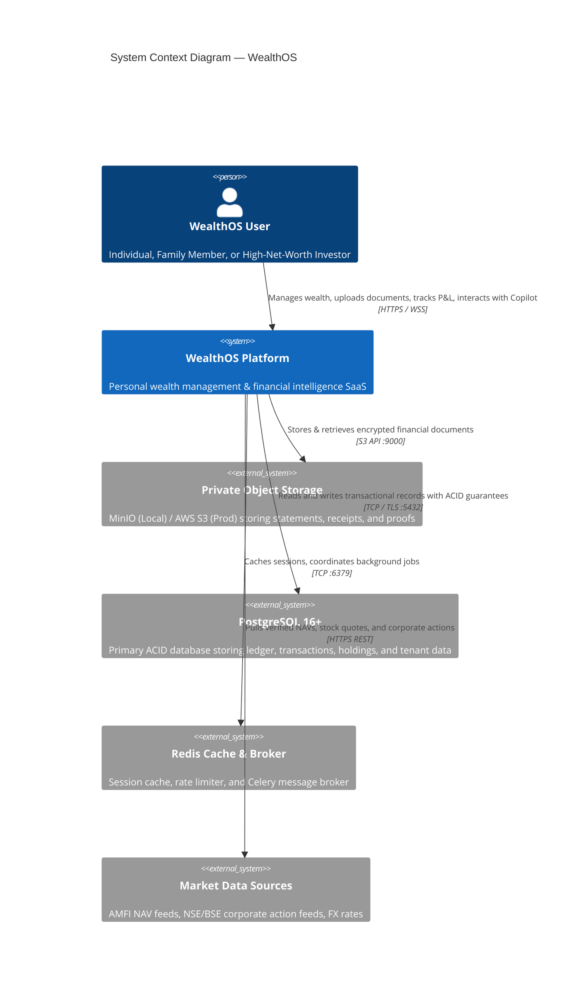
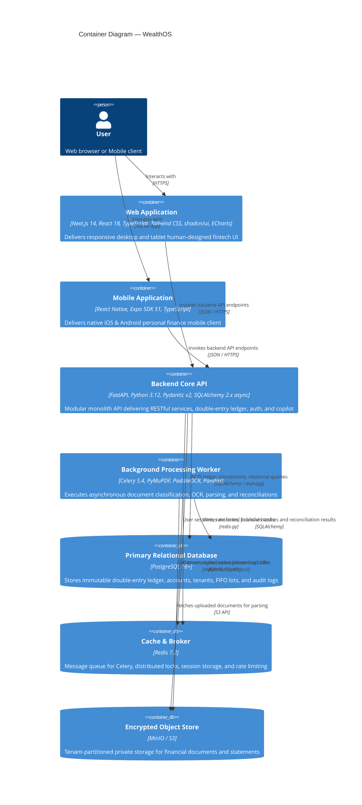
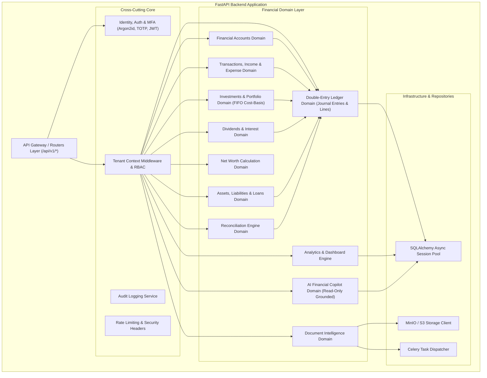
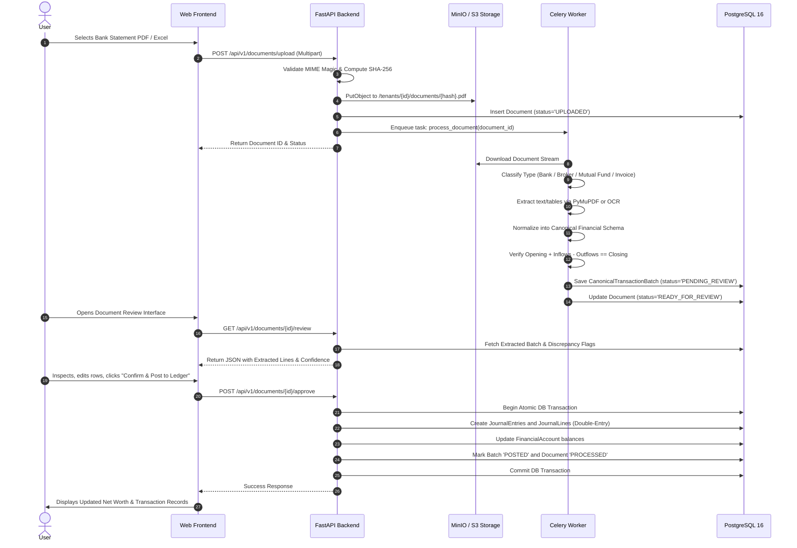
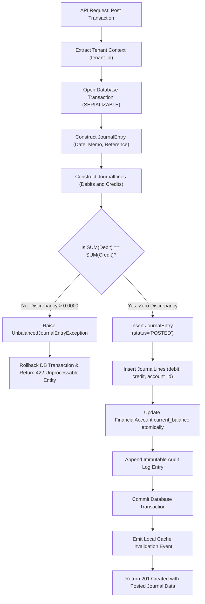
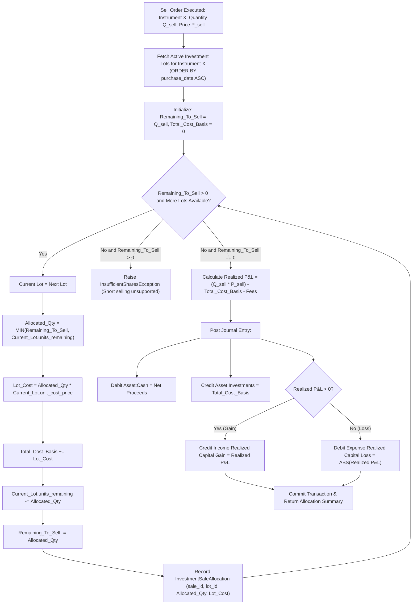

# WEALTHOS — SYSTEM ARCHITECTURE SPECIFICATION

**Document Reference:** WOS-ARCH-001  
**Architecture Style:** Modular Monolith with Asynchronous Background Workers  
**Target Environment:** Local-First Dockerized Architecture / Cloud Deployable  
**Version:** 1.0.0-RELEASE-CANDIDATE  
**Status:** APPROVED / FROZEN BASELINE  

---

## 1. ARCHITECTURAL PHILOSOPHY & PATTERNS

### 1.1 The Modular Monolith Advantage
WealthOS is intentionally structured as a **Modular Monolith** rather than distributed microservices:
1. **Financial Transaction Atomicity:** Double-entry journal entries must post across accounts, ledgers, tax lots, and balances in a single ACID transaction. Distributed two-phase commit (2PC) or Sagas introduce eventual consistency risks that are unacceptable in accounting systems.
2. **Operational Simplicity:** Avoids Kubernetes, service meshes, distributed tracing overhead, and complex network partitions while enabling local-first development with high velocity.
3. **Strict Domain Boundaries:** Each financial domain is an isolated module with its own models, schemas, repositories, and services. Cross-domain interactions occur strictly through explicit service interfaces, never by reaching into another domain's raw database tables.
4. **Asynchronous Scaling:** Computationally heavy operations (OCR parsing, document rendering, statement import, portfolio valuation history) are decoupled via Celery workers and Redis task queues.

---

## 2. C4 ARCHITECTURE MODELS

### 2.1 C4 Level 1: System Context Diagram



---

### 2.2 C4 Level 2: Container Diagram



---

### 2.3 C4 Level 3: Backend Component Diagram



---

## 3. CORE FINANCIAL DATA FLOW PIPELINES

### 3.1 Pipeline A: Universal Document Ingestion & Approval Gate



---

### 3.2 Pipeline B: Double-Entry Transaction Ledger Posting Invariant



---

### 3.3 Pipeline C: FIFO Securities Cost-Basis Engine



---

## 4. MULTI-TENANT ISOLATION ARCHITECTURE

### 4.1 Row-Level Isolation Architecture
- Shared Database, Shared Process, Row-Level Isolation.
- Every query utilizes a tenant filter injected automatically via FastAPI dependency `get_current_tenant_id`:
  ```python
  stmt = select(Account).where(
      Account.tenant_id == current_tenant.id,
      Account.id == account_id
  )
  ```
- Any query lacking a tenant predicate is flagged during automated static analysis and code review.

### 4.2 Storage Key Hierarchy
Documents in S3 / MinIO are strictly partitioned by tenant:
```
/wealthos-vault/
   └── tenants/
        └── {tenant_id}/
             ├── documents/
             │    └── {year}/{month}/{file_hash}.{ext}
             ├── exports/
             │    └── {export_id}.zip
             └── avatars/
                  └── {user_id}.png
```
Pre-signed URLs are generated on-demand with a strict TTL of 300 seconds. Public read access to the bucket is prohibited.

---

## 5. REPOSITORY DIRECTORY LAYOUT

```
wealthos/
├── apps/
│   ├── web/                     # Next.js 14 Web Application
│   │   ├── src/
│   │   │   ├── app/             # App router pages
│   │   │   ├── components/      # Manually designed UI components (shadcn/ui based)
│   │   │   ├── lib/             # API client, formatting utils, state stores
│   │   │   └── styles/          # Tailwind CSS design system tokens
│   │   ├── package.json
│   │   └── tsconfig.json
│   └── mobile/                  # Expo React Native Application
│       ├── src/
│       ├── app.json
│       └── package.json
├── backend/
│   ├── app/
│   │   ├── api/                 # API routers versioned under /api/v1
│   │   │   └── v1/
│   │   ├── core/                # Config, DB engine, security, exceptions, middleware
│   │   ├── domains/             # 26 Domain modules (clean architecture)
│   │   │   ├── auth/            # Identity & MFA
│   │   │   ├── tenancy/         # Workspaces & Memberships
│   │   │   ├── accounts/        # Financial Accounts
│   │   │   ├── ledger/          # Double-Entry Accounting Engine
│   │   │   ├── transactions/    # Inflows, Outflows, Splits
│   │   │   ├── investments/     # Portfolio, Instruments, FIFO lots
│   │   │   ├── dividends/       # Dividends & Interest
│   │   │   ├── assets/          # Real estate, gold, valuations
│   │   │   ├── liabilities/     # Loans, credit cards, amortization
│   │   │   ├── net_worth/       # Net worth snapshots & history
│   │   │   ├── documents/       # File upload & vault
│   │   │   ├── extraction/      # OCR, PDF/Excel parsers
│   │   │   ├── reconciliation/  # Reconciliation rule engine
│   │   │   ├── analytics/       # Aggregations, cash flow, spending
│   │   │   ├── copilot/         # Grounded AI assistant
│   │   │   ├── budgeting/       # Envelopes & goals
│   │   │   └── audit/           # Audit trail logging
│   │   ├── infrastructure/      # S3/MinIO, Redis, Celery app
│   │   └── workers/             # Celery background tasks
│   ├── migrations/              # Alembic database migrations
│   ├── tests/                   # Pytest test suite (unit, integration, invariants)
│   ├── pyproject.toml
│   └── Dockerfile
├── packages/
│   ├── shared-types/            # Shared TypeScript/Pydantic schemas
│   ├── design-tokens/           # FinTech color palettes, spacing, typography
│   └── api-client/              # Generated TypeScript API client
├── infrastructure/
│   ├── docker/                  # Docker Compose, Dockerfiles, dev configs
│   ├── monitoring/              # Prometheus, Grafana dashboards
│   └── deployment/              # Production deployment scripts
├── docs/                        # Architecture, DB, API, Security specifications
├── docker-compose.yml           # Unified local development compose
├── README.md
├── SECURITY.md
└── CONTRIBUTING.md
```
