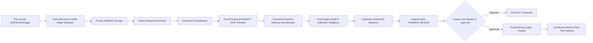

# WEALTHOS — PRODUCT REQUIREMENTS DOCUMENT (PRD)

**Document Reference:** WOS-PRD-001  
**Version:** 1.0.0-RELEASE-CANDIDATE  
**Status:** APPROVED / FROZEN BASELINE  
**Classification:** Proprietary / Commercial Multi-Tenant SaaS  
**Author:** Principal Software Architect & Financial Systems Team  
**Primary Currency Baseline:** INR (Indian Rupee, ₹)  
**Global Architecture:** Multi-Currency, Multi-Jurisdiction Ready  

---

## 1. EXECUTIVE SUMMARY & PRODUCT VISION

### 1.1 Product Statement
**WealthOS** is an enterprise-grade, human-designed personal wealth management and financial intelligence platform built for modern individuals, families, and high-net-worth investors. It solves the endemic fragmentation of personal finance by unifying liquid bank accounts, salary income, discretionary spending, investment portfolios (equities, mutual funds, bonds, gold, retirement funds), physical/real assets, debts, bills, and tax-critical documents into a single, verifiable, double-entry ledger-backed operating system.

### 1.2 Core Value Proposition
1. **Absolute Financial Truth:** Unlike casual budget trackers that use approximate floating-point totals, WealthOS is anchored in an immutable **double-entry general ledger** where every balance change has an auditable journal entry, explicit provenance, and zero unreconciled discrepancies ($\sum \text{Debit} \equiv \sum \text{Credit}$).
2. **Universal Document Intelligence:** Users can ingest physical receipts, complex multi-page bank statements, broker contract notes, consolidated account statements (CAS), utility bills, and salary slips across PDF, Excel, CSV, and image formats. Documents are parsed through an asynchronous pipeline featuring OCR, rule-guided validation, and an explicit **human-in-the-loop approval gate** before posting to the ledger.
3. **Multi-Asset Portfolio Intelligence:** Native support for Indian capital markets (NSE/BSE equities, AMFI mutual funds, sovereign gold bonds, EPF, PPF, NPS, corporate fixed deposits) combined with global investment readiness (multi-currency, FIFO cost-basis accounting, corporate action adjustments).
4. **Human-Crafted FinTech Experience:** Strict avoidance of generative AI "cookie-cutter" dashboards. WealthOS employs a human-designed, information-dense, high-contrast, professional fintech interface engineered for readability, accessibility, and precision.
5. **Deterministic AI Copilot:** Natural language financial intelligence grounded strictly in tenant-scoped, verified database records and deterministic calculation tools, preventing financial hallucinations, unauthorized ledger modifications, or fabricated numbers.

---

## 2. MARKET DEFINITION, GEOGRAPHY & CURRENCY STRATEGY

### 2.1 Primary Market: India
- **Currency:** Indian Rupee (INR / ₹), formatted according to the Indian numbering system (Lakhs and Crores: `₹12,34,567.89`).
- **Fiscal Calendar:** April 1 to March 31 financial year support, with configurable calendar year support (Jan 1 to Dec 31).
- **Tax Regimes:** Direct support for Indian Income Tax structures:
  - Old Tax Regime (Section 80C, 80D, HRA, 24(b) home loan interest).
  - New Tax Regime (Section 115BAC default with revised slab rates).
  - Capital Gains: Long-Term Capital Gains (LTCG) and Short-Term Capital Gains (STCG) on listed equities, debt funds, mutual funds, real estate, and unlisted securities.
  - Tax Deducted at Source (TDS) on dividends (Section 194), bank fixed deposits (Section 194A), and salary (Section 192).

### 2.2 Global Multi-Currency Architecture
- **Base Currency Principle:** Each Workspace (Tenant) declares a Base Currency (Default: `INR`).
- **Transactional Currencies:** Accounts, transactions, and holdings support native foreign currencies (USD, EUR, GBP, AED, SGD, JPY, CAD).
- **Exchange Rate Engine:** Point-in-time exchange rate capture at transaction booking timestamp, storing both local amount, foreign exchange rate, and base currency equivalent for precise realized/unrealized foreign exchange gain/loss calculations.

---

## 3. USER PERSONAS & TARGET AUDIENCE

### Persona 1: The Tech-Savvy Indian Salaried Professional ("Aditya", 32)
- **Profile:** Lead Software Engineer at a Tier-1 tech firm in Bengaluru.
- **Financial Landscape:** Multiple bank accounts (HDFC salary, ICICI personal), Monthly SIPs in 6 mutual funds, Employee Provident Fund (EPF), Voluntary PPF, equity trading account (Zerodha/Groww), RSUs in US parent company, outstanding Home Loan (SBI), 3 credit cards.
- **Pain Points:** Scattered portfolio views across 4 apps; tedious calculation of Capital Gains across financial years; difficulty tracking tax deductions under the Old vs New regime; lack of visibility into recurring subscriptions.
- **WealthOS Solution:** Unified net worth dashboard; automated CAS PDF statement parsing; exact FIFO capital gains computation; consolidated EMI and credit card due date calendar.

### Persona 2: The Active Investor & High-Net-Worth Individual ("Meera", 48)
- **Profile:** Angel investor and entrepreneur in Mumbai.
- **Financial Landscape:** Direct equity portfolio across NSE/BSE, private equity/unlisted shares, Portfolio Management Services (PMS), Sovereign Gold Bonds (SGB), commercial real estate rental income, high dividend yields.
- **Pain Points:** High volume of corporate actions (bonus issues, stock splits, rights issues); tracking dividend declarations vs actual bank account credits; TDS reconciliation against Form 26AS / AIS.
- **WealthOS Solution:** Corporate action adjustment engine; dividend tracking module matching ex-dates, gross declarations, TDS withholding, and net bank credits; comprehensive asset valuation ledger.

### Persona 3: The Freelancer & Independent Consultant ("Kabir", 27)
- **Profile:** UX consultant and cross-border contractor in New Delhi.
- **Financial Landscape:** Volatile monthly receipts; client invoices paid in USD/EUR via Stripe or international wire; GST payments; advance tax quarterly obligations; zero fixed salary.
- **Pain Points:** Irregular cash flow causing budgeting anxiety; failure to save adequately for advance tax tranches; difficulty isolating business vs personal expenses.
- **WealthOS Solution:** Cash flow forecasting with volatility buffers; automated invoice/receipt parsing; quarterly advance tax estimation; category envelope budgeting.

### Persona 4: The Family Financial Custodian ("Ramesh & Sunita", 55 & 53)
- **Profile:** Senior couple managing joint family assets, children's higher education funds, and retirement corpus.
- **Financial Landscape:** Senior Citizens Savings Scheme (SCSS), Bank Fixed Deposits, Post Office Monthly Income Scheme (POMIS), family health insurance policies, joint property.
- **Pain Points:** Ensuring survival and accessibility of all financial records; managing nominations and document repositories; tracking maturity dates of FDs and insurance premiums.
- **WealthOS Solution:** Multi-tenant Household Workspace with granular role-based permissions (Auditor / Joint Owner); document vault with encrypted private storage; upcoming maturity and renewal alerts.

---

## 4. DETAILED SCOPE OF 17 CORE FINANCIAL DOMAINS

| # | Domain Module | Primary Capabilities & Invariants |
|---|---|---|
| **1** | **Bank Accounts & Balances** | Savings, Current, Cash, and Wallet accounts. Explicit tracking of Cleared vs Available vs Book balances. No balance jumps without journal entry. |
| **2** | **Income & Salary** | Gross salary, deductions (PF, Professional Tax, TDS), net take-home, variable bonuses, freelance invoicing, rental income. Direct posting to Income accounts. |
| **3** | **Expenses & Spending** | Granular merchant categorization, sub-categories, payment methods, recurring expense identification, split transactions across multiple categories. |
| **4** | **Investments & Portfolios** | Multi-broker account support (Zerodha, Groww, Upstox, Interactive Brokers). Asset class breakdown (Equity, Debt, Hybrid, Gold, Cash, Alternative). |
| **5** | **Stocks & Mutual Funds** | NSE/BSE script master, ISIN code mapping, AMFI scheme codes, NAV history, Folio tracking, trade order settlement, trade-level STT/brokerage fees. |
| **6** | **Dividends & Interest** | Tracking dividend lifecycle: Announcement -> Ex-Date -> Record Date -> Payout Date -> Bank Credit. TDS deduction tracking (Form 26AS reconciliation). FD/Savings bank interest accrual and credit. |
| **7** | **Realized & Unrealized P&L** | Strict First-In First-Out (FIFO) tax lot tracking for sales. Unrealized mark-to-market valuations computed against latest market prices. Currency conversion gains/losses isolated. |
| **8** | **Assets (Real & Personal)** | Residential/commercial real estate, gold bullion/jewelry, motor vehicles, collectibles. Periodic valuation adjustment entries with historical appraisal records. |
| **9** | **Liabilities & Debt** | Term loans (home, auto, personal), revolving credit cards, personal borrowings. Principal vs Interest EMI amortization schedules, prepayment tracking. |
| **10** | **Net Worth Engine** | Real-time and historical point-in-time calculation: $\text{Net Worth} = \sum \text{Assets} - \sum \text{Liabilities}$. Multi-currency conversion at closing historical rates. |
| **11** | **Loans & Credit Cards** | Statement billing cycles, due date tracking, credit utilization ratio, minimum due vs total due alerts, interest rate APR monitoring. |
| **12** | **Financial Goals** | Target monetary amount, target completion date, asset allocation linkage, monthly required SIP/contribution calculator, Monte Carlo / deterministic progress projection. |
| **13** | **Budgets & Savings** | Monthly flexible and zero-based budgets per category. Savings Rate metric: $\text{Savings Rate} = \frac{\text{Income} - \text{Expenses}}{\text{Income}} \times 100$. Overspending proactive alerts. |
| **14** | **Bills & Recurring Payments** | Subscription tracker (SaaS, OTT, Gym), utility bills (Electricity, Water, Gas, Internet). Due date calendar, reminder notifications. |
| **15** | **Financial Documents** | Multi-format vault (PDF, DOCX, XLSX, CSV, JPG, PNG). Cryptographic hash deduplication, private S3/MinIO storage, pre-signed download URLs. |
| **16** | **Tax-Related Records** | Capital gains statement generation (LTCG / STCG), 80C/80D proof vault, TDS deduction summaries, ready-to-file tax schedules. |
| **17** | **AI Financial Intelligence** | Deterministic question-answering assistant over user's actual financial records. Read-only database query tools, strict guardrails against fabricated calculations or ledger writes. |

---

## 5. UNIVERSAL DOCUMENT INTELLIGENCE PIPELINE



### 5.1 Ingestion Rules
1. **Never Post Ambiguously:** Under no circumstances shall an unvalidated document extraction automatically create posted ledger records. All extractions land in `PENDING_REVIEW` status.
2. **Screenshots vs Executed Trades:** A mobile screenshot of a portfolio or watchlist is classified as an **Unverified Asset Snapshot**, never as executed trade confirmations.
3. **Audit Trail:** Every ledger line generated via a document maintains a foreign key `document_extraction_id` back to the raw source file, bounding box coordinates (for visual documents), or spreadsheet row index (for tabular data).

---

## 6. FINANCIAL ACCOUNTING INVARIANTS & POLICIES

### 6.1 The Fundamental Invariant
$$\sum_{i=1}^{n} \text{Debit}_i \equiv \sum_{i=1}^{n} \text{Credit}_i \quad (\forall \text{ Journal Entries in Base Currency})$$

### 6.2 Sign and Precision Conventions
- **Numeric Precision:** All monetary amounts are stored in PostgreSQL as `NUMERIC(18, 4)`.
- **Crypto & Unit Precision:** Securities/crypto quantities are stored as `NUMERIC(24, 8)`.
- **Zero Floating-Point:** Under no circumstances shall IEEE 754 floating-point types (`float`, `double`, `real`) be used for calculations or storage in backend code or database schemas.
- **Positive Line Amounts:** Debits and Credits in `journal_lines` are strictly non-negative values (`CHECK (debit >= 0 AND credit >= 0)`), with an additional check ensuring mutually exclusive entry (`CHECK ((debit > 0 AND credit = 0) OR (credit > 0 AND debit = 0))`).

### 6.3 Standard Accounting Treatments
1. **Internal Transfers:** Moving funds between Bank Account A and Bank Account B debits Asset:Bank B and credits Asset:Bank A. **Net Income = 0, Net Expense = 0**.
2. **Investment Purchases:** Purchasing shares debits Asset:Investments (Cost Basis) and credits Asset:Bank. Brokerage and STT fees debit Expense:Investment Fees. **Net Worth is unchanged (ignoring fees)**.
3. **Investment Sales (Capital Gain Realization):**
   - Debit: Asset:Bank (Net sale proceeds received)
   - Credit: Asset:Investments (FIFO cost basis of units sold)
   - Credit: Income:Realized Capital Gains (if Proceeds > Cost Basis) OR Debit: Expense:Realized Capital Losses (if Proceeds < Cost Basis).
4. **Loan EMI Payment:**
   - Debit: Liability:Principal Loan Account (Principal portion)
   - Debit: Expense:Loan Interest (Interest portion)
   - Credit: Asset:Bank Account (Total EMI debited)

---

## 7. MULTI-TENANCY & WORKSPACE MODEL

### 7.1 Tenant Hierarchy
```
System Root
 └── Tenant (Organization / Family Office / Personal Workspace)
      ├── Users (Members with RBAC Roles)
      │    ├── Owner (Full administrative, billing, and deletion rights)
      │    ├── Admin (User management, account creation, ledger configuration)
      │    ├── Member (Read/write access to accounts and transactions)
      │    └── Auditor / Read-Only (Read-only access to reports and tax documents)
      ├── Chart of Accounts (COA)
      ├── Financial Accounts & Portfolios
      ├── Double-Entry General Ledger
      └── Document Vault
```

### 7.2 Strict Data Isolation
- **Row-Level Tenancy:** Every single database table (except global system configuration) contains an indexed `tenant_id UUID NOT NULL REFERENCES tenants(id) ON DELETE RESTRICT`.
- **Database Query Enforcement:** All repository and service layers enforce tenant filtering at the base query level. Cross-tenant access is tested at every build.
- **Storage Isolation:** S3 storage keys are strictly partitioned: `/tenants/{tenant_id}/documents/{year}/{month}/{document_uuid}.ext`.

---

## 8. HUMAN-DESIGNED UI/UX PRINCIPLES

### 8.1 Zero AI-Generated Frontend Code
The user experience must be human-architected and manually coded.
- **Aesthetic Direction:** Sophisticated FinTech dark foundation (`#0B0F17` canvas, `#111827` surface panels, `#1F2937` borders) with restrained indigo (`#6366F1`) and emerald (`#10B981`) semantic accents.
- **Information Density:** High information-to-ink ratio. Clean tabular data with mono-spaced numeric alignment (`tabular-nums`), proper thousand separators, and clear debit/credit color indicators.
- **Usability Over Decoration:** Zero gratuitous 3D elements, zero excessive glassmorphism, zero non-functional decorative widgets. Every UI component serves an analytical purpose.
- **Responsive Layouts:** Adaptive desktop multi-column command centers, optimized tablet review interfaces, and touch-first mobile cards.
- **Complete Interaction States:** Every data-fetching screen explicitly implements:
  - Initial skeleton loading states.
  - Informative empty states with actionable setup buttons.
  - Graceful error states with retry buttons and diagnostic codes.
  - Optimistic UI updates with rollback on network failure.

---

## 9. NON-FUNCTIONAL REQUIREMENTS & SLAs

| Requirement Category | Metric / Specification | Target SLA |
|---|---|---|
| **API Latency** | Read endpoints (Accounts, Dashboard summaries) | $P_{95} \le 150 \text{ ms}$ |
| **API Latency** | Complex analytical queries (XIRR, historical net worth) | $P_{95} \le 400 \text{ ms}$ |
| **Document Processing** | 10-page text PDF bank statement | $\le 12 \text{ seconds}$ |
| **Document Processing** | Scanned 1-page receipt image OCR | $\le 6 \text{ seconds}$ |
| **Availability** | Core API, Web Application, Database | $99.9\% \text{ Uptime}$ |
| **Data Integrity** | Ledger debit/credit balance reconciliation | $100.000\% \text{ Accuracy (Zero Drift)}$ |
| **Security Standards** | Password hashing algorithm | Argon2id ($m=65536, t=3, p=4$) |
| **Session Security** | Session token transport | HttpOnly, Secure, SameSite=Strict cookies |
| **Audit Coverage** | Financial postings, adjustments, auth events | $100\% \text{ Immutable Audit Logging}$ |

---

## 10. COMPLIANCE & LEGAL SAFETY POSTURE

1. **Digital Personal Data Protection (DPDP) Act 2023 (India):**
   - Explicit user consent capture for all document uploads and financial aggregations.
   - Comprehensive **Right to Data Erasure** (hard delete or cryptographic shredding of personal identifiers upon account termination).
   - Machine-readable JSON/CSV data export functionality.
2. **RBI Account Aggregator Directives:**
   - Provider-neutral integration hooks.
   - Absolute prohibition of storing user bank net-banking passwords, debit card PINs, or UPI PINs.
3. **SEBI (Investment Advisers) Regulations Disclaimer:**
   - Clear, persistent banner indicating that WealthOS is a financial analytics, record-keeping, and intelligence tool. It does **not** provide SEBI-registered investment advisory services, portfolio management recommendations, or automated trade execution.

---

## 11. MOSCOW PRIORITIZATION MATRIX

| Priority | Modules & Features | Implementation Milestone |
|---|---|---|
| **Must Have (P0)** | Double-entry accounting engine, multi-tenancy, authentication & MFA, bank accounts, income/expense tracking, basic investments (stocks & mutual funds), FIFO cost-basis, net worth engine, manual document upload & OCR parsing, human review gate, audit log. | Phases 0 – 11 |
| **Should Have (P1)** | Dividend tracking & TDS reconciliation, liabilities & loan amortization, multi-currency conversion, budget envelopes & alerts, financial goals, recurring bill calendar, AI Copilot natural language queries. | Phases 12 – 14 |
| **Could Have (P2)** | Mobile application (Expo React Native), advanced tax optimization reports (Old vs New regime), Monte Carlo retirement forecasting, PDF statement export generation. | Phases 14 – 15 |
| **Won't Have (Immediate)** | Automated trade execution, crypto high-frequency arbitrage, unverified direct screen-scraping of banking credentials. | Future Consideration |

---

## 12. RISKS, ASSUMPTIONS & MITIGATIONS

| Risk Item | Impact | Probability | Mitigation Strategy |
|---|---|---|---|
| **Document Parsing Hallucination / OCR Errors** | High | Medium | Strict schema validation, mathematical balance check (Opening + Credits - Debits = Closing), and mandatory human confirmation prior to ledger write. |
| **Cross-Tenant Data Leakage** | Critical | Low | Shared database with strict row-level `tenant_id` scoping in every query; automated multi-tenant unit and integration tests failing builds on leakage. |
| **Floating-Point Precision Drift** | Critical | Low | Hard architectural ban on IEEE 754 floats. Enforce `NUMERIC(18, 4)` in DB and Python `Decimal` in backend. |
| **Market Data Ingestion Downtime** | Medium | Medium | Multi-source fallback, local Redis caching with explicit freshness timestamps, and manual NAV/price override capability. |
