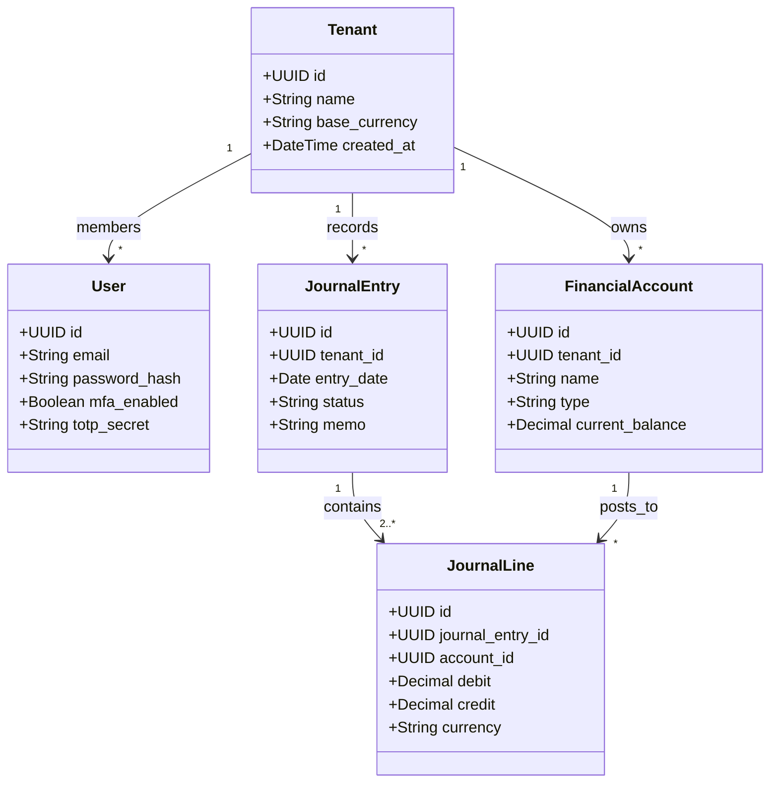

# WEALTHOS — SOFTWARE REQUIREMENTS SPECIFICATION (SRS)

**Document Reference:** WOS-SRS-001  
**Standard Compliance:** IEEE Std 830-1998  
**Version:** 1.0.0-RELEASE-CANDIDATE  
**Status:** APPROVED / FROZEN BASELINE  
**Classification:** Proprietary Engineering Specification  

---

## 1. INTRODUCTION

### 1.1 Purpose
This Software Requirements Specification (SRS) defines the complete functional, non-functional, interface, and data requirements for **WealthOS**, an enterprise-grade multi-tenant personal wealth management and financial intelligence SaaS platform. It serves as the definitive engineering contract for backend, frontend, mobile, security, database, and machine learning components.

### 1.2 Scope
WealthOS provides full-lifecycle management of personal financial assets, liabilities, transactions, investments, and documents through an immutable double-entry general ledger, asynchronous document intelligence pipeline, and a human-designed fintech user interface.

### 1.3 Definitions, Acronyms, and Abbreviations
- **COA:** Chart of Accounts (standardized accounting categorization hierarchy).
- **Double-Entry:** Accounting methodology where every transaction requires equal debit and credit line entries ($\sum \text{Debit} = \sum \text{Credit}$).
- **FIFO:** First-In, First-Out inventory and securities cost-basis accounting method.
- **ISIN:** International Securities Identification Number.
- **CAS:** Consolidated Account Statement (Indian mutual fund & equity depository statement).
- **NAV:** Net Asset Value (per unit price of mutual funds).
- **TDS:** Tax Deducted at Source (Indian direct tax withholding mechanism).
- **XIRR:** Extended Internal Rate of Return (discount rate equating investment cash flows to current value).
- **Argon2id:** Memory-hard cryptographic password hashing algorithm (RFC 9106).
- **TOTP:** Time-based One-Time Password algorithm (RFC 6238).
- **MIME:** Multipurpose Internet Mail Extensions.
- **Envelope Encryption:** Cryptographic practice of encrypting data with a unique Data Encryption Key (DEK), which is itself encrypted with a Master Key (KEK).

---

## 2. SYSTEM ARCHITECTURE PERSPECTIVE & INTERFACES

### 2.1 System Interfaces
- **Database:** PostgreSQL 16+ utilizing `psycopg3` and SQLAlchemy 2.0 async engine.
- **Cache & Broker:** Redis 7.2+ for session storage, distributed rate limiting, and Celery task broker.
- **Object Storage:** Private S3-compatible API (MinIO for local development; AWS S3 / Cloudflare R2 for production).
- **Task Worker:** Celery 5.4+ asynchronous execution engine with Redis backend.

### 2.2 User Interfaces
- **Web Client:** Next.js (App Router), React 18+, TypeScript, Tailwind CSS, custom fintech design system with shadcn/ui primitives, Apache ECharts.
- **Mobile Client:** React Native, Expo SDK 51+, TypeScript, NativeWind.

---

## 3. SPECIFIC FUNCTIONAL REQUIREMENTS

### 3.1 Domain 1: Identity, Authentication & Tenancy (FR-AUTH)

#### FR-AUTH-01: User Registration & Argon2id Hashing
- **Input:** Email address, password, legal full name, workspace name.
- **Processing:**
  1. Validate email format (RFC 5322) and check global uniqueness.
  2. Validate password strength (minimum 12 characters, at least 1 uppercase, 1 lowercase, 1 digit, 1 special character).
  3. Hash password using **Argon2id** with parameters: `time_cost=3`, `memory_cost=65536` KiB, `parallelism=4`, salt length=16 bytes.
  4. Create `User` record in database.
  5. Automatically initialize a default Personal `Tenant` and assign the user as `Owner`.
  6. Bootstrap standard Chart of Accounts (COA) for the tenant.
- **Output:** Created user profile and tenant identity; authentication session.
- **Acceptance Criteria:** Plaintext passwords are never stored or logged; registration executes in $< 400\text{ ms}$.

#### FR-AUTH-02: Multi-Factor Authentication (TOTP MFA)
- **Input:** User ID, TOTP configuration request, 6-digit TOTP token.
- **Processing:**
  1. Generate cryptographically secure base32 secret (160 bits).
  2. Present secret via standard `otpauth://` URI and QR code.
  3. Validate initial 6-digit token using RFC 6238 time-step window ($\pm 1$ step, 30-second window).
  4. Generate and encrypt 8 emergency one-time recovery backup codes.
  5. Set `mfa_enabled = True` upon successful token verification.
- **Output:** MFA activation confirmation and encrypted backup codes.

#### FR-AUTH-03: Multi-Tenant Workspace & Role-Based Access Control (RBAC)
- **Roles:** `Owner`, `Admin`, `Member`, `Auditor` (Read-Only).
- **Processing:**
  1. Every incoming HTTP request must extract active `tenant_id` from validated session/JWT.
  2. Database queries must explicitly include `WHERE tenant_id = :active_tenant_id`.
  3. Prohibit cross-tenant data access; attempts must raise `HTTP 403 Forbidden` and trigger a security audit event.

---

### 3.2 Domain 2: Double-Entry Financial Accounting Engine (FR-LEDGER)

#### FR-LEDGER-01: General Ledger Invariant Verification
- **Rule:** A journal entry cannot be saved or posted unless total debits exactly equal total credits:
  $$\left| \sum \text{Debit} - \sum \text{Credit} \right| < 10^{-4}$$
- **Processing:**
  1. Inspect all `JournalLine` elements attached to the `JournalEntry`.
  2. Sum debits and credits using Python `Decimal`.
  3. If sums differ by more than `0.0000`, raise `UnbalancedJournalEntryException` and abort database transaction.
  4. Set `JournalEntry.status = 'POSTED'`.
- **Immutability Policy:** Once a journal entry is marked `POSTED`, its lines cannot be edited or deleted. Adjustments require an explicit reversing journal entry (`status = 'REVERSAL'`).

#### FR-LEDGER-02: Account Classification & Normal Balances
- **Chart of Accounts Hierarchy:**
  - `ASSET` (Normal Balance: **Debit**) — Bank, Cash, Investments, Property.
  - `LIABILITY` (Normal Balance: **Credit**) — Credit Cards, Mortgages, Loans.
  - `EQUITY` (Normal Balance: **Credit**) — Retained Earnings, Opening Capital.
  - `INCOME` (Normal Balance: **Credit**) — Salary, Dividends, Interest, Capital Gains.
  - `EXPENSE` (Normal Balance: **Debit**) — Rent, Groceries, Utilities, Fees.

---

### 3.3 Domain 3: Transactions, Income & Expenses (FR-TXN)

#### FR-TXN-01: Transaction Lifecycle
- **States:** `PENDING` $\rightarrow$ `POSTED` $\rightarrow$ `RECONCILED` (or `VOIDED`).
- **Processing:**
  - Creating a transaction creates a backing `JournalEntry` and two or more `JournalLine` records.
  - Internal transfers between two own accounts debit the destination asset account and credit the source asset account with zero impact on income/expense statements.

#### FR-TXN-02: Transaction Splits
- Support splitting a single bank debit across multiple expense categories (e.g., ₹5,000 supermarket purchase split into ₹3,500 Groceries and ₹1,500 Household Supplies).
- **Invariant:** Sum of split amounts must equal parent transaction amount.

---

### 3.4 Domain 4: Investment Portfolio & FIFO Engine (FR-INV)

#### FR-INV-01: Supported Asset Classes & Instruments
- Indian Equities (NSE/BSE ticker, ISIN).
- Mutual Funds (AMFI Scheme Code, ISIN, Growth/IDCW).
- Sovereign Gold Bonds (SGB) & Physical Gold (24k/22k grams).
- Fixed Income: Bank Fixed Deposits, Public Provident Fund (PPF), Employee Provident Fund (EPF), National Pension System (NPS), Government / Corporate Bonds.
- Foreign Equities (USD/EUR) with transaction-date exchange rate logging.

#### FR-INV-02: FIFO Cost-Basis & Realized P&L Calculation
- When a `SELL` transaction occurs for $Q_{\text{sold}}$ units of instrument $I$:
  1. Query active `InvestmentLot` records for instrument $I$ where $Q_{\text{remaining}} > 0$, ordered by `purchase_date ASC` (FIFO).
  2. Iterate through lots, allocating units until $Q_{\text{sold}}$ is fully satisfied.
  3. For each lot consumed:
     $$\text{Cost Basis} = Q_{\text{consumed}} \times \text{Unit Cost Price}$$
     $$\text{Gross Proceeds} = Q_{\text{consumed}} \times \text{Unit Sale Price}$$
     $$\text{Realized P\&L} = \text{Gross Proceeds} - \text{Cost Basis} - \text{Pro-rated Sale Fees}$$
  4. Deduct $Q_{\text{consumed}}$ from `InvestmentLot.units_remaining`.
  5. Post ledger entry crediting Asset:Investments (Cost Basis) and posting difference to Income:Realized Capital Gain or Expense:Realized Capital Loss.

#### FR-INV-03: Unrealized P&L & Valuation
$$\text{Current Market Value} = \sum_{\text{lots}} \left( Q_{\text{remaining}} \times \text{Latest Market Price} \right)$$
$$\text{Unrealized P\&L} = \text{Current Market Value} - \sum_{\text{lots}} \left( Q_{\text{remaining}} \times \text{Unit Cost Price} \right)$$

---

### 3.5 Domain 5: Dividends, Interest & Passive Income (FR-DIV)

#### FR-DIV-01: Dividend Tracking Lifecycle
1. **Declaration:** Ticker, Ex-Date, Record Date, Dividend Per Share (DPS).
2. **Eligibility Calculation:** Calculate eligible holding quantity as of Record Date:
   $$\text{Gross Expected Dividend} = Q_{\text{held}} \times \text{DPS}$$
3. **Receipt & Withholding:**
   - Record gross dividend, Tax Deducted at Source (TDS, typically 10% in India under Section 194), and net received amount.
   - Bank matching: Automatically propose link between bank credit and expected dividend.
   - Post: Debit Asset:Bank (Net), Debit Asset:TDS Receivable (Withholding), Credit Income:Dividends (Gross).

---

### 3.6 Domain 6: Universal Document Intelligence (FR-DOC)

#### FR-DOC-01: Document Upload & Storage
- **Allowed Formats:** PDF, DOCX, XLSX, XLS, CSV, PNG, JPG, JPEG.
- **Maximum File Size:** 35 MB.
- **Validation Pipeline:**
  1. Inspect magic numbers / file signature (reject spoofed extensions).
  2. Compute SHA-256 hash. If hash exists for tenant, flag duplicate and prompt user.
  3. Encrypt file and stream to private MinIO/S3 object storage under tenant-isolated path.
  4. Create `Document` metadata record with status `UPLOADED`.
  5. Enqueue Celery task `process_document_pipeline(document_id)`.

#### FR-DOC-02: Document Extraction & Canonical Schema
- **Processing:**
  1. Determine parser engine:
     - Text-native PDF: PyMuPDF (`fitz`) / `pdfplumber`.
     - Scanned PDF / Image: PaddleOCR / Tesseract pipeline.
     - Spreadsheet: `pandas` / `openpyxl`.
  2. Extract metadata: Institution name, statement period start/end, account number (masked), opening balance, closing balance.
  3. Extract line items: Date, description, reference number, debit, credit, balance.
  4. Validate arithmetic balance equation:
     $$\text{Opening Balance} + \sum \text{Credits} - \sum \text{Debits} \stackrel{?}{=} \text{Closing Balance}$$
  5. Map to **Canonical Financial Schema** (`CanonicalTransactionBatch`).
  6. Calculate confidence score $[0.0, 1.0]$ based on arithmetic consistency and field completeness.
  7. Set status to `PENDING_REVIEW`.

#### FR-DOC-03: Human-in-the-Loop Review Gate
- Prohibit automatic posting of document data.
- Frontend displays side-by-side view: Document viewer on left; extracted editable table on right.
- User can edit fields, approve rows, or discard spurious entries.
- Explicit user click on **"Confirm & Post to Ledger"** commits the journal entries.

---

### 3.7 Domain 7: AI Financial Copilot (FR-COPILOT)

#### FR-COPILOT-01: Read-Only Deterministic Architecture
- AI Copilot operates strictly in a read-only sandboxed retrieval environment.
- **No Direct Mutation:** The model has zero tool access to write, modify, or delete database records or ledger lines.
- **Tool Grounding:** The assistant executes pre-defined SQL parameter queries (e.g., `get_monthly_spending(month, year)`, `get_net_worth_breakdown()`, `get_top_merchants(n)`).
- **Hallucination Prevention:** The response must cite explicit supporting records and calculation formulas. If data is unavailable, the model responds with `"Data not available in records"` rather than interpolating.

---

## 4. NON-FUNCTIONAL REQUIREMENTS (NFR)

### 4.1 Performance & Scalability
- **NFR-PERF-01:** Read queries for core financial dashboards shall return in $< 150\text{ ms}$ at $P_{95}$.
- **NFR-PERF-02:** Background processing of a 10-page bank statement shall complete within $15\text{ seconds}$.
- **NFR-PERF-03:** Database queries must utilize tenant-prefixed composite indexes to support 100,000+ transactions per tenant without table scans.

### 4.2 Security & Privacy
- **NFR-SEC-01:** Passwords must be hashed using Argon2id ($m=65536, t=3, p=4$).
- **NFR-SEC-02:** All sensitive external tokens (broker OAuth tokens, Account Aggregator consent tokens) must be encrypted at rest using AES-256-GCM envelope encryption.
- **NFR-SEC-03:** Document download links must be private pre-signed S3 URLs with a maximum time-to-live (TTL) of 300 seconds (5 minutes).
- **NFR-SEC-04:** Complete audit logging must record `user_id`, `tenant_id`, `ip_address`, `action`, `resource_type`, `resource_id`, `changes_json`, and `timestamp` for every write operation.

### 4.3 Reliability & Accounting Invariant Integrity
- **NFR-REL-01:** Database transactions wrapping journal entry postings must use PostgreSQL `SERIALIZABLE` or `READ COMMITTED` isolation with explicit row-level locking where concurrent balance updates occur.
- **NFR-REL-02:** The system must run a daily automated integrity verification task checking all journal entries for zero balance discrepancy across the database. Any discrepancy triggers immediate alerting.
