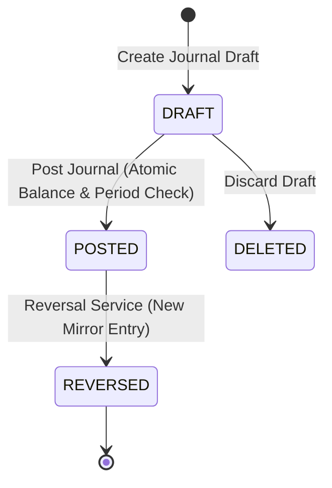

# WealthOS — Journal Entry Lifecycle & Posting Rules

## 1. Lifecycle States

- **DRAFT:** Entry in progress. Mutable. Draft lines and totals do NOT appear in posted general ledger, trial balance, or account balances.
- **POSTED:** Irreversible and immutable. Written to general ledger. Cannot be modified or deleted.
- **REVERSED:** Original entry flagged as reversed, linked bidirectionally to a new offsetting journal entry.

---

## 2. Posting Pipeline Invariants

When a user or service requests posting of a journal entry:
1. **Tenant Resolution:** Request actor must possess `accounting:journals:post` in active tenant.
2. **Locking & Concurrency:** Acquire row-level lock on draft (`SELECT ... FOR UPDATE`) to eliminate duplicate posting races.
3. **Idempotency Gate:** If `idempotency_key` is supplied, check `accounting_idempotency_records`. If already COMMITTED with same fingerprint, return cached result. If different fingerprint, raise HTTP 409 Conflict.
4. **Line Validation:**
   - At least 2 lines.
   - All accounts exist, are active, and belong to `current_tenant_id`.
   - Each line has strictly positive amount on one side (`debit > 0, credit = 0` OR `credit > 0, debit = 0`).
5. **Period Validation:** `entry_date` must fall within an `OPEN` accounting period. Postings into `CLOSED` periods are rejected.
6. **Balance Invariant:** Total functional debits must equal total functional credits exactly:
   $$\sum \text{functional\_debit} = \sum \text{functional\_credit}$$
7. **Commit & Audit:** Update status to `POSTED`, record `posted_by`, `posted_at`, insert idempotency record, dispatch security audit log, and commit transaction atomically.
