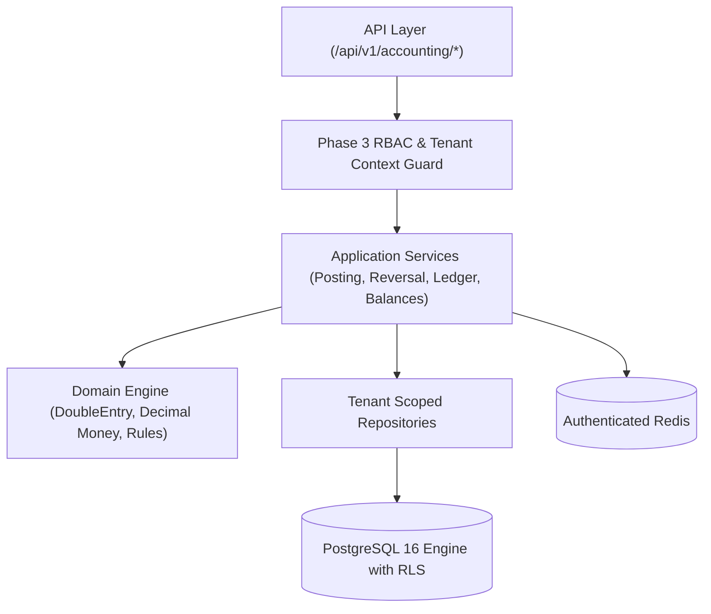

# WealthOS — Financial Core & Accounting Architecture

## 1. System Context & Layered Monolith Design

---

## 2. Invariants & Guarantees
- Single source of truth for all posted transactions.
- Zero floating-point arithmetic.
- Immutable posted entries via database triggers.
- Idempotency preventing duplicate postings.
- RLS protecting multi-tenant boundaries.
