# WealthOS — Accounting Data Flows & Concurrency Model

## 1. Atomic Journal Posting Sequence

```mermaid
sequenceDiagram
    autonumber
    actor Client
    participant API as FastAPI Router
    participant Guard as RBAC & Tenant Context
    participant Service as PostingService
    participant Repo as AccountingRepository
    participant DB as PostgreSQL (RLS)
    participant Audit as AuditLogger

    Client->>API: POST /api/v1/accounting/journals/{id}/post
    API->>Guard: Validate Permission (accounting:journals:post)
    Guard->>DB: SET LOCAL app.current_tenant_id = :tid
    API->>Service: post_journal(journal_id, actor_id, idempotency_key)
    
    rect rgb(20, 30, 45)
        note over Service,DB: Atomic PostgreSQL Transaction
        Service->>DB: SELECT * FROM journal_entries WHERE id = :id FOR UPDATE
        Service->>Service: Validate lines (count >= 2, sum debits == sum credits)
        Service->>DB: Check Accounting Period is OPEN
        Service->>DB: Check / Insert Idempotency Record
        Service->>DB: UPDATE journal_entries SET status = 'POSTED', posted_at = now()
        Service->>Audit: record_security_event('journal_posted')
    end

    Service-->>API: JournalDetailResponse
    API-->>Client: 200 OK (Posted Journal)
```

---

## 2. Concurrency & Race Condition Defenses
1. **Row-Level Draft Locking:** `SELECT ... FOR UPDATE` on draft prevents parallel requests from double-posting the same entry.
2. **Durable Idempotency Unique Constraint:** `UNIQUE (tenant_id, idempotency_key)` prevents parallel posting requests with the same key.
3. **Database Immutability Triggers:** Block any concurrent update or delete statements once an entry is marked `POSTED`.
