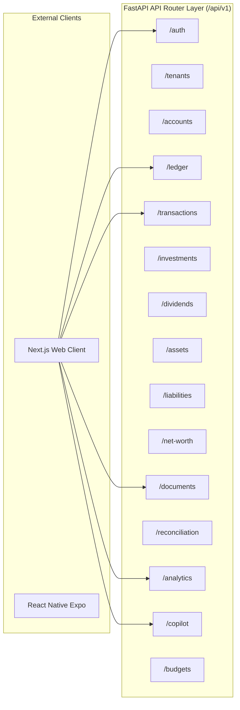

# WEALTHOS — API BOUNDARIES & DOMAIN CONTRACTS SPECIFICATION

**Document Reference:** WOS-API-001  
**Protocol:** HTTP/1.1 & HTTP/2 over TLS 1.3  
**Data Format:** JSON (application/json)  
**Standard Compliance:** OpenAPI 3.1  
**Version:** 1.0.0-RELEASE-CANDIDATE  
**Status:** APPROVED / FROZEN BASELINE  

---

## 1. API CONVENTIONS & ENVELOPE DESIGN

### 1.1 Uniform Response Envelope
All API endpoints return a standardized JSON envelope to guarantee predictable client-side consumption:

```json
{
  "success": true,
  "data": { ... },
  "error": null,
  "metadata": {
    "timestamp": "2026-11-07T14:00:00.000Z",
    "request_id": "req_01HXYZ987654321",
    "tenant_id": "9b1deb4d-3b7d-4bad-9bdd-2b0d7b3dcb6d",
    "pagination": {
      "page": 1,
      "page_size": 50,
      "total_items": 128,
      "total_pages": 3
    }
  }
}
```

### 1.2 Error Envelope Format
When an operation fails, the endpoint returns an HTTP 4xx or 5xx code with a structured error envelope:

```json
{
  "success": false,
  "data": null,
  "error": {
    "code": "UNBALANCED_JOURNAL_ENTRY",
    "message": "Total debits (₹5,000.00) do not equal total credits (₹4,800.00). Discrepancy: ₹200.00.",
    "field_violations": [
      {
        "field": "lines",
        "description": "Debit sum must equal credit sum"
      }
    ]
  },
  "metadata": {
    "timestamp": "2026-11-07T14:00:00.000Z",
    "request_id": "req_01HXYZ987654321",
    "tenant_id": "9b1deb4d-3b7d-4bad-9bdd-2b0d7b3dcb6d"
  }
}
```

### 1.3 Authentication & Workspace Context Headers
- `Authorization: Bearer <session_jwt>` (or via HttpOnly cookie `wos_session`)
- `X-Tenant-ID: <uuid>` (optional: required when a user has multiple workspace memberships to select active tenant)
- `X-Idempotency-Key: <uuid>` (compulsory for state-changing ledger transactions: `POST /api/v1/ledger/journal-entries`, `POST /api/v1/transactions`)

---

## 2. DOMAIN BOUNDARIES & ROUTE MAP



---

## 3. DOMAIN-BY-DOMAIN ENDPOINT SPECIFICATION

### 3.1 Domain 1: Authentication & Identity (`/api/v1/auth`)
| Method | Endpoint | Description | Auth Required |
|---|---|---|---|
| `POST` | `/api/v1/auth/register` | Register new user and default personal workspace. | None |
| `POST` | `/api/v1/auth/login` | Authenticate with email/password; returns session cookie or MFA prompt. | None |
| `POST` | `/api/v1/auth/mfa/setup` | Generate TOTP secret and QR code URI. | Session |
| `POST` | `/api/v1/auth/mfa/verify` | Verify initial TOTP token and activate MFA. | Session |
| `POST` | `/api/v1/auth/logout` | Revoke session in Redis and clear cookies. | Session |
| `GET` | `/api/v1/auth/me` | Fetch active user profile, tenant memberships, and roles. | Session |

### 3.2 Domain 2: Tenancy & Workspaces (`/api/v1/tenants`)
| Method | Endpoint | Description | Role Required |
|---|---|---|---|
| `GET` | `/api/v1/tenants` | List all workspaces user is a member of. | Member |
| `POST` | `/api/v1/tenants` | Create a new family or household workspace. | Member |
| `GET` | `/api/v1/tenants/{id}/members` | List members and their assigned RBAC roles. | Member |
| `POST` | `/api/v1/tenants/{id}/invite` | Invite new member with specified role. | Admin |
| `PATCH` | `/api/v1/tenants/{id}/members/{user_id}` | Update member role. | Owner |

### 3.3 Domain 3: Financial Accounts (`/api/v1/accounts`)
| Method | Endpoint | Description | Role Required |
|---|---|---|---|
| `GET` | `/api/v1/accounts` | List all financial accounts with current balances. | Member |
| `POST` | `/api/v1/accounts` | Create bank, cash, wallet, or broker account. | Admin |
| `GET` | `/api/v1/accounts/{id}` | Account details, chart of accounts linkage, and history. | Member |
| `PATCH` | `/api/v1/accounts/{id}` | Update account details (name, active status). | Admin |

### 3.4 Domain 4: Double-Entry Ledger (`/api/v1/ledger`)
| Method | Endpoint | Description | Role Required |
|---|---|---|---|
| `POST` | `/api/v1/ledger/journal-entries` | Post balanced journal entry ($\sum \text{Debit} \equiv \sum \text{Credit}$). | Member |
| `GET` | `/api/v1/ledger/journal-entries` | Paginated list of journal entries with debit/credit lines. | Member |
| `GET` | `/api/v1/ledger/journal-entries/{id}` | Detailed entry view with audit provenance. | Member |
| `POST` | `/api/v1/ledger/journal-entries/{id}/reverse` | Post an immutable reversing entry. | Admin |
| `GET` | `/api/v1/ledger/trial-balance` | Generate trial balance across all COA categories. | Member |

### 3.5 Domain 5: Transactions, Income & Expenses (`/api/v1/transactions`)
| Method | Endpoint | Description | Role Required |
|---|---|---|---|
| `GET` | `/api/v1/transactions` | Query transactions with filters (date, account, category). | Member |
| `POST` | `/api/v1/transactions` | Record transaction (creates backing journal entry). | Member |
| `GET` | `/api/v1/transactions/{id}` | Transaction detail with split breakdown. | Member |
| `POST` | `/api/v1/transactions/{id}/split` | Split transaction across multiple categories. | Member |

### 3.6 Domain 6: Investments & Portfolio (`/api/v1/investments`)
| Method | Endpoint | Description | Role Required |
|---|---|---|---|
| `GET` | `/api/v1/investments/holdings` | Aggregate holdings across brokers with real-time valuation. | Member |
| `POST` | `/api/v1/investments/trades` | Record buy/sell trade (triggers FIFO cost-basis engine). | Member |
| `GET` | `/api/v1/investments/lots` | Inspect open purchase lots and unit balances. | Member |
| `GET` | `/api/v1/investments/pnl` | Realized and unrealized P&L report (LTCG / STCG). | Member |
| `GET` | `/api/v1/investments/performance` | Calculate portfolio XIRR, CAGR, and benchmark comparison. | Member |

### 3.7 Domain 7: Universal Document Intelligence (`/api/v1/documents`)
| Method | Endpoint | Description | Role Required |
|---|---|---|---|
| `POST` | `/api/v1/documents/upload` | Multipart file upload; triggers async Celery pipeline. | Member |
| `GET` | `/api/v1/documents` | List uploaded documents with parsing status. | Member |
| `GET` | `/api/v1/documents/{id}/extractions` | Fetch parsed line items and validation flags. | Member |
| `POST` | `/api/v1/documents/{id}/approve` | Confirm extraction; post entries to double-entry ledger. | Admin |
| `POST` | `/api/v1/documents/{id}/reject` | Discard extracted batch. | Admin |
| `GET` | `/api/v1/documents/{id}/download-url` | Generate temporary pre-signed S3 download URL. | Member |

### 3.8 Domain 8: AI Financial Copilot (`/api/v1/copilot`)
| Method | Endpoint | Description | Role Required |
|---|---|---|---|
| `POST` | `/api/v1/copilot/conversations` | Start new conversation thread. | Member |
| `GET` | `/api/v1/copilot/conversations` | List user conversation history. | Member |
| `POST` | `/api/v1/copilot/ask` | Send question; returns grounded response with citations. | Member |

---

## 4. CROSS-DOMAIN INTERNAL SERVICE CONTRACTS

To maintain architectural integrity in the modular monolith, domains interact via explicit Python typed service interfaces:

### Contract 1: Transactions Domain $\rightarrow$ Ledger Domain
```python
class LedgerService:
    async def create_journal_entry(
        self,
        tenant_id: UUID,
        entry_date: date,
        memo: str,
        lines: list[JournalLineInput],
        source: str = "MANUAL",
        idempotency_key: str | None = None
    ) -> JournalEntryResult:
        """
        Validates sum(debit) == sum(credit).
        Inserts JournalEntry and JournalLine records atomically.
        Updates FinancialAccount balances.
        """
        ...
```

### Contract 2: Investments Domain $\rightarrow$ FIFO Engine $\rightarrow$ Ledger Domain
```python
class InvestmentService:
    async def record_sell_trade(
        self,
        tenant_id: UUID,
        broker_account_id: UUID,
        instrument_id: UUID,
        trade_date: date,
        units_sold: Decimal,
        sale_price_per_unit: Decimal,
        fees: Decimal
    ) -> TradeExecutionResult:
        """
        1. Queries open investment lots by purchase_date ASC.
        2. Allocates sold units, deducting units_remaining.
        3. Computes FIFO cost basis and realized P&L.
        4. Invokes LedgerService.create_journal_entry to post balanced entries.
        """
        ...
```

### Contract 3: Document Extraction $\rightarrow$ Human Gate $\rightarrow$ Ledger Domain
```python
class DocumentApprovalService:
    async def approve_extraction_batch(
        self,
        tenant_id: UUID,
        extraction_id: UUID,
        approved_by_user_id: UUID
    ) -> BatchCommitResult:
        """
        1. Loads extraction_line_items where status == 'ACCEPTED'.
        2. Translates lines into balanced JournalEntries.
        3. Commits journal entries within an atomic database transaction.
        4. Updates document status to 'APPROVED'.
        """
        ...
```
