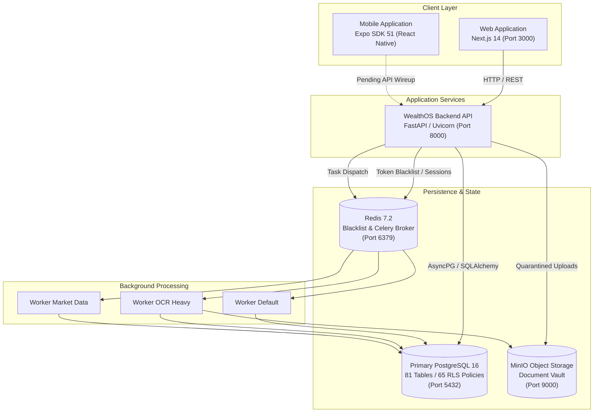

# WealthOS — Existing System Architecture Baseline

**Programme:** WealthOS Enterprise Architecture & Production Readiness  
**Document:** Existing Architecture Baseline  
**Commit SHA:** `b221558f522b2d553d7b30ff6640a481c04ed135`  
**Active Branch:** `feature/final-financial-intelligence-production`  
**Date:** 2026-11-08  
**Author:** Principal Software Architect & Database Architect  

---

## 1. Monorepo Organization

WealthOS is structured as a pnpm workspace monorepo uniting the Python FastAPI backend, Next.js web application, React Native mobile application, and shared TypeScript packages:

```
WEALTHOS/
├── apps/
│   ├── web/                     # Next.js 14 App Router Web Application
│   └── mobile/                  # Expo SDK 51 / React Native Mobile Application
├── backend/
│   ├── app/
│   │   ├── core/                # Database, Redis, Security, Configuration
│   │   ├── domains/             # 15 Domain Engines (Modular Monolith)
│   │   ├── models/              # Shared SQLAlchemy 2.0 Base Models
│   │   ├── schemas/             # Pydantic v2 Input/Output DTOs
│   │   └── workers/             # Celery Task Definitions
│   ├── alembic/                 # Database Schema Migration Revisions
│   └── tests/                   # Pytest Test Suites (291 passing tests)
├── packages/
│   ├── api-client/              # Typed OpenAPI SDK client
│   └── design-tokens/           # WCAG AA compliant fintech tokens
├── infrastructure/              # Docker, NGINX, and orchestration configs
├── docs/                        # Architecture, Security, Operations & Release specs
├── docker-compose.yml           # Base development and staging services
└── pnpm-workspace.yaml          # PNPM monorepo package workspace
```

---

## 2. Backend Architecture: Modular Monolith

WealthOS backend is engineered as a domain-driven **Modular Monolith** using **FastAPI** and **SQLAlchemy 2.0 Async (asyncpg)**. Rather than prematurely distributing into fragmented microservices with distributed transaction complexity, the system preserves transactional ACID atomicity within well-defined, encapsulated domain modules.

### Domain Module Catalog

| Domain | Directory Path | Core Responsibilities & Business Rules |
|---|---|---|
| **Auth** | `backend/app/domains/auth/` | User registration, password hashing (bcrypt 12 rounds), JWT issuance, Redis token blacklist revocation, tenant initialization. |
| **Ledger** | `backend/app/domains/ledger/` | Strict double-entry general ledger. Balanced journals ($\sum\text{Dr} - \sum\text{Cr} = 0$), immutable posted entries, reversing entries, zero binary floats (`NUMERIC(20, 4)` and `Decimal`). |
| **Reconciliation**| `backend/app/domains/reconciliation/` | Bank statement reconciliation against General Ledger, tolerance matching, discrepancy scoring, duplicate detection. |
| **Cash** | `backend/app/domains/cash/` | Multi-account liquidity aggregation, multi-currency support, transfer neutrality filtering (self-transfers excluded from income/expense), 30d/90d/12m forecasting. |
| **Investments** | `backend/app/domains/investments/` | First-In, First-Out (FIFO) lot acquisition/disposal matching, negative inventory prevention, mathematical separation of Realized vs Unrealized P&L, stock split corporate action invariance, XIRR returns. |
| **Budgets** | `backend/app/domains/budgets/` | Envelope category allocations, rollover surplus/deficit, category tracking, budget alert triggers. |
| **Liabilities** | `backend/app/domains/liabilities/` | Reducing balance loan amortization schedules, EMI calculations, interest obligations, avalanche vs snowball debt payoff simulators. |
| **Documents** | `backend/app/domains/documents/` | Multipart upload quarantine, SHA-256 deduplication, MIME/magic-byte validation, arithmetic balance checking, OCR extraction. |
| **Planning** | `backend/app/domains/planning/` | Financial goal forecasting, retirement projections, Monte Carlo simulations, milestone affordability tracking. |
| **Tax** | `backend/app/domains/tax/` | India tax readiness: April–March FY/AY demarcation, Section 112A ₹1.25L capital gains exemption, dual regime comparison (Section 115BAC vs Old Regime). |
| **Risk** | `backend/app/domains/risk/` | 5-pillar Financial Health Score (0–100), empirical risk detection rules, emergency fund coverage, debt-to-income ratio, alert lifecycle. |
| **Copilot** | `backend/app/domains/copilot/` | AI Financial Copilot: 15 allowlisted read-only tools, grounded citations, pre-execution regex prompt injection defense. |
| **Twin** | `backend/app/domains/twin/` | Personal Financial Digital Twin: Point-in-time state synthesis, data freshness tracking (`CURRENT`, `STALE`, `INCOMPLETE`). |
| **Household** | `backend/app/domains/household/` | Household wealth management: 4 RBAC roles (`OWNER`, `ADMIN`, `MEMBER`, `VIEWER`), 3-tier visibility scopes, consolidated net worth with single-deduplication, internal settlements. |
| **Integrations**| `backend/app/domains/integrations/` | Normalized `ProviderAdapter` abstraction layer, RBI Account Aggregator sandbox, NSE/BSE market feed, Broker CAS ingestion, AES-256-GCM envelope credential encryption, HMAC-SHA256 webhook verification with 300s replay prevention. |

---

## 3. Database Architecture & Schema Design

### Database Engine
- **Engine:** PostgreSQL 16.8 (Running in Docker container `wealthos_postgres`).
- **Extensions Installed:**
  - `plpgsql`: Procedural language.
  - `uuid-ossp`: UUID generation.
  - `pgcrypto`: Cryptographic hashing and key management.
  - `btree_gist`: GiST indexing for temporal range exclusion constraints.
- **Table Count:** 81 public tables managed via Alembic migrations (`0001_initial` through `0010_wave_4_intelligence`).
- **Row-Level Security (RLS):** 65 tables enforced with `ALTER TABLE ... FORCE ROW LEVEL SECURITY`.
  - Application connections set transaction-local context: `SET LOCAL app.current_tenant_id = '<tenant_id>';`.
  - RLS policies restrict all `SELECT`, `INSERT`, `UPDATE`, `DELETE` operations exclusively to matching tenant rows.

### Connection Management
- **ORM / Driver:** SQLAlchemy 2.0 Async with `asyncpg`.
- **Pool Configuration:** Single `create_async_engine` instance in `backend/app/core/database.py`:
  - `pool_size = 10`
  - `max_overflow = 20`
  - `pool_pre_ping = True`
  - `pool_recycle = 3600`
- **Limitation:** Direct connection to PostgreSQL without PgBouncer. Multiple API instances will saturate PostgreSQL's default `max_connections = 100`.

---

## 4. Web Frontend Architecture

- **Framework:** Next.js 14.2.23 (React 18.3.1) using the App Router (`apps/web/src/app/`).
- **Styling & Design System:** Tailwind CSS with `@wealthos/design-tokens` providing accessible semantic color palettes, typography, and spacing tokens.
- **State Management & Data Fetching:** React Context (`AuthContext`, `TenantContext`), React Hooks, and typed fetch wrappers in `apps/web/src/lib/api.ts`.
- **Pages & Routes (27 Routes):**
  - Core Dashboard: `/` (Consolidated overview, net worth, cash flow, asset breakdown)
  - Control Centre: `/control-centre` (Reconciliation, discrepancies, audit log)
  - Cash Management: `/cash` (Accounts, liquid cash, transfer neutrality, liquidity forecasts)
  - Investments: `/investments` (Holdings, FIFO trade log, corporate actions, performance)
  - Budgets: `/budgets` (Envelope budgets, category tracking, rollover surplus)
  - Liabilities: `/liabilities` (Loans, credit cards, amortization schedules, payoff plans)
  - Documents: `/documents` (Statement upload, OCR extraction, quarantine review)
  - Planning: `/planning` (Financial goals, retirement projections, scenario simulations)
  - Tax Readiness: `/tax` (India FY/AY tax estimates, 112A capital gains, regime comparison)
  - Risk Intelligence: `/risk` (Health score, risk alerts, vulnerability analysis)
  - Copilot: `/copilot` (AI financial assistant, natural language query, grounded citations)
  - Digital Twin: `/twin` (Financial state graph, freshness indicators, point-in-time snapshot)
  - Household: `/household` (Multi-member net worth, shared goals, visibility controls)
  - Integrations: `/integrations` (Bank AA connectors, broker CAS, market data feeds)
  - Auth: `/login`, `/register`
- **Current Limitation:** Token and tenant context stored in browser `localStorage`. Needs migration to `HttpOnly` secure cookies.

---

## 5. Mobile Architecture

- **Framework:** React Native / Expo SDK 51 (`apps/mobile/`).
- **Storage Layer:** `apps/mobile/src/storage.ts` provides fully tested `SecureStoreAdapter` (using `expo-secure-store`) with an encrypted fallback and offline transaction mutation queue.
- **Current Limitation:** `apps/mobile/App.tsx` contains static preview cards; navigation and API integration are not yet wired to backend endpoints. Missing `android/` native build configuration and `eas.json`.

---

## 6. Background Processing & Distributed State

- **Cache & Key-Value Store:** Redis 7.2.7 (`wealthos_redis`) used for:
  - JWT token revocation blacklist (`blacklist:{jti}`).
  - Celery task broker and result backend.
  - Rate limiting key tracking.
- **Task Worker Infrastructure:** Celery 5.3 configured with 3 separate worker queues:
  - `default`: General asynchronous processing.
  - `ocr_heavy`: Document processing and statement extraction.
  - `market_data`: Market price updates and ticker synchronization.
- **Current Limitation:** Workers exist in Docker Compose, but actual document parsing tasks currently execute synchronously within API request handlers.

---

## 7. Current Architecture Topology Diagram


