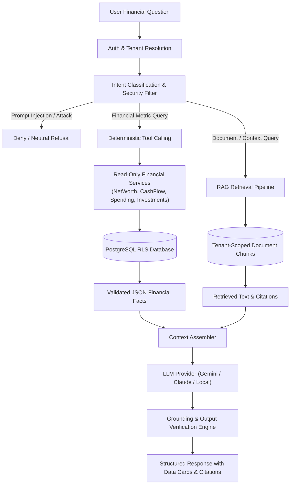
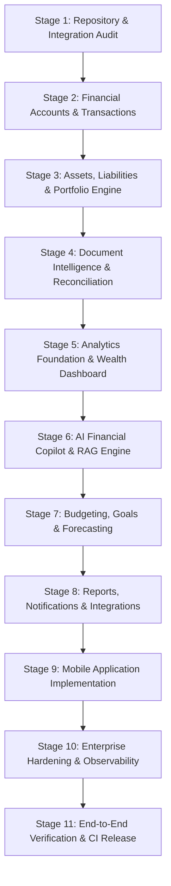

# WealthOS — Final Phase: Financial Intelligence, AI Copilot, Mobile & Enterprise Production
## Stage 1 — Repository and Integration Audit Report

**Date:** November 7, 2026  
**Document Reference:** WOS-FINAL-STAGE1-AUDIT  
**Status:** AWAITING ARCHITECTURE APPROVAL  
**Branch:** `feature/final-financial-intelligence-production`  
**Starting Commit Baseline:** `e4fe49bb50aa41b790e86dd779efcf4bcc1b1a40` (Phase 4 Head Commit)  
**Parent Phase 3 Baseline:** `2827570f6b7710aa856a02f71b7e164d701bbff7`

---

## 1. Executive Summary & Verification of Preceding Phases

A rigorous inspection of the WealthOS git repository, database migrations, backend services, frontend packages, mobile workspace, and CI pipeline was conducted.

### Status of Preceding Foundations

| Phase / Module | Verified In Codebase? | Evidence / Commit SHA | Implementation Status |
| :--- | :--- | :--- | :--- |
| **Phase 0: Architecture & PRD/SRS** | **YES** | Commit `003ee35`, Tag `v0.1.0-phase0` | Complete frozen baseline specifications, ADRs 001–010, ERD, and threat model. |
| **Phase 1: Human-Designed UI/UX** | **YES** | Commit `44ad242`, Tag `v0.2.0-phase1` | Complete design token system (`@wealthos/design-tokens`), WCAG AA tokens, 65 screens inventory. |
| **Phase 2: Infrastructure Foundation** | **YES** | Commit `ca94795` | FastAPI, Next.js 14, Expo SDK 51, PostgreSQL 16, Redis 7.2, Celery (3 workers), MinIO, Docker Compose. |
| **Phase 3: Auth & Tenant Security** | **YES** | Commit `2827570` | Argon2id, Refresh Token Rotation, TOTP MFA, RBAC, tenant context, PostgreSQL RLS (`FORCE ROW LEVEL SECURITY`). |
| **Phase 4: Double-Entry Accounting** | **YES** | Commit `e4fe49b` | Chart of Accounts (52 template), journal entries & lines, database immutability triggers, mirror reversals, multi-currency NUMERIC(18,4). |
| **Bank Accounts & Transactions** | **NO (Pending)** | Planned in Schema | Not yet implemented as domain tables; currently only generic COA and journal lines exist. |
| **Assets & Liabilities Registry** | **NO (Pending)** | Planned in Schema | Not yet implemented as domain tables. |
| **Investments & FIFO Engine** | **NO (Pending)** | Planned in Schema | Not yet implemented as domain tables. |
| **Dividends & Passive Income** | **NO (Pending)** | Planned in Schema | Not yet implemented as domain tables. |
| **Document Intelligence Pipeline** | **PARTIAL** | Storage/Quarantine present | MinIO quarantine & signature validation exist in `storage.py`, but parsing & extraction jobs not yet implemented. |
| **Reconciliation Engine** | **PARTIAL** | Table `reconciliation_records` | Basic table created in migration 0004; matching engine and session workflows not yet implemented. |
| **Wealth Dashboard & Analytics** | **NO (Pending)** | Planned | Shell layout exists in `apps/web/src/app/dashboard`, but real analytics engine not yet implemented. |
| **AI Financial Copilot** | **NO (Pending)** | Planned | Not yet implemented. |
| **Mobile Application** | **PARTIAL** | Expo scaffold in `apps/mobile` | Scaffold exists, but financial screens and authentication flows are not yet wired. |

> [!IMPORTANT]
> **Audit Finding:** Phases 0 through 4 are **fully implemented, tested (127 passing tests), and green in CI (Run `42394010791`)**.
> However, the domain-specific business models (Bank Accounts, Transactions, Assets, Liabilities, Investment FIFO lots, Dividends, Document Ingestion Jobs) and the final intelligence layer (Analytics, AI Copilot, Mobile, Budgets, Reports, Alerts) must be implemented in this consolidated release.

---

## 2. Current Architecture & Reusable Backend Services

WealthOS is built on Clean Architecture principles, enforcing strict separation of concerns:

```mermaid
flowchart TD
    Client["Clients: Web (Next.js 14) / Mobile (Expo SDK 51)"] -->|Bearer Token + X-Tenant-ID| API["FastAPI REST API (/api/v1)"]
    API --> SecurityContext["Core Security & Tenant Context Engine"]
    SecurityContext -->|set_config('app.current_tenant_id')| Postgres[("PostgreSQL 16+ with FORCE RLS")]
    API --> DomainServices["Domain & Intelligence Services"]
    DomainServices --> PostingService["Phase 4 PostingService (Double-Entry Core)"]
    PostingService --> Triggers["Database Immutability Triggers (P0001)"]
    DomainServices --> Repositories["TenantScopedRepository[T]"]
    Repositories --> Postgres
    DomainServices --> Celery["Celery Task Queues (default, ocr_heavy, market_data)"]
    DomainServices --> MinIO["MinIO S3 (Quarantine & Promoted Storage)"]
    DomainServices --> Redis[("Redis 7.2 (Sessions, Cache, Rate Limits)")]
```

### Existing Reusable Services & Modules
1. **`PostingService.create_and_post`** (`backend/app/domains/accounting/services/posting_service.py`):
   - Validates accounting period status (`OPEN`/`CLOSED`).
   - Validates mathematical double-entry balance: $\sum \text{FunctionalDebit} \equiv \sum \text{FunctionalCredit}$.
   - Atomically transitions DRAFT entries to POSTED.
   - Enforces durable deduplication via `accounting_idempotency_records`.
2. **`ReversalService.reverse_journal_entry`** (`backend/app/domains/accounting/services/reversal_service.py`):
   - Executes mirrored counter-entries (`REVERSAL`) with flipped debit/credit lines.
   - Establishes bidirectional foreign keys (`reversed_by_entry_id` $\leftrightarrow$ `reversal_of_entry_id`).
   - Ensures immutable audit trail.
3. **`BalanceService`** (`backend/app/domains/accounting/services/balance_service.py`):
   - Computes real-time account balances, running statement ledgers, and trial balances.
4. **`storage.py`** (`backend/app/infrastructure/storage.py`):
   - MinIO quarantine lifecycle: `upload_to_quarantine`, `validate_file_magic_bytes`, `validate_and_promote_quarantine_document`.
   - Presigned download and upload URLs with short TTL (15 minutes).
5. **`celery_app.py`** (`backend/app/infrastructure/celery_app.py`):
   - Distributed task execution across 3 dedicated queues: `default`, `ocr_heavy`, and `market_data`.
6. **`security.py` & `tenant_context.py`** (`backend/app/core/`):
   - `get_current_tenant_context`: Injects validated tenant membership and sets transaction-local `app.current_tenant_id`.
   - `require_permission(...)` and `require_role(...)`: Deny-by-default RBAC enforcement.
   - `TenantScopedRepository[T]`: Tenant-scoped query isolation.
7. **`money.py`** (`backend/app/domains/accounting/domain/money.py`):
   - Fixed-point monetary utilities: `quantize_money`, `quantize_rate`, strict binary float prohibition.

---

## 3. Frontend & Mobile State

### Web Frontend (`apps/web`)
- **Technology:** Next.js 14 App Router, React 18, TypeScript, Tailwind CSS.
- **Design Tokens:** Handcrafted dark foundation from `@wealthos/design-tokens` (`#0B0F17` canvas, `#111827` surface panels).
- **Navigation:** `Sidebar.tsx` has pre-configured routes for all financial domains:
  - `/dashboard`, `/net-worth`, `/accounts`, `/transactions`, `/cashflow`, `/budgets`, `/investments`, `/dividends`, `/documents`, `/reconciliation`, `/copilot`, `/goals`, `/reports/tax`, `/settings`.
- **Existing Screens:** Auth screens (`/auth/login`, `/register`, `/verify-email`, `/reset-password`, `/mfa`), Settings screens (`/settings/security`, `/workspaces`, `/audit`, `/members`), and Dashboard shell.

### Mobile Client (`apps/mobile`)
- **Technology:** React Native 0.74, Expo SDK 51, TypeScript.
- **Packages:** Consumes `@wealthos/design-tokens`, `@wealthos/api-client`, `@wealthos/shared-types`.
- **Current State:** Basic scaffold with brand header and placeholder card; requires complete financial screen tree and authentication navigation.

---

## 4. Financial Calculations & Accounting Integration

Every financial transaction in WealthOS maps to a double-entry journal entry:

| Operation | Debit Account | Credit Account | Accounting Principle |
| :--- | :--- | :--- | :--- |
| **Account Opening Balance** | Financial Account (`1020`, Asset) | Opening Balance Equity (`3010`, Equity) | Establishes starting net worth without artificial revenue. |
| **Salary Received** | Bank Account (`1020`, Asset) | Salary Income (`4010`, Income) | Earned income increases cash. |
| **Operating Expense** | Expense Category (`5xxx`, Expense) | Bank Account (`1020`, Asset) | Operating expense decreases cash. |
| **Internal Transfer** | Destination Bank (`1020`, Asset) | Source Bank (`1020`, Asset) | **Zero income/expense impact.** Asset reallocation only. |
| **Credit Card Purchase** | Expense Category (`5xxx`, Expense) | Credit Card Liability (`2010`, Liability) | Expense incurred on debt; cash unaffected. |
| **Credit Card Payment** | Credit Card Liability (`2010`, Liability) | Bank Account (`1020`, Asset) | **Zero expense impact.** Settles liability; prevents double-counting. |
| **Loan Inflow** | Bank Account (`1020`, Asset) | Loan Liability (`2100`, Liability) | Borrowed capital is a liability, **never income**. |
| **Loan EMI Repayment** | Loan Liability (`2100`, Principal) + Interest Expense (`5080`) | Bank Account (`1020`, Asset) | Splits repayment: principal reduces liability, interest recognized as expense. |
| **Investment Buy** | Investment Asset (`12xx`) + Brokerage (`5250`) | Bank Account (`1020`, Asset) | Asset swap; not an operating expense. |
| **Investment Sell (FIFO)** | Bank Account (`1020`, Net proceeds) | Investment Asset (`12xx`, Cost basis) + Realized Gain (`4310`, Income) | Reduces holding at FIFO cost; net profit booked as capital gain. |
| **Dividend Receipt** | Bank Account (`1020`, Net) + TDS Asset (`1410`, Tax) | Dividend Income (`4110`, Gross) | Gross income recorded; TDS tracked as tax asset. |
| **Market Valuation Change** | *None (Off-ledger)* | *None (Off-ledger)* | Unrealized appreciation is **never posted to the general ledger as income**. Net worth engine computes mark-to-market separately. |

---

## 5. AI Financial Copilot & RAG Architecture

The Copilot is designed with strict boundaries to guarantee financial correctness:



### Non-Negotiable AI Rules:
1. **Zero Write Access:** The Copilot has **zero write access** to the general ledger, bank accounts, or financial transactions. All tools are read-only.
2. **Deterministic Computation:** Financial metrics (net worth, spending sums, FIFO gains) are calculated by deterministic Python services, **never by LLM arithmetic**.
3. **Tenant-Safe Context:** Chunks and metadata filtered strictly by `tenant_id`. Cross-tenant retrieval is impossible.
4. **Citation & Data Freshness:** Every answer cites its source documents and indicates valuation timestamps.

---

## 6. Database Design: Consolidated Migration `0005`

To support both the financial data domain and the final intelligence features, migration `0005_financial_intelligence_production.py` will introduce the following tables under PostgreSQL `FORCE ROW LEVEL SECURITY`:

### A. Financial Data Management (Phases 5 Domain Tables)
1. `financial_institutions` (Directory of banks, brokers, depositories)
2. `financial_accounts` (User accounts: savings, current, credit card, cash, loan)
3. `account_balance_snapshots` (Periodic statement and source balance observations)
4. `transaction_categories` (Hierarchical categories: income, expense, transfer)
5. `transaction_merchants` (Normalized merchant registry)
6. `financial_transactions` (User transactions backed by `journal_entries.id`)
7. `recurring_transaction_rules` (Schedules, frequencies, next expected occurrences)
8. `budgets` (Monthly/category budget limits and actual spending)
9. `assets` (Real estate, vehicles, gold, EPF/PPF with purchase prices)
10. `asset_valuations` (Historical appraisals and valuation sources)
11. `liabilities` (Loans, mortgages, interest rates, EMIs, tenures)
12. `net_worth_snapshots` (Historical daily/monthly net worth calculation records)
13. `financial_instruments` (Security master: equities, mutual funds, gold, bonds, ISINs, prices)
14. `investment_accounts` (Broker/demat accounts linked to financial accounts)
15. `investment_holding_lots` (FIFO acquisition lots: date, units purchased/remaining, cost basis)
16. `investment_transactions` (Buy, Sell, Split, Bonus trades with fees, taxes, realized P&L, linked to `journal_entries.id`)
17. `passive_income_records` (Dividends, interest events, ex-date, gross amount, TDS withheld, net amount, status)
18. `financial_documents` (Metadata, file hash, storage path, status, quarantine state)
19. `document_processing_jobs` (Celery background processing stages and status)
20. `extracted_financial_records` (Candidate extracted items awaiting human review)
21. `reconciliation_sessions` (Reconciliation batches comparing external statements with ledger)
22. `reconciliation_matches` (Match candidates, confidence scores, discrepancy reasons, and status)

### B. Final Phase Intelligence & Operations Tables
23. `financial_goals` (Goal name, target amount, current amount, target date, priority, monthly contribution)
24. `goal_contributions` (Contribution history linked to transactions)
25. `forecast_scenarios` (What-if simulation parameters: savings rates, expense cuts, income changes)
26. `copilot_conversations` (User conversational sessions with the AI Financial Copilot)
27. `copilot_messages` (Grounded conversation messages with tool invocations and citations)
28. `copilot_document_chunks` (Text chunks with metadata and embeddings for RAG retrieval)
29. `notifications` (In-app, email, and push notification inbox with read/unread state)
30. `notification_preferences` (User threshold and channel preferences)
31. `report_exports` (Generated PDF/XLSX/CSV report job metadata and expiring storage links)
32. `provider_connections` (Authorized external provider consent, encrypted credentials, and sync status)

---

## 7. Technical Risks & Mitigation Matrix

| Risk | Severity | Root Cause | Mitigation Strategy |
| :--- | :--- | :--- | :--- |
| **Transfer Double-Counting** | Critical | Internal transfer treated as expense and income | Enforce strict rule: Transfer transactions touch only Asset accounts (`1020` $\leftrightarrow$ `1020`); zero Income/Expense accounts involved. |
| **Credit Card Double-Counting** | High | Both CC purchase and CC repayment counted as expenses | CC purchase debits Expense and credits CC Liability. CC payment debits CC Liability and credits Bank. Expense is recorded only once. |
| **LLM Financial Hallucination** | Critical | LLM inventing numbers or performing mental math | Strict architecture: LLM only receives pre-calculated facts from deterministic services; zero LLM arithmetic. |
| **AI Prompt Injection** | High | Malicious user or document injecting prompt instructions | Strict tool allowlist, input sanitization, separate system instructions, output schema validation. |
| **Floating-Point Drift** | Critical | Using standard Python `float` for money | Enforce Decimal across all schemas, service methods, and `NUMERIC(18, 4)` in PostgreSQL. Strict float ban tests. |
| **FIFO Lot Integrity** | High | Partial sales miscalculating cost basis or realized P&L | Implement deterministic FIFO lot matching repository that consumes lots in chronological order (`purchase_date ASC`). |
| **Cross-Tenant Leakage** | Critical | Missing tenant filter in background workers or AI | RLS `FORCE ROW LEVEL SECURITY` enabled on all 32 new tables. Celery tasks and AI tools explicitly bind tenant context. |
| **Malicious Document Ingestion** | High | Uploaded file containing exploit or ZIP bomb | Files written to quarantine bucket first. Magic bytes checked against allowed MIME types. Decompression bomb limits. 15-minute presigned URLs. |
| **Screenshot False Posting** | High | Ambiguous document treated as an executed trade | Explicit rule: Screenshots create point-in-time *holdings observations* for human review; never automated buy/sell ledger postings. |

---

## 8. Implementation Dependencies

### Backend Dependencies
1. **Document Intelligence & Export:**
   - `pypdf` / `pymupdf` (for PDF text, metadata, and statement tables).
   - `openpyxl` (for Excel statement ingestion and export).
   - `pillow` (for image format and dimension validation).
   - `reportlab` or lightweight HTML-to-PDF / CSV formatting (for financial statement exports).
2. **AI & Vector Retrieval:**
   - LLM provider abstraction supporting Gemini, Claude, or local OpenAI-compatible endpoints.
   - Text chunking & token counting utilities.
   - Vector similarity search (in-database cosine distance via SQL / pgvector or lightweight numpy/embedding index).
3. **Mobile Dependencies (`apps/mobile`):**
   - `@react-navigation/native` & stack navigation for mobile screen flows.
   - `expo-secure-store` for hardware-backed token storage.
   - `@wealthos/api-client` integration with auto-token injection.

---

## 9. Stage-by-Stage Execution Plan



- **Stage 1 (Current):** Repository and Integration Audit (Awaiting Architecture Approval).
- **Stage 2:** Financial Account, Transaction, Category & Merchant Domain (Integration with Phase 4 PostingService).
- **Stage 3:** Assets, Liabilities, Investment Portfolio with FIFO Lots & Passive Income Engine.
- **Stage 4:** Universal Document Intelligence Pipeline & Financial Reconciliation Engine.
- **Stage 5:** Financial Analytics Engine & Wealth Dashboard (`apps/web` with Apache ECharts).
- **Stage 6:** AI Financial Copilot (RAG, deterministic tools, prompt injection guards, conversational UI).
- **Stage 7:** Budgeting, Financial Goals & Forecasting Simulation Engine.
- **Stage 8:** Financial Reports (PDF/Excel/CSV), Notifications & Provider Integrations.
- **Stage 9:** Mobile Application (`apps/mobile` financial screens, navigation, secure storage).
- **Stage 10:** Enterprise Hardening, Performance Benchmarks, Backups & Disaster Recovery Runbooks.
- **Stage 11:** Full-System Integration, Automated Tests, GitHub Actions CI & Delivery Report.
