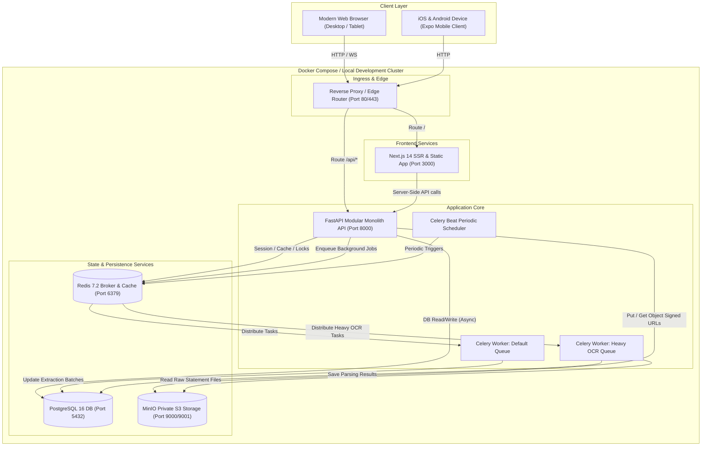
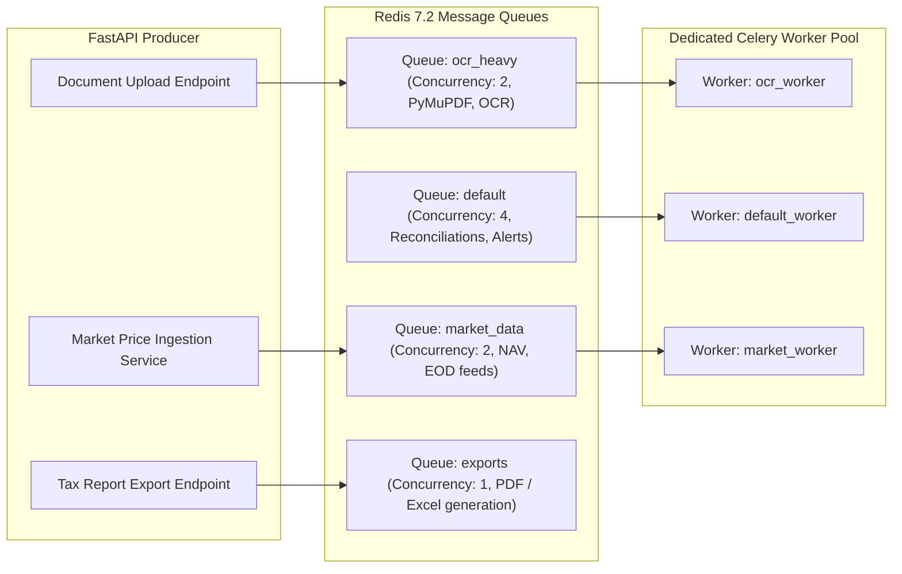
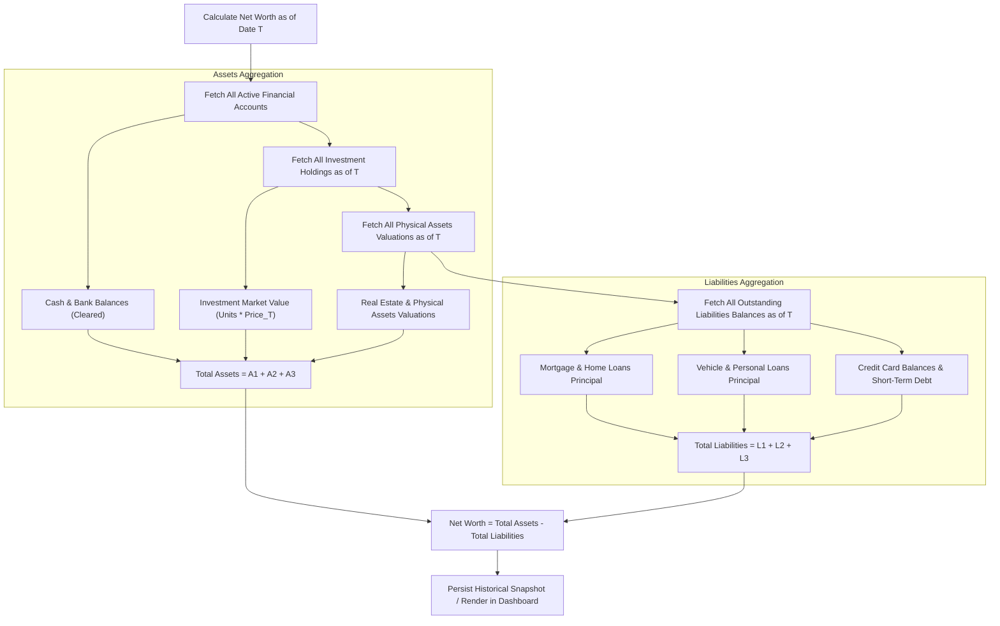
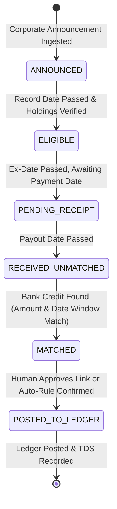

# WEALTHOS — SYSTEM ARCHITECTURE DIAGRAMS & RUNTIME TOPOLOGY

**Document Reference:** WOS-ARCH-DIAG-001  
**Version:** 1.0.0-RELEASE-CANDIDATE  
**Status:** APPROVED / FROZEN BASELINE  

---

## 1. INFRASTRUCTURE & RUNTIME TOPOLOGY

---

## 2. CELERY ASYNCHRONOUS WORKER QUEUE TOPOLOGY

To ensure fast user interaction, background workloads are partitioned across specialized Redis queues:

---

## 3. NET WORTH POINT-IN-TIME CALCULATION ENGINE

---

## 4. DIVIDEND & BANK RECONCILIATION STATE MACHINE

