# WealthOS — Target System Architecture & Enterprise Design

**Programme:** WealthOS Enterprise Architecture & Production Readiness  
**Document:** Target System Architecture  
**Date:** 2026-11-08  
**Status:** Architecture Blueprint (Phase 1 Target)  
**Author:** Principal Software Architect, Database Architect, AppSec Lead & SRE Lead  

---

## 1. Executive Architecture Overview

WealthOS is an enterprise-grade, multi-tenant financial management and intelligence operating system. The platform guarantees strict financial correctness (balanced double-entry ledger, zero float drift), bank-grade tenant isolation (database-enforced PostgreSQL Row-Level Security), high availability (primary-replica database replication, automatic connection pooling), horizontal scalability (stateless API instances behind NGINX), and end-to-end auditability.

The architectural pattern is a **Modular Monolith** with strict logical domain boundaries, asynchronous background task execution, and decoupled web and mobile client frontends.

---

## 2. Core Architectural Principles & Logical Domain Boundaries

WealthOS enforces 17 encapsulated logical domains. Cross-domain communication is governed through explicit service interfaces and domain contracts, preventing circular dependencies and unauthorized cross-domain database mutations.

### The 17 Logical Domain Boundaries

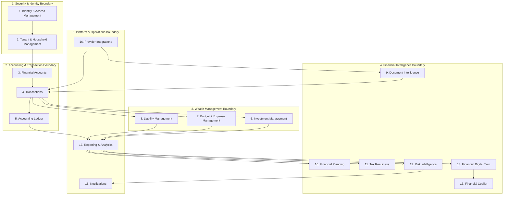

### Domain Module Specifications

1. **Identity & Access Management (IAM):** User lifecycle, bcrypt credential verification, JWT issuance, multi-factor authentication (MFA), Redis token blacklist revocation, user account deletion.
2. **Tenant & Household Management:** Multi-tenant organization boundaries, Household RBAC roles (`OWNER`, `ADMIN`, `MEMBER`, `VIEWER`), visibility tier enforcement (`PERSONAL_ONLY`, `HOUSEHOLD_SHARED`, `LIMITED_SHARED`).
3. **Financial Accounts:** Account definitions (checking, savings, credit cards, brokerage, loans), currency definitions, balance tracking.
4. **Transactions:** Financial journal lines, transaction deduplication, categorization, transfer neutrality filtering.
5. **Accounting Ledger:** Immutable double-entry general ledger, atomic journal entries ($\sum\text{Dr} - \sum\text{Cr} = 0$), audit log verification, reversing entries.
6. **Investment Management:** First-In, First-Out (FIFO) lot matching, realized and unrealized gain/loss calculations, stock split corporate action invariance, XIRR returns.
7. **Budget & Expense Management:** Envelope budgeting, rollover surplus/deficit mechanics, category tracking, burn radar.
8. **Liability Management:** Loan amortization schedules, reducing balance interest calculations, debt payoff simulators (avalanche vs snowball).
9. **Document Intelligence:** Quarantine pipeline, SHA-256 deduplication, MIME/magic-byte validation, OCR extraction, statement reconciliation.
10. **Financial Planning:** Goal-based wealth projections, retirement simulations, Monte Carlo analyses.
11. **Tax Readiness:** India FY/AY tax calculations, Section 112A capital gains exemptions, Old vs New Regime comparisons (Section 115BAC).
12. **Risk Intelligence:** 5-pillar Financial Health Score (0–100), automated vulnerability detection, alert lifecycle management.
13. **Financial Copilot:** AI query interface, 15 allowlisted read-only tools, regex prompt injection defenses, citation generation.
14. **Financial Digital Twin:** Dynamic financial graph synthesis, point-in-time net worth snapshots, data freshness states.
15. **Notifications:** System alerts, threshold warnings, email/SMS dispatch queues.
16. **Provider Integrations:** Normalized `ProviderAdapter`, Account Aggregator consent flows, NSE/BSE market feeds, broker CAS ingestion, envelope credential encryption.
17. **Reporting & Analytics:** Aggregated balance sheets, cash flow summaries, multi-period audit trails.

---

## 3. System Diagrams (Mermaid)

### 3.1 System Context Diagram (C4 Level 1)

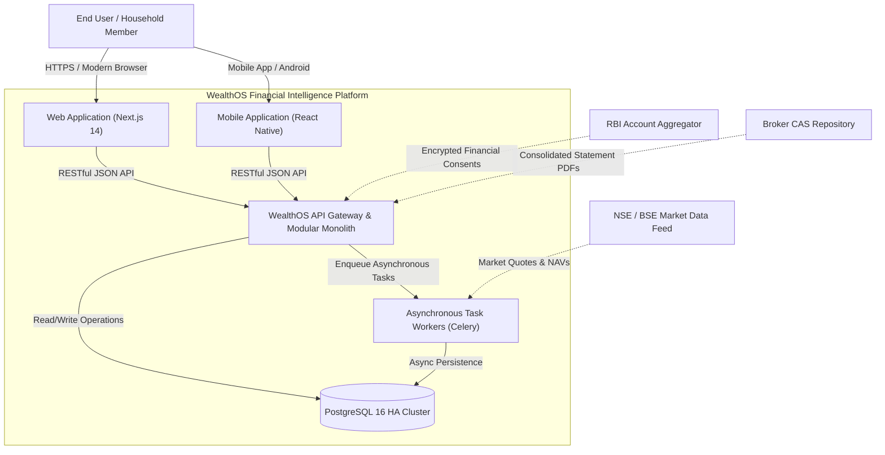

---

### 3.2 Container Diagram (C4 Level 2)

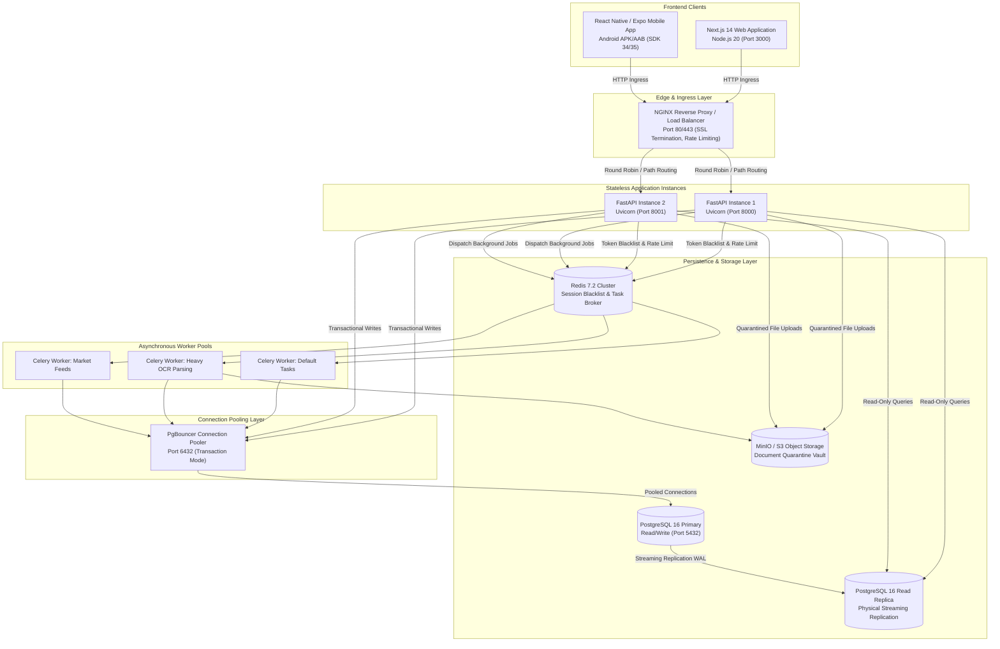

---

### 3.3 Component Diagram: Backend Modular Monolith (C4 Level 3)

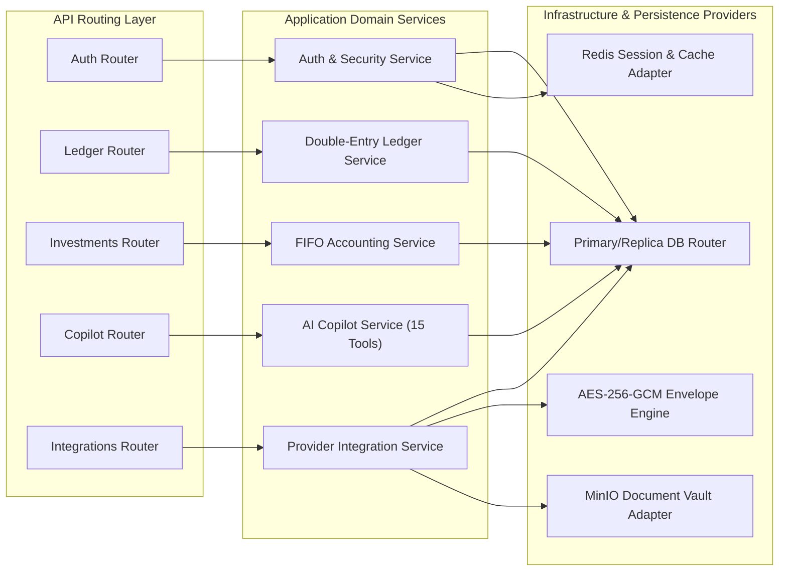

---

### 3.4 Production Deployment Topology

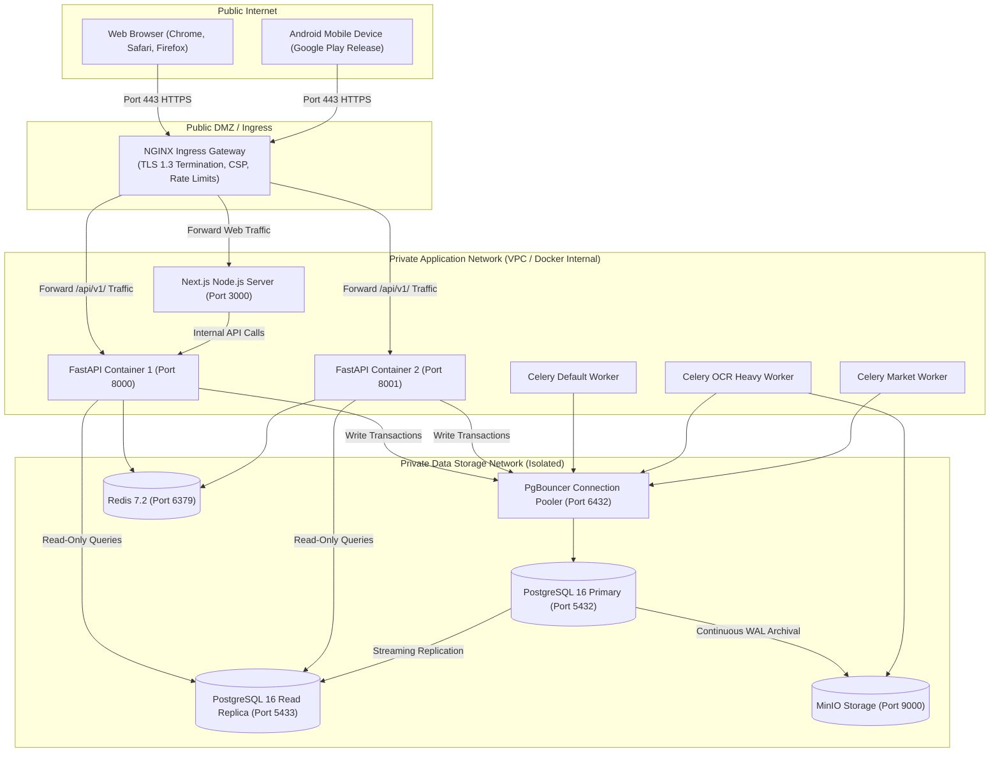

---

## 4. Sequence Diagrams

### 4.1 Authentication & Session Issuance Sequence

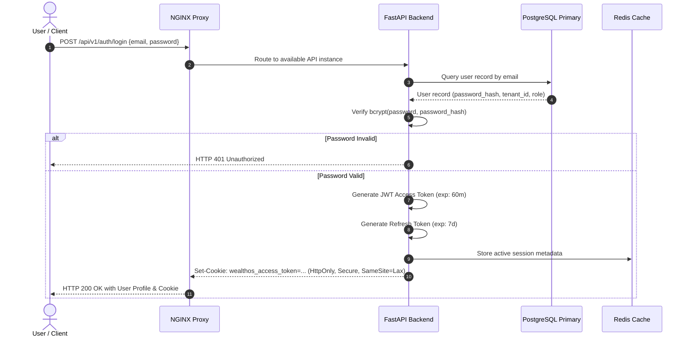

---

### 4.2 Database Transaction Write Sequence (ACID Ledger Invariance)

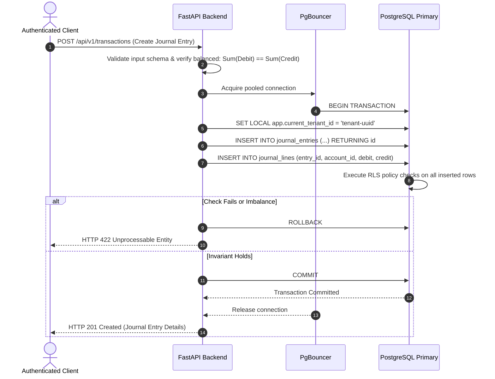

---

### 4.3 Read-Replica Routing Sequence

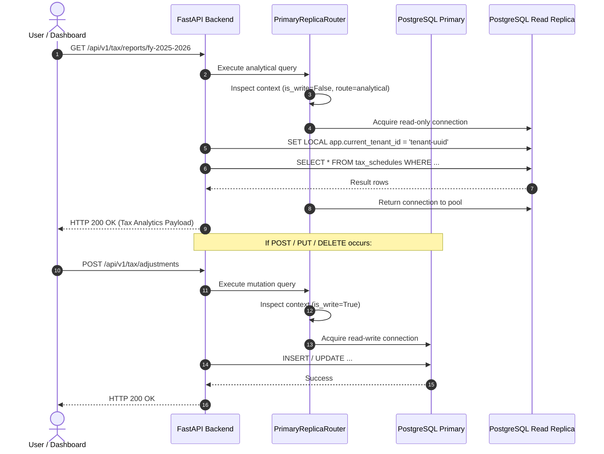

---

### 4.4 High-Availability Database Failover Sequence

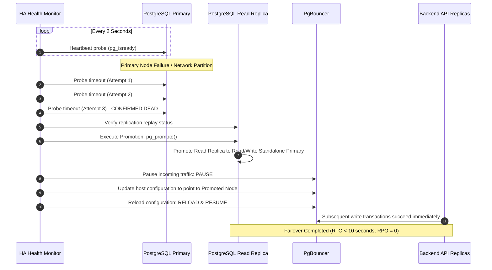

---

### 4.5 Background Job Execution Lifecycle

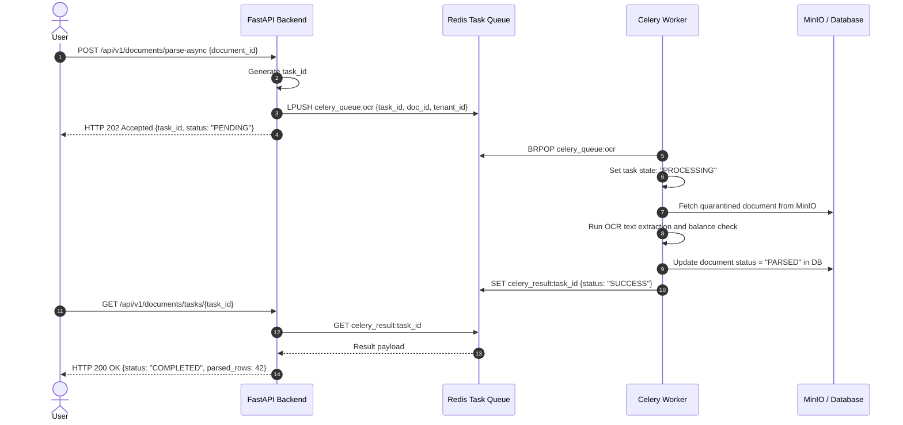

---

### 4.6 Universal Document Ingestion & Quarantine Lifecycle

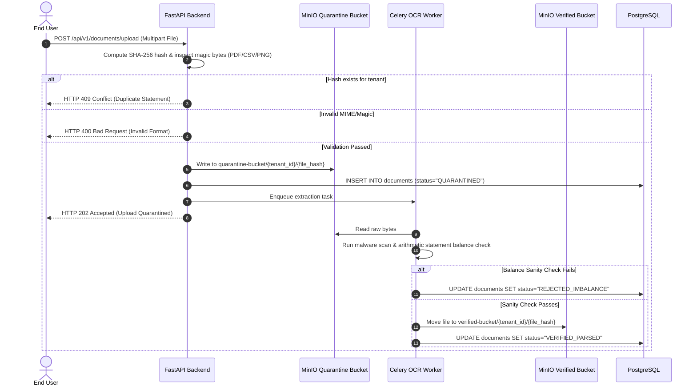

---

### 4.7 Financial Copilot Request Lifecycle

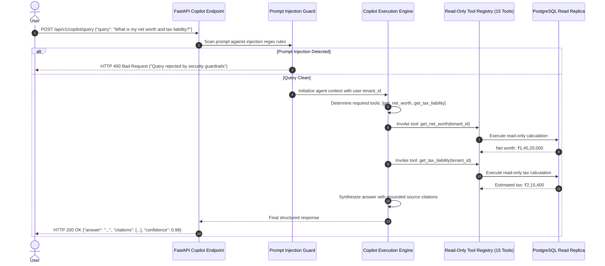

---

### 4.8 User Account Deletion & Right-to-be-Forgotten Lifecycle

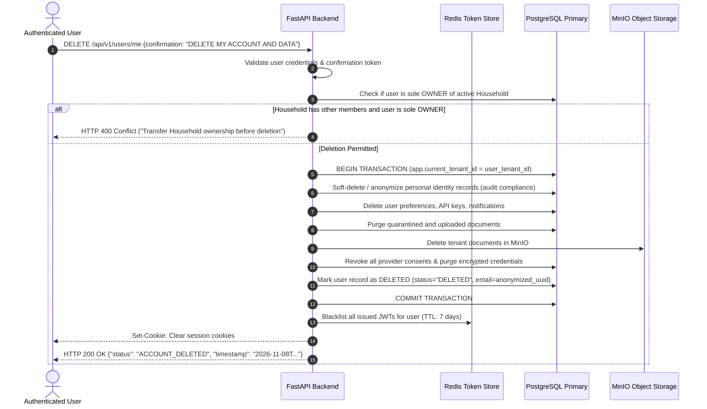
