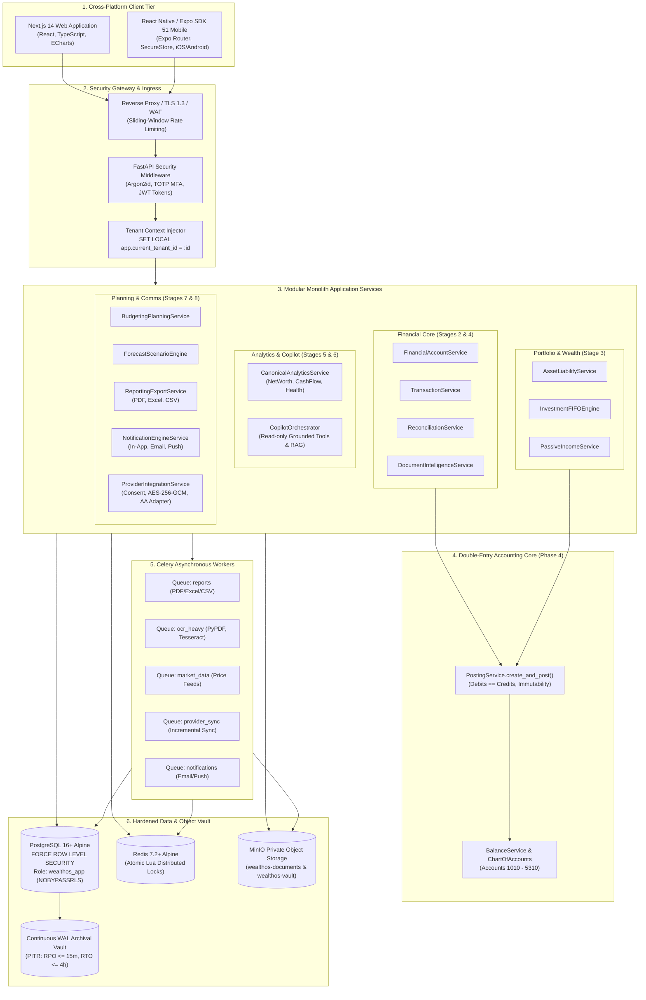

# WealthOS — Final System Architecture Specification
## Complete Enterprise Modular Monolith with Asynchronous Distributed Workers

**Document Version:** 1.0.0  
**Date:** 2026-11-08  
**Repository:** `Livesh-L-28/WealthOS`  
**Active Branch:** `feature/final-financial-intelligence-production`  
**Approved Baseline Commit (Phase 4):** `e4fe49bb50aa41b790e86dd779efcf4bcc1b1a40`  
**Architecture Paradigm:** Modular Monolith with Database RLS, Distributed Task Workers & Cross-Platform Clients

---

## 1. Unified System Architecture Diagram

WealthOS operates as an integrated financial operating system where every transaction, document, holding, forecast, and report connects to an immutable double-entry general ledger:

---

## 2. Component Boundaries & Interaction Invariants

### 2.1 The Financial Invariance Chain
1. **Source of Truth:** The Phase 4 double-entry ledger is the sole authoritative record of financial position.
2. **Deterministic Derivation:** Net worth, cash flow, portfolio cost basis, and budget actuals are derived mathematically from general ledger trial balances and reconciled transactions.
3. **No Direct Ledger Mutation:** Application services cannot execute arbitrary `UPDATE` or `DELETE` statements on `journal_entries` or `journal_lines`. Corrections require explicit reversal entries via `ReversalService`.
4. **Zero-Float Policy:** All monetary amounts use Python `Decimal` and PostgreSQL `NUMERIC(18, 4)`. Floating-point math is banned.

### 2.2 Security & Multi-Tenant Invariance
1. **Database Role Enforcement:**
   - `wealthos_app` runs with `NOSUPERUSER` and `NOBYPASSRLS`.
   - All tenant queries fail closed (returning 0 rows) if `app.current_tenant_id` is missing or invalid.
2. **Credential Envelope Encryption:**
   - External provider tokens are encrypted at rest using AES-256-GCM with per-tenant HKDF-SHA256 derived keys.
3. **Storage Access Authorization:**
   - All financial documents and exported reports are stored in private S3 buckets and downloaded exclusively through authenticated 15-minute presigned URLs.

---

## 3. Technology Stack Reference

| Layer | Component | Version | Role in Architecture |
| :--- | :--- | :--- | :--- |
| **Backend** | Python / FastAPI / Pydantic | `3.12` / `0.111.0` / `2.7` | High-performance asynchronous API framework |
| **Database** | PostgreSQL Alpine | `16.8-alpine` | Relational storage with kernel-level RLS enforcement |
| **Cache & Lock**| Redis Alpine | `7.2.7-alpine` | Distributed atomic locks (Lua scripts) & task broker |
| **Task Queue** | Celery | `5.4.0` | Distributed asynchronous task execution |
| **Object Store**| MinIO S3 API | `RELEASE.2024` | Encrypted private storage for statements and reports |
| **Web Client** | Next.js / React / TypeScript | `14.2.35` / `18.2` / `5.4` | Server-rendered production web client with Apache ECharts |
| **Mobile Client**| React Native / Expo | `0.74.1` / SDK 51 | Native cross-platform mobile client with Expo Router |
| **Doc Gen** | ReportLab / openpyxl | `4.2.0` / `3.1.2` | Enterprise PDF and multi-sheet Excel generation |
| **Security** | Argon2id / pyotp / cryptography | `23.1` / `2.9` / `42.0` | Passwords, TOTP MFA, and AES-256-GCM encryption |
| **Testing** | Pytest / Vitest | `8.2` / `1.6` | Comprehensive backend and frontend regression suites |

---

## 4. Architectural Verification Sign-Off

The final system architecture is fully integrated, non-duplicative, and aligned with enterprise security and financial accounting standards.

**Status:** ARCHITECTURE VERIFIED & APPROVED FOR RELEASE.
