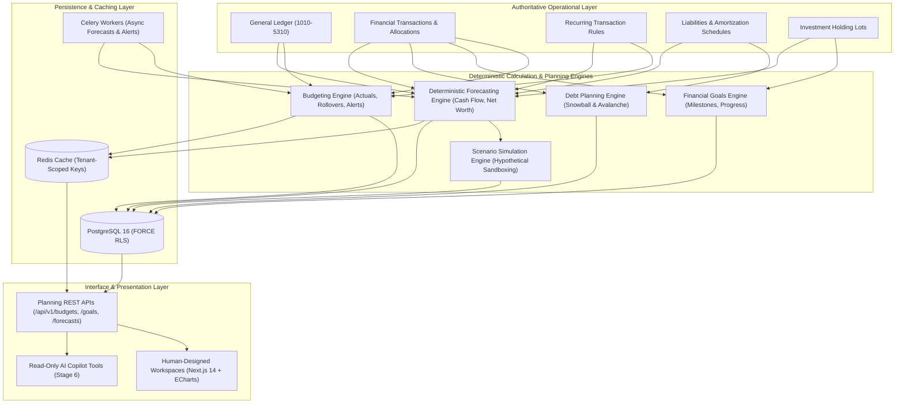

# WealthOS — Stage 7 Technical Architecture Specification
## Enterprise Budgeting, Financial Goals & Forecasting Engine

**Document Version:** 1.0.0  
**Status:** Approved Technical Design  
**Date:** 2026-11-08  
**Author:** Google DeepMind / Antigravity Agentic Engineering  
**Approved Baseline:** Phase 4 Ledger (`e4fe49b`), Stages 2–6 Standards

---

## 1. Executive Summary & Core Architectural Principles

Stage 7 completes the forward-looking strategic intelligence core of WealthOS. While previous stages capture and explain historical records, Stage 7 gives users the tools to actively budget cash flow, define financial goals, simulate debt payoff strategies, project future net worth, and test hypothetical financial scenarios.

### Core Architecture Invariants:
1. **Financial Records Are Authoritative:** All forecasts and budgets ground themselves in verified general ledger and operational records.
2. **Deterministic Calculation Services:** Projections, debt payoffs, and budget actuals calculate strictly via deterministic Python backend services using `Decimal` and `NUMERIC(18, 4)`. AI never calculates numbers.
3. **Scenario Isolation Sandbox:** Scenario simulations operate in an isolated environment. They NEVER post journal entries, update account balances, alter loans, or modify active budgets.
4. **No Double-Counting:** Internal account transfers, credit card payments, investment purchases, and loan principal reductions are segregated from consumption expenses.
5. **Multi-Tenant Row-Level Security:** All Stage 7 tables enforce PostgreSQL `FORCE ROW LEVEL SECURITY`. Application queries run under `wealthos_app` (`NOSUPERUSER NOBYPASSRLS`).
6. **Human-Designed UI:** Adheres to Phase 1 design tokens and Apache ECharts visualizations.

---

## 2. System Architecture & Component Interaction



---

## 3. Subsystem Breakdown

### 3.1 Budgeting Engine
- **Budget Management:** Supports `MONTHLY`, `QUARTERLY`, `ANNUAL`, and `CUSTOM` date ranges.
- **Category Allocations:** Maps planned amounts to hierarchical transaction categories (`transaction_categories`).
- **Calculation Core:**
  $$\text{Remaining} = \text{Planned} - \text{Actual}$$
  $$\text{Utilization \%} = \frac{\text{Actual}}{\text{Planned}} \times 100$$
  $$\text{Projected Period Spending} = \text{Actual To Date} + \text{Remaining Expected Recurring Obligations}$$
- **Budget Rollover:** Configurable surplus/deficit carryforward recorded as an auditable adjustment in the subsequent period.
- **Threshold Alerts:** Idempotent event triggers at 50%, 75%, 90%, 100%, and projected overspending.

### 3.2 Financial Goals Engine
- **Goal Types:** Emergency Fund, Real Estate Purchase, Vehicle, Education, Wedding, Travel, Retirement, Debt Payoff, Custom.
- **Progress Tracking:** Evaluates current funded amount against target amount:
  $$\text{Progress \%} = \frac{\text{Current Funded Amount}}{\text{Target Amount}} \times 100$$
- **Required Periodic Contribution:**
  $$\text{Required Monthly Contribution} = \frac{\text{Remaining Amount}}{\text{Remaining Months to Target Date}}$$
- **Milestone Tracking:** Idempotent alerts when user achieves 25%, 50%, 75%, and 100% of goal target.

### 3.3 Debt Repayment Planning Engine
- **Snowball Simulation:** Prioritizes smallest outstanding loan balance first for psychological momentum.
- **Avalanche Simulation:** Prioritizes highest annual interest rate first to mathematically minimize total interest paid.
- **Payoff Projections:** Simulates monthly compound interest, minimum payments, and extra payments to project exact debt-free dates and total interest saved.

### 3.4 Deterministic Forecasting Engine
- **Cash-Flow Forecast:**
  $$\text{Net Cash Flow}_t = \text{Projected Income}_t - \text{Projected Expenses}_t$$
  $$\text{Projected Cash Balance}_t = \text{Opening Cash Balance} + \sum_{i=1}^t \text{Net Cash Flow}_i$$
- **Net Worth Forecast:** Combines projected liquid cash accumulation, scheduled loan principal reduction, and conservative asset appreciation models.
- **Baseline Window:** Uses 90-day rolling transaction averages and active recurring rules to prevent single-month anomalies from skewing forecasts.

### 3.5 Scenario Simulation Engine
- **Interactive Sandboxing:** Simulates hypothetical events:
  - Income Changes (e.g. +₹15,000/month salary raise).
  - Expense Surges (e.g. +10% inflation, +₹5,000 rent).
  - Career Break (e.g. 3 months zero income).
  - One-Time Capital Outlay (e.g. ₹5,00,000 car purchase).
- **Zero Ledger Impact:** All scenario runs are evaluated in memory and stored in `scenario_forecast_results`. They cannot alter actual financial records.

---

## 4. Database Architecture (Stage 7 Entities)

All tables use UUID primary keys, explicit `tenant_id` foreign keys, `created_at`/`updated_at` timestamps, and PostgreSQL `FORCE ROW LEVEL SECURITY`.

### 4.1 Budgeting Tables
1. `budgets` (Master budget records, periods, total planned amounts).
2. `budget_versions` (Historical version snapshots upon budget adjustments).
3. `budget_allocations` (Category-level planned limits).
4. `budget_rollover_records` (Carryover balances between periods).
5. `budget_threshold_events` (Alert event logs for threshold crossings).
6. `budget_templates` & `budget_template_allocations` (Reusable planning templates).

### 4.2 Financial Goal Tables
7. `financial_goals` (Goal targets, deadlines, priorities, linked accounts).
8. `goal_contributions` (Individual contribution allocations and transaction linkages).
9. `goal_milestones` & `goal_milestone_events` (Milestone thresholds and achievement logs).

### 4.3 Debt Planning Tables
10. `debt_repayment_plans` (Strategy definitions: Snowball, Avalanche, Custom).
11. `debt_repayment_plan_items` (Order of loans, planned extra payments, simulated interest).

### 4.4 Forecasting & Scenario Tables
12. `forecast_runs` (Forecasting sessions, historical windows, data cutoffs).
13. `forecast_periods` (Itemized daily/monthly projected cash balances).
14. `financial_scenarios` (User-defined "what-if" parameter sets).
15. `scenario_forecast_results` (Comparative simulation outputs).

---

## 5. REST API Specification

### Budgeting (`/api/v1/budgets`)
- `POST /api/v1/budgets`: Create budget with category allocations.
- `GET /api/v1/budgets`: List budgets with status and utilization.
- `GET /api/v1/budgets/{id}`: Budget detail with category performance.
- `PATCH /api/v1/budgets/{id}`: Update budget allocations and version.
- `GET /api/v1/budgets/{id}/performance`: Real-time actuals vs planned spending.
- `GET /api/v1/budgets/{id}/alerts`: List threshold alerts for budget.

### Goals (`/api/v1/goals`)
- `POST /api/v1/goals`: Create financial goal with target date and amount.
- `GET /api/v1/goals`: List active goals with progress percentages.
- `GET /api/v1/goals/{id}`: Goal details with milestone tracking.
- `POST /api/v1/goals/{id}/contributions`: Record or link contribution.
- `GET /api/v1/goals/{id}/projection`: Projected achievement date.

### Debt Planning (`/api/v1/debt-plans`)
- `GET /api/v1/debt-plans`: List active debt repayment plans.
- `POST /api/v1/debt-plans/simulate`: Simulate Snowball vs Avalanche strategy.
- `GET /api/v1/debt-plans/comparison`: Payoff timeline and interest comparison.

### Forecasting & Scenarios (`/api/v1/forecasts` & `/api/v1/scenarios`)
- `POST /api/v1/forecasts`: Generate baseline cash flow and net worth forecast.
- `GET /api/v1/forecasts/{id}/cash-flow`: Projected cash flow time-series.
- `POST /api/v1/scenarios`: Create "what-if" hypothetical scenario.
- `POST /api/v1/scenarios/{id}/simulate`: Run isolated simulation and compare against baseline.

---

## 6. AI Financial Copilot Integration (Stage 6 Read-Only Tools)

Exposes read-only tools to the Stage 6 `ToolRegistry`:
- `get_budget_performance(budget_id, period)`
- `get_category_budget_variance(category_id, period)`
- `get_goal_progress(goal_id)`
- `get_goal_completion_projection(goal_id)`
- `get_debt_repayment_comparison(strategy)`
- `get_cash_flow_forecast(horizon_days)`
- `get_financial_scenario_results(scenario_id)`

The Copilot explains findings, highlights overspending categories, and cites exact numbers; it has **zero authority to modify budgets, contribute to goals, or post transactions**.

---

## 7. Security, Tenant Isolation & Row-Level Security

All 15 Stage 7 tables enforce PostgreSQL `ROW LEVEL SECURITY` and `FORCE ROW LEVEL SECURITY`.
```sql
ALTER TABLE budgets ENABLE ROW LEVEL SECURITY;
ALTER TABLE budgets FORCE ROW LEVEL SECURITY;
CREATE POLICY budgets_tenant_isolation ON budgets
    FOR ALL
    USING (NULLIF(current_setting('app.current_tenant_id', true), '') IS NOT NULL 
           AND tenant_id = NULLIF(current_setting('app.current_tenant_id', true), '')::uuid)
    WITH CHECK (NULLIF(current_setting('app.current_tenant_id', true), '') IS NOT NULL 
                AND tenant_id = NULLIF(current_setting('app.current_tenant_id', true), '')::uuid);
```
*(Applied identically across all 15 Stage 7 tables).*

---

## 8. Test Strategy & Acceptance Matrix

1. **Budget Calculation Tests:**
   - Overspending detection, rollover carryover mathematics, transfer exclusion.
2. **Goal Progress Tests:**
   - Multi-goal account allocation, milestone event idempotency, required contribution formulas.
3. **Debt Repayment Tests:**
   - Mathematical verification of Snowball vs. Avalanche interest calculations.
4. **Forecasting Tests:**
   - 90-day baseline cash-flow projection, negative cash balance detection.
5. **Scenario Isolation Tests:**
   - Verify that running a scenario does not insert, update, or alter any transaction, account, or ledger record.
6. **Regression Guarantee:**
   - All 127 existing backend regression tests across Phases 0–4 remain 100% passing.
