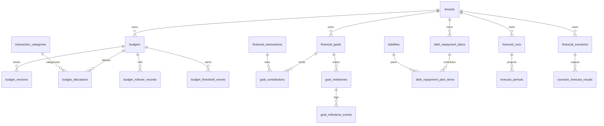

# WealthOS — Stage 7 Database Schema Design Specification
## Enterprise Budgeting, Financial Goals & Forecasting Engine

**Document Version:** 1.0.0  
**Status:** Approved Technical Design  
**Date:** 2026-11-08  
**Author:** Google DeepMind / Antigravity Agentic Engineering  
**Approved Baseline:** Phase 4 Engine (`e4fe49b`), Stages 2–6 Standards

---

## 1. Executive Summary

This document specifies the database schema for **Stage 7: Enterprise Budgeting, Financial Goals & Forecasting Engine**.

All tables use:
- **UUID Primary Keys:** Generated via PostgreSQL `gen_random_uuid()`.
- **Tenant Isolation:** Foreign key to `tenants(id)` on delete cascade.
- **Row-Level Security:** PostgreSQL `ROW LEVEL SECURITY` and `FORCE ROW LEVEL SECURITY` enabled on every tenant-owned table.
- **Numeric Precision:** Monetary figures use `NUMERIC(18, 4)` and Python `Decimal`. Percentages use `NUMERIC(7, 4)`. Floating-point types are strictly forbidden.
- **Auditability:** `created_at` and `updated_at` timezone-aware timestamps (`TIMESTAMPTZ`).

---

## 2. Entity Relationship Diagram (ERD)



---

## 3. Database Schema DDL (17 Relational Tables)

### 3.1 Budgeting Domain

#### Table: `budgets`
```sql
CREATE TABLE budgets (
    id UUID PRIMARY KEY DEFAULT gen_random_uuid(),
    tenant_id UUID NOT NULL REFERENCES tenants(id) ON DELETE CASCADE,
    name VARCHAR(255) NOT NULL,
    description TEXT,
    period_type VARCHAR(50) NOT NULL DEFAULT 'MONTHLY', -- MONTHLY, QUARTERLY, ANNUALLY, CUSTOM
    start_date DATE NOT NULL,
    end_date DATE NOT NULL,
    total_planned_amount NUMERIC(18, 4) NOT NULL CHECK (total_planned_amount >= 0),
    currency VARCHAR(3) NOT NULL DEFAULT 'INR',
    rollover_policy VARCHAR(50) NOT NULL DEFAULT 'NONE', -- NONE, ROLLOVER_SURPLUS, ROLLOVER_ALL
    status VARCHAR(50) NOT NULL DEFAULT 'ACTIVE', -- DRAFT, ACTIVE, PAUSED, COMPLETED, ARCHIVED
    version_number INTEGER NOT NULL DEFAULT 1,
    is_active BOOLEAN NOT NULL DEFAULT TRUE,
    created_at TIMESTAMPTZ NOT NULL DEFAULT NOW(),
    updated_at TIMESTAMPTZ NOT NULL DEFAULT NOW(),
    CONSTRAINT chk_budget_dates CHECK (end_date >= start_date)
);
CREATE INDEX idx_budgets_tenant ON budgets(tenant_id, status);
CREATE INDEX idx_budgets_period ON budgets(tenant_id, start_date, end_date);
```

#### Table: `budget_versions`
```sql
CREATE TABLE budget_versions (
    id UUID PRIMARY KEY DEFAULT gen_random_uuid(),
    tenant_id UUID NOT NULL REFERENCES tenants(id) ON DELETE CASCADE,
    budget_id UUID NOT NULL REFERENCES budgets(id) ON DELETE CASCADE,
    version_number INTEGER NOT NULL,
    total_planned_amount NUMERIC(18, 4) NOT NULL,
    allocations_snapshot JSONB NOT NULL,
    change_reason VARCHAR(255),
    created_at TIMESTAMPTZ NOT NULL DEFAULT NOW(),
    CONSTRAINT uq_budget_version UNIQUE (tenant_id, budget_id, version_number)
);
```

#### Table: `budget_allocations`
```sql
CREATE TABLE budget_allocations (
    id UUID PRIMARY KEY DEFAULT gen_random_uuid(),
    tenant_id UUID NOT NULL REFERENCES tenants(id) ON DELETE CASCADE,
    budget_id UUID NOT NULL REFERENCES budgets(id) ON DELETE CASCADE,
    category_id UUID NOT NULL REFERENCES transaction_categories(id) ON DELETE RESTRICT,
    allocated_amount NUMERIC(18, 4) NOT NULL CHECK (allocated_amount >= 0),
    rollover_amount NUMERIC(18, 4) NOT NULL DEFAULT 0,
    effective_amount NUMERIC(18, 4) GENERATED ALWAYS AS (allocated_amount + rollover_amount) STORED,
    notes TEXT,
    created_at TIMESTAMPTZ NOT NULL DEFAULT NOW(),
    updated_at TIMESTAMPTZ NOT NULL DEFAULT NOW(),
    CONSTRAINT uq_budget_alloc_cat UNIQUE (tenant_id, budget_id, category_id)
);
CREATE INDEX idx_budget_alloc_cat ON budget_allocations(tenant_id, category_id);
```

#### Table: `budget_rollover_records`
```sql
CREATE TABLE budget_rollover_records (
    id UUID PRIMARY KEY DEFAULT gen_random_uuid(),
    tenant_id UUID NOT NULL REFERENCES tenants(id) ON DELETE CASCADE,
    from_budget_id UUID NOT NULL REFERENCES budgets(id) ON DELETE RESTRICT,
    to_budget_id UUID NOT NULL REFERENCES budgets(id) ON DELETE CASCADE,
    category_id UUID NOT NULL REFERENCES transaction_categories(id) ON DELETE RESTRICT,
    surplus_deficit_amount NUMERIC(18, 4) NOT NULL,
    applied_amount NUMERIC(18, 4) NOT NULL,
    created_at TIMESTAMPTZ NOT NULL DEFAULT NOW()
);
```

#### Table: `budget_threshold_events`
```sql
CREATE TABLE budget_threshold_events (
    id UUID PRIMARY KEY DEFAULT gen_random_uuid(),
    tenant_id UUID NOT NULL REFERENCES tenants(id) ON DELETE CASCADE,
    budget_id UUID NOT NULL REFERENCES budgets(id) ON DELETE CASCADE,
    category_id UUID REFERENCES transaction_categories(id) ON DELETE SET NULL,
    threshold_percentage NUMERIC(5, 2) NOT NULL, -- 50.00, 75.00, 90.00, 100.00
    actual_amount NUMERIC(18, 4) NOT NULL,
    planned_amount NUMERIC(18, 4) NOT NULL,
    is_projected BOOLEAN NOT NULL DEFAULT FALSE,
    notified_at TIMESTAMPTZ NOT NULL DEFAULT NOW(),
    CONSTRAINT uq_budget_threshold UNIQUE (tenant_id, budget_id, category_id, threshold_percentage, is_projected)
);
```

#### Tables: `budget_templates` & `budget_template_allocations`
```sql
CREATE TABLE budget_templates (
    id UUID PRIMARY KEY DEFAULT gen_random_uuid(),
    name VARCHAR(255) NOT NULL,
    description TEXT,
    is_system BOOLEAN NOT NULL DEFAULT FALSE,
    created_at TIMESTAMPTZ NOT NULL DEFAULT NOW()
);

CREATE TABLE budget_template_allocations (
    id UUID PRIMARY KEY DEFAULT gen_random_uuid(),
    template_id UUID NOT NULL REFERENCES budget_templates(id) ON DELETE CASCADE,
    category_name VARCHAR(100) NOT NULL,
    allocation_percentage NUMERIC(5, 2) NOT NULL CHECK (allocation_percentage > 0 AND allocation_percentage <= 100),
    created_at TIMESTAMPTZ NOT NULL DEFAULT NOW()
);
```

---

### 3.2 Financial Goals Domain

#### Table: `financial_goals`
```sql
CREATE TABLE financial_goals (
    id UUID PRIMARY KEY DEFAULT gen_random_uuid(),
    tenant_id UUID NOT NULL REFERENCES tenants(id) ON DELETE CASCADE,
    name VARCHAR(255) NOT NULL,
    description TEXT,
    goal_type VARCHAR(50) NOT NULL, -- EMERGENCY_FUND, REAL_ESTATE, VEHICLE, EDUCATION, WEDDING, RETIREMENT, DEBT_PAYOFF, CUSTOM
    target_amount NUMERIC(18, 4) NOT NULL CHECK (target_amount > 0),
    current_amount NUMERIC(18, 4) NOT NULL DEFAULT 0 CHECK (current_amount >= 0),
    currency VARCHAR(3) NOT NULL DEFAULT 'INR',
    start_date DATE NOT NULL,
    target_date DATE NOT NULL,
    priority VARCHAR(20) NOT NULL DEFAULT 'MEDIUM', -- LOW, MEDIUM, HIGH, CRITICAL
    status VARCHAR(50) NOT NULL DEFAULT 'ACTIVE', -- DRAFT, ACTIVE, ON_TRACK, AT_RISK, ACHIEVED, PAUSED, CANCELLED
    linked_account_id UUID REFERENCES financial_accounts(id) ON DELETE SET NULL,
    created_at TIMESTAMPTZ NOT NULL DEFAULT NOW(),
    updated_at TIMESTAMPTZ NOT NULL DEFAULT NOW(),
    CONSTRAINT chk_goal_dates CHECK (target_date >= start_date)
);
CREATE INDEX idx_fin_goals_tenant ON financial_goals(tenant_id, status);
```

#### Table: `goal_contributions`
```sql
CREATE TABLE goal_contributions (
    id UUID PRIMARY KEY DEFAULT gen_random_uuid(),
    tenant_id UUID NOT NULL REFERENCES tenants(id) ON DELETE CASCADE,
    goal_id UUID NOT NULL REFERENCES financial_goals(id) ON DELETE CASCADE,
    financial_transaction_id UUID REFERENCES financial_transactions(id) ON DELETE SET NULL,
    contribution_date DATE NOT NULL,
    amount NUMERIC(18, 4) NOT NULL CHECK (amount > 0),
    currency VARCHAR(3) NOT NULL DEFAULT 'INR',
    source VARCHAR(50) NOT NULL DEFAULT 'MANUAL', -- MANUAL, LINKED_TRANSACTION, ACCOUNT_ALLOCATION
    notes TEXT,
    created_at TIMESTAMPTZ NOT NULL DEFAULT NOW()
);
CREATE INDEX idx_goal_contrib_goal ON goal_contributions(tenant_id, goal_id, contribution_date);
```

#### Tables: `goal_milestones` & `goal_milestone_events`
```sql
CREATE TABLE goal_milestones (
    id UUID PRIMARY KEY DEFAULT gen_random_uuid(),
    tenant_id UUID NOT NULL REFERENCES tenants(id) ON DELETE CASCADE,
    goal_id UUID NOT NULL REFERENCES financial_goals(id) ON DELETE CASCADE,
    milestone_name VARCHAR(100) NOT NULL,
    target_percentage NUMERIC(5, 2) NOT NULL CHECK (target_percentage > 0 AND target_percentage <= 100),
    target_amount NUMERIC(18, 4) NOT NULL,
    is_achieved BOOLEAN NOT NULL DEFAULT FALSE,
    achieved_at TIMESTAMPTZ,
    created_at TIMESTAMPTZ NOT NULL DEFAULT NOW(),
    CONSTRAINT uq_goal_milestone UNIQUE (tenant_id, goal_id, target_percentage)
);

CREATE TABLE goal_milestone_events (
    id UUID PRIMARY KEY DEFAULT gen_random_uuid(),
    tenant_id UUID NOT NULL REFERENCES tenants(id) ON DELETE CASCADE,
    milestone_id UUID NOT NULL REFERENCES goal_milestones(id) ON DELETE CASCADE,
    achieved_amount NUMERIC(18, 4) NOT NULL,
    achieved_date DATE NOT NULL,
    created_at TIMESTAMPTZ NOT NULL DEFAULT NOW()
);
```

---

### 3.3 Debt Repayment Planning Domain

#### Table: `debt_repayment_plans`
```sql
CREATE TABLE debt_repayment_plans (
    id UUID PRIMARY KEY DEFAULT gen_random_uuid(),
    tenant_id UUID NOT NULL REFERENCES tenants(id) ON DELETE CASCADE,
    plan_name VARCHAR(255) NOT NULL,
    strategy VARCHAR(50) NOT NULL, -- SNOWBALL, AVALANCHE, CUSTOM
    monthly_extra_payment NUMERIC(18, 4) NOT NULL DEFAULT 0 CHECK (monthly_extra_payment >= 0),
    currency VARCHAR(3) NOT NULL DEFAULT 'INR',
    is_active BOOLEAN NOT NULL DEFAULT TRUE,
    created_at TIMESTAMPTZ NOT NULL DEFAULT NOW(),
    updated_at TIMESTAMPTZ NOT NULL DEFAULT NOW()
);
CREATE INDEX idx_debt_plans_tenant ON debt_repayment_plans(tenant_id);
```

#### Table: `debt_repayment_plan_items`
```sql
CREATE TABLE debt_repayment_plan_items (
    id UUID PRIMARY KEY DEFAULT gen_random_uuid(),
    tenant_id UUID NOT NULL REFERENCES tenants(id) ON DELETE CASCADE,
    plan_id UUID NOT NULL REFERENCES debt_repayment_plans(id) ON DELETE CASCADE,
    liability_id UUID NOT NULL REFERENCES liabilities(id) ON DELETE RESTRICT,
    priority_order INTEGER NOT NULL CHECK (priority_order > 0),
    simulated_payoff_date DATE NOT NULL,
    simulated_total_interest NUMERIC(18, 4) NOT NULL,
    created_at TIMESTAMPTZ NOT NULL DEFAULT NOW(),
    CONSTRAINT uq_debt_plan_item UNIQUE (tenant_id, plan_id, liability_id)
);
```

---

### 3.4 Forecasting & Scenario Simulation Domain

#### Table: `forecast_runs`
```sql
CREATE TABLE forecast_runs (
    id UUID PRIMARY KEY DEFAULT gen_random_uuid(),
    tenant_id UUID NOT NULL REFERENCES tenants(id) ON DELETE CASCADE,
    run_date DATE NOT NULL,
    data_cutoff_timestamp TIMESTAMPTZ NOT NULL,
    horizon_days INTEGER NOT NULL CHECK (horizon_days > 0),
    historical_window_days INTEGER NOT NULL DEFAULT 90,
    forecast_type VARCHAR(50) NOT NULL, -- CASH_FLOW, NET_WORTH, HYBRID
    data_quality_status VARCHAR(50) NOT NULL DEFAULT 'HIGH_CONFIDENCE', -- HIGH_CONFIDENCE, MODERATE_CONFIDENCE, LOW_CONFIDENCE
    assumptions JSONB NOT NULL DEFAULT '{}'::jsonb,
    created_at TIMESTAMPTZ NOT NULL DEFAULT NOW()
);
CREATE INDEX idx_forecast_runs_tenant ON forecast_runs(tenant_id, run_date DESC);
```

#### Table: `forecast_periods`
```sql
CREATE TABLE forecast_periods (
    id UUID PRIMARY KEY DEFAULT gen_random_uuid(),
    tenant_id UUID NOT NULL REFERENCES tenants(id) ON DELETE CASCADE,
    forecast_run_id UUID NOT NULL REFERENCES forecast_runs(id) ON DELETE CASCADE,
    period_date DATE NOT NULL,
    projected_inflows NUMERIC(18, 4) NOT NULL DEFAULT 0,
    projected_outflows NUMERIC(18, 4) NOT NULL DEFAULT 0,
    projected_net_cash_flow NUMERIC(18, 4) NOT NULL,
    projected_cash_balance NUMERIC(18, 4) NOT NULL,
    projected_net_worth NUMERIC(18, 4),
    created_at TIMESTAMPTZ NOT NULL DEFAULT NOW(),
    CONSTRAINT uq_forecast_period UNIQUE (tenant_id, forecast_run_id, period_date)
);
CREATE INDEX idx_forecast_periods_date ON forecast_periods(tenant_id, forecast_run_id, period_date);
```

#### Table: `financial_scenarios`
```sql
CREATE TABLE financial_scenarios (
    id UUID PRIMARY KEY DEFAULT gen_random_uuid(),
    tenant_id UUID NOT NULL REFERENCES tenants(id) ON DELETE CASCADE,
    name VARCHAR(255) NOT NULL,
    description TEXT,
    base_forecast_run_id UUID REFERENCES forecast_runs(id) ON DELETE SET NULL,
    input_parameters JSONB NOT NULL, -- e.g. {"income_delta": 10000, "rent_increase_pct": 15}
    time_horizon_months INTEGER NOT NULL DEFAULT 12 CHECK (time_horizon_months > 0),
    status VARCHAR(50) NOT NULL DEFAULT 'ACTIVE',
    created_at TIMESTAMPTZ NOT NULL DEFAULT NOW(),
    updated_at TIMESTAMPTZ NOT NULL DEFAULT NOW()
);
CREATE INDEX idx_fin_scenarios_tenant ON financial_scenarios(tenant_id);
```

#### Table: `scenario_forecast_results`
```sql
CREATE TABLE scenario_forecast_results (
    id UUID PRIMARY KEY DEFAULT gen_random_uuid(),
    tenant_id UUID NOT NULL REFERENCES tenants(id) ON DELETE CASCADE,
    scenario_id UUID NOT NULL REFERENCES financial_scenarios(id) ON DELETE CASCADE,
    projected_cash_balance NUMERIC(18, 4) NOT NULL,
    projected_net_savings NUMERIC(18, 4) NOT NULL,
    projected_net_worth NUMERIC(18, 4) NOT NULL,
    debt_free_date DATE,
    simulation_summary JSONB NOT NULL DEFAULT '{}'::jsonb,
    created_at TIMESTAMPTZ NOT NULL DEFAULT NOW()
);
```

---

## 4. PostgreSQL Row-Level Security Policies

Every tenant table enforces `ROW LEVEL SECURITY` and `FORCE ROW LEVEL SECURITY`.

```sql
ALTER TABLE budgets ENABLE ROW LEVEL SECURITY;
ALTER TABLE budgets FORCE ROW LEVEL SECURITY;
CREATE POLICY budgets_tenant_isolation ON budgets
    FOR ALL
    USING (NULLIF(current_setting('app.current_tenant_id', true), '') IS NOT NULL 
           AND tenant_id = NULLIF(current_setting('app.current_tenant_id', true), '')::uuid)
    WITH CHECK (NULLIF(current_setting('app.current_tenant_id', true), '') IS NOT NULL 
                AND tenant_id = NULLIF(current_setting('app.current_tenant_id', true), '')::uuid);
```
*(Applied identically across all 17 Stage 7 tables).*

The runtime application role `wealthos_app` has `NOSUPERUSER NOBYPASSRLS`. Queries without a valid tenant context fail closed (0 rows returned or SQL exception).
