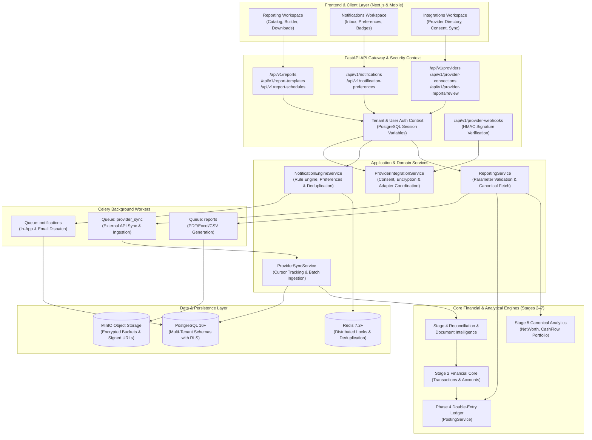
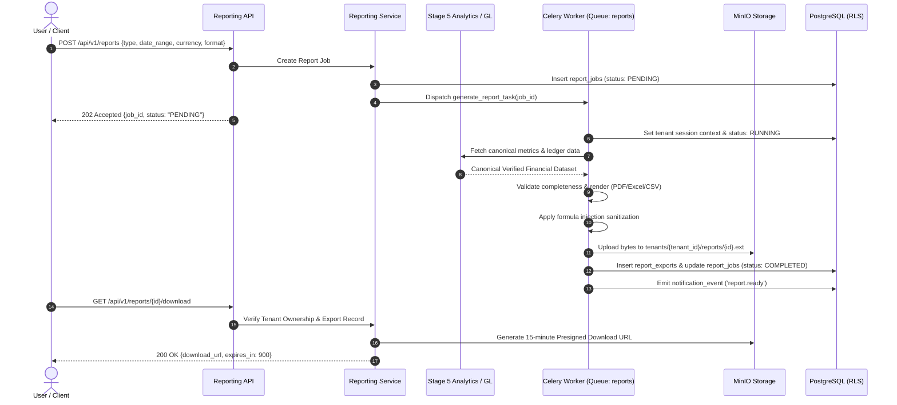
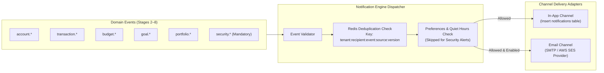
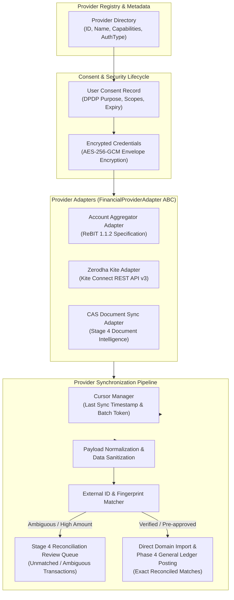

# WealthOS — Stage 8 Technical Architecture Specification
## Enterprise Reports, Notifications & Financial Provider Integrations

**Document Version:** 1.0.0  
**Date:** 2026-11-08  
**Repository:** `Livesh-L-28/WealthOS`  
**Active Branch:** `feature/final-financial-intelligence-production`  
**Approved Baseline Commit (Phase 4):** `e4fe49bb50aa41b790e86dd779efcf4bcc1b1a40`  
**Architecture Paradigm:** Modular Monolith with Asynchronous Celery Workers & PostgreSQL RLS

---

## 1. System Architecture Overview

Stage 8 integrates three core subsystems into WealthOS:
1. **Reporting Subsystem:** Orchestrates financial report compilation, calculation validation, multi-format rendering (PDF, Excel, CSV), secure object storage in MinIO, and scheduled delivery.
2. **Notification Subsystem:** Evaluates domain events, user preferences, and quiet hours to dispatch in-app messages and emails while guaranteeing deduplication and non-suppression of security alerts.
3. **Provider Integration Subsystem:** Manages external financial data sources under explicit user consent, envelope-encrypted credentials (AES-256-GCM), adapter-based data fetching, incremental cursor tracking, and validation routing to Stage 4 reconciliation.



---

## 2. Subsystem Architecture

### 2.1 Subsystem 1: Reporting Engine & Export Pipelines

The reporting engine enforces a strict separation between report calculation and presentation formatting.



#### Export Specifications:
- **PDF Exporter (`PdfReportExporter`):** Built with `reportlab.platypus`. Implements `SimpleDocTemplate`, `Paragraph`, `Table`, `Spacer`, and dynamic `PageTemplate` with running headers, confidentiality footers, currency watermarks, and auto-pagination (`Page X of Y`).
- **Excel Exporter (`ExcelReportExporter`):** Built with `openpyxl`. Generates multi-sheet workbooks (`Executive Summary`, `Transactions`, `Holdings`, `Methodology`). Explicitly enforces numeric types for amounts (`#,##0.00`), ISO date formatting, column auto-fit, header freeze panes, and strict string escaping (`'`).
- **CSV Exporter (`CsvReportExporter`):** Standard RFC 4180 CSV serialization with UTF-8 BOM for universal spreadsheet compatibility. Prefixes cells starting with `=`, `+`, `-`, `@`, `\t`, or `\r` with `'` to mitigate CVE-1236 Formula Injection.

---

### 2.2 Subsystem 2: Notification Engine & Multi-Channel Dispatch

A centralized event-driven architecture processes system occurrences across all 9 domains:



#### Notification Invariants:
1. **Mandatory Security Alerts:** Events with category `SECURITY` (logins, password changes, MFA updates, provider connection/revocation) bypass user suppressions, quiet hours, and frequency digests.
2. **Fail-Closed Deduplication:** Evaluated before channel dispatch using atomic Redis `SET NX EX 86400` with the composite key:
   $$\text{Key} = \text{tenant\_id} : \text{user\_id} : \text{event\_type} : \text{source\_id} : \text{version\_hash}$$
3. **Authorization Re-evaluation:** Deep links in notifications point to UI routes (e.g. `/transactions/{id}`). The UI and API strictly re-verify tenant permissions before serving data; notifications convey zero ambient authorization.

---

### 2.3 Subsystem 3: Financial Provider Integration Framework

The provider framework isolates external third-party communication from internal financial accounting:



---

## 3. Cryptographic Security Model

### 3.1 Credential Envelope Encryption (AES-256-GCM)
External provider credentials (tokens, refresh tokens, client secrets) are encrypted before writing to `provider_credentials`:
- **Cipher:** AES-256 in Galois/Counter Mode (GCM), providing confidentiality and tamper-evident authenticated data integrity.
- **Key Derivation:** Master key `ENCRYPTION_MASTER_KEY` configured in settings (min 32 bytes). Tenant-specific keys are derived using HKDF-SHA256:
  $$K_{\text{tenant}} = \text{HKDF-SHA256}(\text{IKM}=\text{MasterKey}, \text{Salt}=\text{tenant\_id}, \text{Info}=\text{"wealthos-provider-credential"})$$
- **Payload Structure:** Each encrypted row stores:
  - `iv`: 12-byte randomly generated nonce.
  - `ciphertext`: AES-GCM encrypted payload.
  - `auth_tag`: 16-byte GCM authentication tag.
  - `key_version`: Version identifier enabling zero-downtime key rotation.

### 3.2 Webhook Security & Anti-Replay
Incoming provider webhooks (e.g. Account Aggregator consent notifications) must be cryptographically verified:
1. **Signature Verification:** Compute HMAC-SHA256 over raw request body using provider-configured webhook secret:
   $$\text{ExpectedSig} = \text{HMAC-SHA256}(K_{\text{secret}}, \text{RawBody})$$
   Compare using constant-time comparison `hmac.compare_digest`.
2. **Timestamp Freshness:** Webhook timestamp must be within $\pm 300$ seconds (5 minutes) of server UTC time to prevent replay attacks.
3. **Event Idempotency:** The provider event ID is recorded in `provider_webhook_events` with a unique constraint. Duplicate deliveries return HTTP 200 without re-processing.

### 3.3 Spreadsheet Formula Injection Mitigation (CWE-1236)
When exporting to CSV or Excel, user-controlled strings (e.g. transaction descriptions, account names, merchant labels) are sanitized:
- Any field beginning with `=`, `+`, `-`, `@`, `\t`, or `\r` is escaped by prepending a single quote `'`.
- In openpyxl exports, cells are explicitly typed as string or numeric, preventing Excel formula evaluation engines from interpreting text as active commands.

---

## 4. Database Architecture & Table Inventory

The Stage 8 database design introduces 17 normalized, tenant-isolated tables under PostgreSQL Row-Level Security:

### 4.1 Reporting Subsystem Tables
1. **`report_definitions`:** Registry of available report types (Wealth Overview, Income, Expense, Cash Flow, etc.) and parameter schemas.
2. **`report_templates`:** User-defined or system preset configurations (selected metrics, filters, layout options).
3. **`report_jobs`:** Execution records tracking report generation lifecycle (`PENDING`, `RUNNING`, `COMPLETED`, `FAILED`, `CANCELLED`).
4. **`report_exports`:** Metadata for generated files in MinIO (`file_path`, `format`, `file_size_bytes`, `sha256_hash`, `expires_at`).
5. **`report_schedules`:** Recurring generation schedules (frequency, cron expression, timezone, active status).

### 4.2 Notification Subsystem Tables
6. **`notification_events`:** Immutable domain event log (`event_type`, `category`, `source_id`, `payload`, `emitted_at`).
7. **`notifications`:** In-app inbox entries (`user_id`, `title`, `message`, `category`, `priority`, `read_at`, `archived_at`, `action_url`).
8. **`notification_preferences`:** User delivery settings per category and channel (in-app, email, immediate, daily digest).
9. **`notification_quiet_hours`:** Configured suppression windows (start time, end time, timezone).
10. **`notification_delivery_attempts`:** Delivery status log per channel (`status`, `provider_response`, `attempt_count`, `next_retry_at`).

### 4.3 Provider Integration Subsystem Tables
11. **`financial_providers`:** System provider catalog (`provider_key`, `name`, `category`, `status`, `capabilities_json`).
12. **`provider_consents`:** User consent agreements (`scopes_granted`, `purpose`, `valid_until`, `revoked_at`, `dpdp_notice_version`).
13. **`provider_credentials`:** Envelope-encrypted authentication secrets (`encrypted_data`, `iv`, `auth_tag`, `key_version`, `expires_at`).
14. **`provider_connections`:** Active provider link per tenant (`status`, `account_count`, `last_successful_sync_at`, `health_status`).
15. **`provider_sync_jobs`:** Individual sync execution history (`sync_type`, `records_fetched`, `records_imported`, `records_failed`, `status`).
16. **`provider_sync_cursors`:** Resilient incremental cursor storage (`cursor_token`, `last_item_timestamp`, `cursor_metadata`).
17. **`provider_webhook_events`:** Webhook idempotency and verification log (`provider_id`, `event_id`, `signature_verified`, `payload`).

---

## 5. PostgreSQL Row-Level Security (RLS) Policy

Every tenant-owned table in Stage 8 enforces PostgreSQL RLS and `FORCE ROW LEVEL SECURITY`:

```sql
-- Pattern applied to all Stage 8 tenant tables
ALTER TABLE report_jobs ENABLE ROW LEVEL SECURITY;
ALTER TABLE report_jobs FORCE ROW LEVEL SECURITY;

CREATE POLICY report_jobs_tenant_isolation ON report_jobs
    AS RESTRICTIVE
    USING (tenant_id = NULLIF(current_setting('app.current_tenant_id', true), '')::uuid)
    WITH CHECK (tenant_id = NULLIF(current_setting('app.current_tenant_id', true), '')::uuid);
```

The runtime role `wealthos_app` has `NOSUPERUSER NOBYPASSRLS`. Any query executed without setting `app.current_tenant_id` fails closed with 0 rows or an error.

---

## 6. Architecture Verification & Invariance Checklist

| Requirement | Architectural Guarantee | Verification Mechanism |
| :--- | :--- | :--- |
| **No Disabling of Security Alerts** | `NotificationEngineService` intercepts `SECURITY` events before applying preference filters | Unit test `test_security_notification_cannot_be_disabled` |
| **Formula Injection Defense** | `sanitize_formula_prefix` applied to all CSV/Excel text cells | Unit test `test_csv_and_excel_formula_sanitization` |
| **Zero Plaintext Credentials** | AES-256-GCM envelope encryption with unique IV and auth tag | Unit test `test_provider_credentials_encryption_at_rest` |
| **No Fake Integrations** | Providers declare explicit capability matrix and licensing status; uncredentialed adapters marked `REQUIRES_APPROVAL` | Integration test `test_provider_status_and_capabilities` |
| **RLS Multi-Tenant Isolation** | All 17 tables enforce `FORCE ROW LEVEL SECURITY` | Multi-tenant test `test_stage_8_tenant_isolation` |
| **Regression Safety** | All existing 127 regression tests across Phases 0–4 remain green | Full test suite execution |
