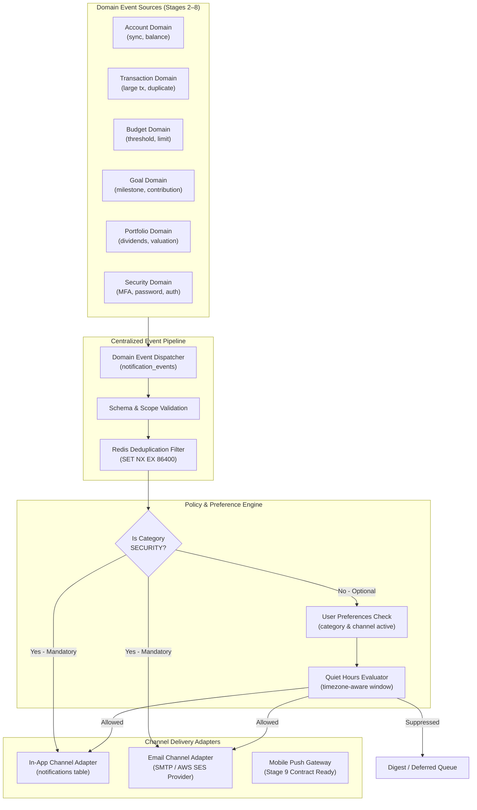

# WealthOS — Stage 8 Notification Engine Specification
## Centralized Domain Event Processing, Multi-Channel Delivery & User Preferences

**Document Version:** 1.0.0  
**Date:** 2026-11-08  
**Repository:** `Livesh-L-28/WealthOS`  
**Active Branch:** `feature/final-financial-intelligence-production`  
**Approved Baseline Commit (Phase 4):** `e4fe49bb50aa41b790e86dd779efcf4bcc1b1a40`  
**Core Technologies:** Python 3.12, Redis 7.2+, Celery 5.4, PostgreSQL 16+ RLS

---

## 1. Notification Subsystem Architecture

The WealthOS Notification Engine centralizes alert generation, rule evaluation, quiet-hours suppression, and channel dispatching across all business domains.



---

## 2. Domain Event Contracts

All domain events emitted within WealthOS follow a standardized JSON envelope:

```json
{
  "event_id": "9b1deb4d-3b7d-4bad-9bdd-2b0d7b3dcb6d",
  "event_type": "budget.threshold_reached",
  "category": "BUDGET",
  "priority": "HIGH",
  "tenant_id": "c1f72782-944f-4d3f-b64d-5847b2c55d04",
  "recipient_user_id": "8a38cbb2-1563-4bbf-a6dc-3cb7663e6396",
  "source_entity": "budgets",
  "source_id": "3e9b1102-3c87-4d7a-8fbc-1c6d3f284e32",
  "timestamp": "2026-11-08T06:45:00Z",
  "payload": {
    "budget_name": "Groceries & Dining",
    "threshold_percent": 90,
    "allocated_amount": "50000.00",
    "actual_spent": "45250.00",
    "currency": "INR"
  },
  "action_url": "/budgets/3e9b1102-3c87-4d7a-8fbc-1c6d3f284e32"
}
```

### 2.1 Complete Catalog of Supported Event Types

| Category | Event Type | Priority | Mandatory? | Description |
| :--- | :--- | :--- | :--- | :--- |
| **ACCOUNT** | `account.linked` | MEDIUM | No | Financial institution or account connected |
| **ACCOUNT** | `account.sync.completed` | LOW | No | Provider synchronization completed successfully |
| **ACCOUNT** | `account.sync.failed` | HIGH | No | Provider synchronization encountered an error |
| **ACCOUNT** | `account.connection.expiring` | HIGH | No | Provider token or consent expiring within 7 days |
| **ACCOUNT** | `account.connection.revoked` | MEDIUM | No | Provider authorization revoked |
| **TRANSACTION** | `transaction.imported` | LOW | No | Batch of new transactions ingested |
| **TRANSACTION** | `transaction.large_amount` | HIGH | No | Single transaction exceeding user-configured threshold |
| **TRANSACTION** | `transaction.duplicate_detected` | MEDIUM | No | Potential duplicate transaction flagged |
| **TRANSACTION** | `transaction.review_required` | HIGH | No | Imported transaction requires manual categorization/approval |
| **BUDGET** | `budget.threshold_reached` | MEDIUM | No | Spending reached 50%, 75%, or 90% of budget |
| **BUDGET** | `budget.limit_exceeded` | URGENT | No | Spending exceeded 100% of allocation |
| **BUDGET** | `budget.overspending_projected`| HIGH | No | Current run rate projected to exceed month-end limit |
| **GOAL** | `goal.contribution_recorded` | LOW | No | New savings contribution allocated to goal |
| **GOAL** | `goal.milestone_reached` | HIGH | No | Goal milestone achieved (e.g. 50% reached) |
| **GOAL** | `goal.at_risk` | HIGH | No | Contribution velocity lagging behind required schedule |
| **GOAL** | `goal.achieved` | URGENT | No | Goal target amount fully accumulated |
| **INVESTMENT** | `portfolio.valuation_updated`| LOW | No | Monthly or batch market revaluation completed |
| **INVESTMENT** | `dividend.expected` | LOW | No | Corporate action dividend announced |
| **INVESTMENT** | `dividend.received` | MEDIUM | No | Dividend credited to bank account |
| **INVESTMENT** | `market_data.stale` | MEDIUM | No | Security price feed unavailable for > 48 hours |
| **LIABILITY** | `liability.repayment_due` | HIGH | No | Upcoming EMI or loan repayment due within 3 days |
| **LIABILITY** | `liability.repayment_overdue`| URGENT | No | Scheduled repayment date passed without recorded payment |
| **FORECAST** | `forecast.negative_cash_flow`| HIGH | No | Projected liquidity deficit in upcoming 30 days |
| **REPORT** | `report.ready` | MEDIUM | No | Asynchronous report generation completed |
| **REPORT** | `report.failed` | HIGH | No | Scheduled or on-demand report generation failed |
| **SECURITY** | `security.login_new_device` | URGENT | **YES** | User session authenticated from unrecognized IP or user-agent |
| **SECURITY** | `security.password_changed` | URGENT | **YES** | Account password updated |
| **SECURITY** | `security.mfa_updated` | URGENT | **YES** | Multi-factor authentication enabled, disabled, or reset |
| **SECURITY** | `security.provider_authorized`| HIGH | **YES** | Third-party provider access granted with specific scopes |
| **SECURITY** | `security.provider_revoked` | HIGH | **YES** | Third-party provider access revoked and credentials purged |

---

## 3. Mandatory Security Alert Policy

> [!IMPORTANT]
> **Zero Disabling of Security Notifications:**
> Notifications categorized as `SECURITY` cannot be muted, disabled, or delayed by the user.

1. **Policy Enforcement:** When `NotificationEngineService` processes an event where `category == NotificationCategory.SECURITY`, the preference filter and quiet-hours evaluation are bypassed completely.
2. **Channel Dispatch:** Security alerts are delivered immediately to the **In-App Inbox** AND dispatched via the **Email Channel** to the verified user email on record.
3. **Audit Trail:** Security notifications record an immutable audit event in `audit_logs` linking the alert to the triggering session.

---

## 4. Deduplication & Distributed State Invariance

To prevent duplicate alerts arising from Celery task retries, parallel worker processing, or repeated event emissions:
1. **Deduplication Key Formulation:**
   $$\text{DedupeKey} = \text{tenant\_id} : \text{recipient\_user\_id} : \text{event\_type} : \text{source\_id} : \text{state\_hash}$$
   Where $\text{state\_hash} = \text{MD5}(\text{payload.threshold} + \text{payload.status} + \text{payload.date})$.
2. **Atomic Verification:**
   Before delivering the notification, the worker calls:
   ```python
   is_new = await redis_client.set(
       f"notif_dedupe:{dedupe_key}",
       "1",
       nx=True,
       ex=86400,  # 24-hour suppression window
   )
   if not is_new:
       logger.info(f"Duplicate notification suppressed: {dedupe_key}")
       return
   ```

---

## 5. Quiet Hours & Preference Management

### 5.1 User Preferences Schema (`notification_preferences`)
Users configure notification channels and frequency per category:
- **Channels:** `in_app` (boolean), `email` (boolean).
- **Frequency:** `IMMEDIATE`, `DAILY_DIGEST`, `WEEKLY_DIGEST`, `MUTED` (muted disallowed for `SECURITY`).

### 5.2 Quiet Hours Window (`notification_quiet_hours`)
- Configurable window (e.g. `22:00` to `07:00`).
- Evaluated against the user's localized timezone (e.g. `Asia/Kolkata`).
- Non-critical notifications (`LOW`, `MEDIUM`) generated during quiet hours are queued for release at the end of the window.
- Urgent notifications (`URGENT`, such as `security.*` or `budget.limit_exceeded`) override quiet hours.

---

## 6. Multi-Channel Delivery Adapters

### 6.1 In-App Notification Channel (`InAppNotificationChannel`)
- Writes directly to the `notifications` table under PostgreSQL RLS:
  - Columns: `id`, `tenant_id`, `user_id`, `event_type`, `category`, `priority`, `title`, `message`, `action_url`, `read_at`, `archived_at`, `created_at`.
- Provides instant unread badge counts via `/api/v1/notifications/unread-count`.
- Full pagination, filtering by category, single mark-as-read, and atomic mark-all-as-read endpoints.
- **Deep Link Security:** `action_url` (e.g. `/accounts/{id}`) contains zero ambient authentication tokens. When the frontend routes the user, the target API endpoint validates tenant membership and permissions independently.

### 6.2 Email Notification Channel (`EmailNotificationChannel`)
- **Data Minimization:** Email subject lines and notification previews MUST NEVER expose exact account numbers, full balances, or sensitive transaction descriptions.
  - *Compliant Subject:* "WealthOS Alert: Unusual spending detected in your Food category"
  - *Non-Compliant Subject:* "You spent ₹25,400 at The Taj Hotel on Account 4092"
- **Expiring Action Links:** Financial action buttons contain expiring single-use authenticated action tokens (valid for 15 minutes) or require the user to log in before viewing the sensitive resource.
- **Delivery Protocol:** Modular adapter supporting standard SMTP (development/local) and Amazon SES / SendGrid (production).
- **Bounce & Unsubscribe:** Implements standard `List-Unsubscribe` headers and records delivery attempt status in `notification_delivery_attempts`.

### 6.3 Mobile Push Readiness (Stage 9 Handshake)
- The notification engine defines the `PushNotificationPayload` schema and registers the `PushGatewayAdapter` interface.
- Device token registration (`device_tokens` table) and APNS/FCM dispatch workflows are architected to attach seamlessly without refactoring core notification pipelines.
