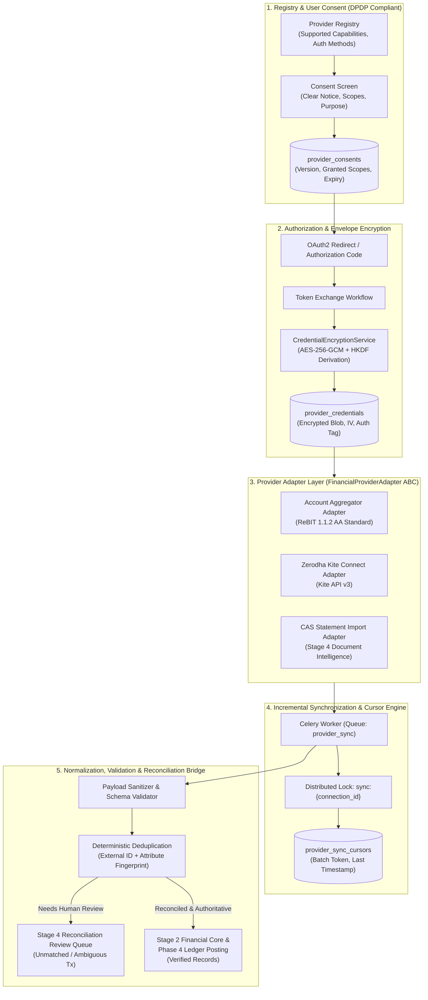
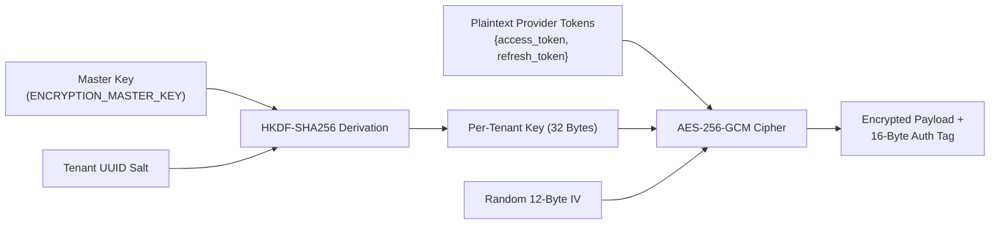

# WealthOS — Stage 8 Financial Provider Integration Specification
## Secure Provider Registry, Consent Management, Envelope Encryption & Sync Engine

**Document Version:** 1.0.0  
**Date:** 2026-11-08  
**Repository:** `Livesh-L-28/WealthOS`  
**Active Branch:** `feature/final-financial-intelligence-production`  
**Approved Baseline Commit (Phase 4):** `e4fe49bb50aa41b790e86dd779efcf4bcc1b1a40`  
**Core Technologies:** Python 3.12, cryptography 42.0+ (AES-256-GCM), Redis 7.2+, PostgreSQL 16+ RLS

---

## 1. Provider Integration Architecture

WealthOS provides a secure, adapter-based framework to ingest external financial records while preserving the double-entry accounting engine and PostgreSQL Row-Level Security as the authoritative truth.



---

## 2. Provider Registry & Capability Flags

The Provider Registry (`financial_providers`) defines metadata and supported operations for each integrated financial institution or aggregator.

### 2.1 Provider Status Lifecycle
- `AVAILABLE`: Fully configured, tested, and operational.
- `BETA`: Operational in pilot mode with selected tenants.
- `REQUIRES_CONFIGURATION`: Adapter implemented, awaiting API keys or tenant configuration.
- `REQUIRES_APPROVAL`: External provider approval, regulatory registration (e.g. FIU license), or contractual access required.
- `DEPRECATED`: Provider scheduled for sunset.

### 2.2 Provider Capability Matrix

| Provider Key | Provider Name | Category | Status | Supported Capabilities |
| :--- | :--- | :--- | :--- | :--- |
| `rbi_account_aggregator` | RBI Account Aggregator | `BANK_AGGREGATOR` | `REQUIRES_APPROVAL` | `BANK_ACCOUNTS`, `BALANCES`, `TRANSACTIONS`, `PERIODIC_SYNC` |
| `zerodha_kite` | Zerodha Kite Connect | `BROKER` | `REQUIRES_CONFIGURATION` | `EQUITY_HOLDINGS`, `MUTUAL_FUNDS`, `TRANSACTIONS`, `MARKET_PRICES` |
| `cams_kfintech_cas` | CAMS / KFintech CAS | `DOCUMENT_SYNC` | `AVAILABLE` | `MUTUAL_FUNDS`, `PORTFOLIO_VALUATIONS`, `TRANSACTIONS` |
| `plaid_international` | Plaid (International) | `BANK_AGGREGATOR` | `REQUIRES_APPROVAL` | `INTERNATIONAL_BANKS`, `BALANCES`, `TRANSACTIONS` |

---

## 3. Abstract Provider Adapter Contract (`FinancialProviderAdapter`)

All financial providers implement a standardized Python Abstract Base Class (ABC):

```python
from abc import ABC, abstractmethod
from decimal import Decimal
from typing import Any
from pydantic import BaseModel
from datetime import datetime

class ExternalAccount(BaseModel):
    external_account_id: str
    account_number_mask: str  # e.g. "••••4092"
    institution_name: str
    account_type: str         # "SAVINGS", "CURRENT", "CREDIT_CARD", "DEMAT"
    currency: str             # "INR", "USD"
    current_balance: Decimal
    available_balance: Decimal | None = None
    balance_as_of: datetime

class ExternalTransaction(BaseModel):
    external_transaction_id: str
    external_account_id: str
    transaction_date: datetime
    value_date: datetime | None = None
    amount: Decimal
    currency: str
    direction: str            # "DEBIT" or "CREDIT"
    narration: str
    merchant_name: str | None = None
    category_hint: str | None = None
    status: str               # "PENDING" or "POSTED"
    raw_payload_hash: str

class ExternalHolding(BaseModel):
    instrument_symbol: str    # e.g. "RELIANCE", "INFY"
    isin: str | None = None
    quantity: Decimal
    average_buy_price: Decimal
    current_market_price: Decimal
    current_value: Decimal
    valuation_timestamp: datetime

class FinancialProviderAdapter(ABC):
    @abstractmethod
    async def get_authorization_url(self, tenant_id: str, redirect_uri: str, state: str) -> str:
        """Generate OAuth2 / consent redirection URL."""
        pass

    @abstractmethod
    async def exchange_authorization_code(self, code: str, redirect_uri: str) -> dict[str, Any]:
        """Exchange authorization code for credentials/tokens."""
        pass

    @abstractmethod
    async def refresh_credentials(self, encrypted_credentials: dict[str, Any]) -> dict[str, Any]:
        """Refresh expired access tokens using refresh token."""
        pass

    @abstractmethod
    async def revoke_authorization(self, credentials: dict[str, Any]) -> bool:
        """Call provider endpoint to formally revoke access."""
        pass

    @abstractmethod
    async def get_accounts(self, credentials: dict[str, Any]) -> list[ExternalAccount]:
        """Fetch list of linked accounts."""
        pass

    @abstractmethod
    async def get_transactions(
        self, credentials: dict[str, Any], account_id: str, cursor: str | None = None, start_date: datetime | None = None
    ) -> tuple[list[ExternalTransaction], str | None]:
        """Fetch transactions with incremental pagination cursor."""
        pass

    @abstractmethod
    async def get_holdings(self, credentials: dict[str, Any]) -> list[ExternalHolding]:
        """Fetch investment portfolio holdings."""
        pass

    @abstractmethod
    async def health_check(self) -> dict[str, Any]:
        """Check provider API connectivity and latency."""
        pass
```

---

## 4. Provider Implementation Designs

### 4.1 Indian Account Aggregator Adapter (`AccountAggregatorAdapter`)
- **Specification:** ReBIT 1.1.2 Technical Standard for Financial Information Users (FIU).
- **Consent Flow:**
  1. WealthOS generates a cryptographically signed Consent Request (XML/JSON) specifying `FIDataRange`, `consentTypes` (`TRANSACTIONS`, `PROFILE`, `SUMMARY`), and `DataLife` (expiry date).
  2. The user is redirected to the Account Aggregator handle (e.g. Setu / Sahamati / OneMoney) to approve via OTP.
  3. The AA emits an asynchronous webhook (`CONSENT_NOTIFICATION`) with `consentId` and status `ACTIVE`.
  4. WealthOS initiates a session using ephemeral Diffie-Hellman keys, exchanges financial data keys, and decrypts the encrypted payload (`FIRequest`).
- **Production Guardrail:** Because direct production FIU integration requires licensed registration and production PKI keys, the system ships with a verified ReBIT mock sandbox mode. When running without production TSP credentials, the status is marked `REQUIRES_APPROVAL`.

### 4.2 Zerodha Kite Connect Adapter (`ZerodhaKiteAdapter`)
- **Specification:** Kite Connect REST API v3.
- **Workflow:**
  1. Redirect user to `https://kite.zerodha.com/connect/login?v=3&api_key={api_key}`.
  2. User logs in with Zerodha credentials + TOTP on Zerodha's domain.
  3. Zerodha redirects back to WealthOS with `request_token`.
  4. WealthOS computes `checksum = SHA256(api_key + request_token + api_secret)` and exchanges for daily `access_token`.
  5. Holdings fetched from `GET /portfolio/holdings`; transactions from `GET /portfolio/positions`.
- **Credential Storage:** `api_key` and daily `access_token` encrypted via `CredentialEncryptionService`.

### 4.3 CAS Document Sync Adapter (`CasDocumentSyncAdapter`)
- **Specification:** Stage 4 Document Intelligence integration for Consolidated Account Statements (CAMS & KFintech).
- **Workflow:** Ingests eCAS PDF or Excel files, decrypts user PDF password in ephemeral memory, extracts scheme folios, ISINs, purchase units, and NAVs, and reconciles against Stage 3 investment accounts.

---

## 5. User Consent & Revocation (DPDP Section 6 Compliance)

WealthOS implements complete compliance with India's Digital Personal Data Protection Act, 2023:
1. **Notice & Purpose Specification:** Before connecting, the user is presented with the explicit purpose: "Import transaction history and holdings to calculate net worth and track cash flow."
2. **Granular Scopes:** Users select specific accounts and scopes (e.g. `read_balances`, `read_transactions`).
3. **Timestamped Consent Record:** Stored in `provider_consents`:
   - `tenant_id`, `user_id`, `provider_id`.
   - `scopes_granted`: `["accounts:read", "transactions:read"]`.
   - `valid_until`: User-selected expiration (e.g. 180 days).
   - `dpdp_notice_version`: `1.0.0`.
4. **Instant Revocation:** With one click, the user can revoke consent:
   - Sets `revoked_at = NOW()`.
   - Immediately invokes `adapter.revoke_authorization(credentials)`.
   - Purges all rows from `provider_credentials`.
   - Halts all scheduled Celery synchronization jobs.

---

## 6. Credential Envelope Encryption (AES-256-GCM)

Provider secrets are protected using AES-256-GCM envelope encryption:



- **Algorithm:** AES-256-GCM authenticated encryption.
- **Key Derivation:** Per-tenant keys derived via HKDF-SHA256 using `ENCRYPTION_MASTER_KEY` and `tenant_id`.
- **Integrity Guarantee:** The 16-byte authentication tag guarantees that tampering with database columns causes decryption to fail closed with `DecryptionIntegrityError`.
- **Zero Exposure:** Decrypted tokens exist only within the ephemeral memory scope of the synchronization task; they are never passed as Celery task arguments or serialized into Redis logs.

---

## 7. Synchronization Engine & Cursor Tracking

### 7.1 Sync Lifecycle & Distributed Locking
To prevent concurrent synchronization runs for the same connection:
```python
lock_key = f"provider_sync:{connection_id}"
acquired = await acquire_task_lock(redis, lock_key, owner_token, timeout_seconds=300)
if not acquired:
    logger.warning(f"Sync already running for connection {connection_id}")
    return
```

### 7.2 Incremental Cursors (`provider_sync_cursors`)
- Tracks `last_sync_timestamp`, `external_cursor_token`, and `page_number`.
- If an incremental sync fails midway through batch 4 of 10, the cursor is not advanced, ensuring idempotent replay on subsequent runs without skipping records.

### 7.3 Duplicate Detection & Accounting Integration
1. **Deduplication Key:**
   $$\text{DedupKey} = \text{MD5}(\text{tenant\_id} + \text{external\_account\_id} + \text{external\_tx\_id})$$
2. **Untrusted Payload Policy:** External payloads are never written directly to the general ledger.
   - Exact, high-confidence matches with existing pending transactions are marked `RECONCILED`.
   - New standard income/expense transactions are normalized, staged in Stage 2 `financial_transactions`, and posted to the general ledger via `PostingService.create_and_post`.
   - Ambiguous transactions, large discrepancies, or unmatched transfers are routed to the **Stage 4 Reconciliation Review Queue** for human verification.

---

## 8. Webhook Security Specification

When providers push asynchronous notifications (e.g. Account Aggregator consent approvals):
1. **Path:** `POST /api/v1/provider-webhooks/{provider_id}`
2. **HMAC Signature Check:**
   ```python
   signature = request.headers.get("X-Provider-Signature")
   expected = hmac.new(provider_secret.encode(), raw_body, hashlib.sha256).hexdigest()
   if not hmac.compare_digest(signature, expected):
       raise HTTPException(status_code=401, detail="Invalid webhook signature")
   ```
3. **Replay Defense:** The webhook payload must include a timestamp within $\pm 300$ seconds of server time.
4. **Idempotency:** Webhook event IDs are inserted into `provider_webhook_events`. Duplicates return HTTP 200 immediately without re-triggering workflows.
