# WealthOS — Stage 8 Reporting Engine Specification
## Enterprise Financial Report Definitions, Multi-Format Exporters & Scheduling

**Document Version:** 1.0.0  
**Date:** 2026-11-08  
**Repository:** `Livesh-L-28/WealthOS`  
**Active Branch:** `feature/final-financial-intelligence-production`  
**Approved Baseline Commit (Phase 4):** `e4fe49bb50aa41b790e86dd779efcf4bcc1b1a40`  
**Core Technologies:** ReportLab 4.2+, openpyxl 3.1+, Python 3.12, Celery 5.4, MinIO Object Storage

---

## 1. Reporting Engine Architecture

The WealthOS Reporting Engine compiles verified financial records and canonical analytical calculations into presentation-ready documents.

```mermaid
flowchart TD
    subgraph Request["Report Request"]
        Params["Parameters:\n- report_type\n- date_range (start, end)\n- reporting_currency\n- filters (accounts, categories)\n- format (pdf, xlsx, csv)"]
    end

    subgraph DataFetch["Canonical Data Ingestion"]
        Analytics["Stage 5 Analytics Services:\n- NetWorthAnalyticsService\n- CashFlowAnalyticsService\n- PortfolioAnalyticsService"]
        Ledger["Phase 4 Double-Entry Ledger:\n- General Ledger Trial Balance\n- BalanceService"]
        Stage2Tx["Stage 2 Transaction Store:\n- Verified Transactions & Categories"]
        Stage7Planning["Stage 7 Planning Services:\n- Budget & Goals Tracking\n- Deterministic Forecasts"]
    end

    subgraph Validation["Data Validation & Calculation Engine"]
        ValCheck["Integrity & Scope Verification:\n- Multi-currency FX Conversion\n- Date Boundary Normalization\n- Double-entry Invariance Check"]
    end

    subgraph Rendering["Format Rendering Pipeline"]
        PDF_Render["ReportLab PDF Exporter:\n- Running Headers & Footers\n- Dynamic Flowables & Tables\n- Page X of Y Pagination"]
        Excel_Render["openpyxl Excel Exporter:\n- Multi-sheet Workbook\n- Typed Cells & Numeric Formatting\n- Formula Injection Sanitization"]
        CSV_Render["RFC 4180 CSV Exporter:\n- UTF-8 with BOM\n- Dangerous Prefix Escaping (')\n- Decimal Precision Serialization"]
    end

    subgraph Storage["Private Vault Storage"]
        MinIO["MinIO Bucket: wealthos-documents\nPath: tenants/{tenant_id}/reports/{report_id}.{ext}"]
        SignedURL["Short-Lived Presigned Download URL\n(15-Minute Expiry)"]
    end

    Request --> DataFetch --> Validation --> Rendering --> Storage --> SignedURL
```

### Governing Invariants:
1. **Zero Ad-Hoc Math:** Reports never execute custom or unvetted SQL formulas. All net worth, cash flow, IRR, and portfolio metrics are fetched directly from Stage 5 analytical registries and general ledger trial balances.
2. **Deterministic Multi-Currency:** Amounts in foreign currencies must be converted using the verified exchange rate on the transaction date or valuation snapshot date. Mixing currencies without conversion is strictly disallowed.
3. **Data Freshness Disclosure:** Every generated report must clearly display the cutoff timestamp, market valuation date, and data source.

---

## 2. Specification of 12 Canonical Financial Reports

### 2.1 Wealth Overview Report (`WEALTH_OVERVIEW`)
- **Purpose:** Comprehensive executive balance sheet summarizing total wealth, net worth trajectory, and asset-liability breakdown.
- **Data Sources:** Stage 5 `NetWorthAnalyticsService`, Stage 3 `assets` and `liabilities`, Phase 4 General Ledger (`1010`–`2030`).
- **Required Sections:**
  1. **Executive Summary:** Total Assets, Total Liabilities, Net Worth, Cash & Bank Balances, Liquid Investments.
  2. **Asset Allocation Breakdown:** Cash/Equivalents, Equity, Mutual Funds, Real Estate, Precious Metals, Fixed Deposits.
  3. **Liability Profile:** Secured Loans, Unsecured Loans, Mortgages, Credit Card Balances, Weighted Average Interest Rate.
  4. **Net Worth Historical Trend:** Monthly net worth snapshots over the selected period with absolute and percentage change.
  5. **Valuation Cutoff & Data Quality:** Timestamp of latest asset valuation and verification status.

### 2.2 Income Report (`INCOME_STATEMENT`)
- **Purpose:** Detailed analysis of all earnings, distinguishing active, passive, and portfolio income.
- **Data Sources:** Stage 5 `CashFlowAnalyticsService`, Stage 2 `financial_transactions`, Stage 3 `passive_income_records`.
- **Required Sections:**
  1. **Total Income Summary:** Gross Earned Income, Passive Income, Portfolio Distributions.
  2. **Income by Stream:** Salary/Professional, Rental Income, Dividends, Interest from Deposits, Business/Other.
  3. **Period-over-Period Variance:** Comparison against prior period (e.g. Month-on-Month or Year-on-Year).
  4. **Expected vs. Received:** Reconciled income vs. anticipated dividends/interest.

### 2.3 Expense Report (`EXPENSE_STATEMENT`)
- **Purpose:** Granular breakdown of operational expenses, lifestyle outflows, and debt servicing.
- **Data Sources:** Stage 2 `financial_transactions` & `transaction_categories`, Stage 3 `liability_repayments`.
- **Required Sections:**
  1. **Total Outflow Summary:** Operational Expenses, Recurring Subscriptions, Discretionary Outlays, Debt Repayments.
  2. **Expense by Category & Merchant:** Top spending categories and top counterparties.
  3. **Fixed vs. Variable Expenses:** Necessary living costs vs. discretionary spending.
  4. **Refunds & Adjustments:** Explicit accounting for credits, reversals, and reimbursements.

### 2.4 Cash Flow Report (`CASH_FLOW`)
- **Purpose:** Direct statement of cash flows tracking actual liquidity movements.
- **Data Sources:** Stage 5 `CashFlowAnalyticsService`, Phase 4 General Ledger cash accounts (`1010`–`1020`).
- **Required Sections:**
  1. **Cash Flow Summary:** Opening Cash, Operating Inflows, Operating Outflows, Financing/Debt Servicing, Net Change, Closing Cash.
  2. **Account Movements:** Liquidity shift by bank account, wallet, and cash reserve.
  3. **Internal Transfer Neutrality:** Strict validation that transfers between owned accounts are excluded from income/expense totals.

### 2.5 Transaction History Report (`TRANSACTION_HISTORY`)
- **Purpose:** Full auditable transaction register for tax, audit, and recordkeeping purposes.
- **Data Sources:** Stage 2 `financial_transactions`, Stage 4 `reconciliation_matches`.
- **Required Columns:** Transaction Date, Value Date, Account Name, Description, Counterparty/Merchant, Category, Direction (`DEBIT`/`CREDIT`), Amount, Reporting Currency Amount, Reconciliation Status, Reference ID.

### 2.6 Investment Portfolio Report (`PORTFOLIO_PERFORMANCE`)
- **Purpose:** Institutional-grade investment portfolio report covering valuation, performance, and asset weights.
- **Data Sources:** Stage 3 `investment_holding_lots` (FIFO), `market_price_observations`, Stage 5 `PortfolioAnalyticsService`.
- **Required Sections:**
  1. **Portfolio Summary:** Total Invested Cost, Current Market Value, Absolute Gain/Loss, Unrealized P&L, Realized P&L.
  2. **Holdings Breakdown:** Symbol, Asset Class, Quantity, Average Buy Price, Current Market Price, Valuation, P&L (%), Weight (%).
  3. **Asset Allocation & Sector Weights:** Equities vs. Debt vs. Gold vs. Alternatives.
  4. **Valuation Stale Warning:** Explicit notation of any security where market price is older than 24 hours.

### 2.7 Dividend & Interest Report (`PASSIVE_INCOME`)
- **Purpose:** Schedule of all passive income received and anticipated across investments and deposits.
- **Data Sources:** Stage 3 `passive_income_records`, Stage 2 `financial_transactions`.
- **Required Sections:**
  1. **Passive Income Summary:** Total Dividends, Total Interest, Total Rental/Other, Net Tax Withheld (TDS).
  2. **Detailed Schedule:** Instrument/Asset, Pay Date, Record Date, Gross Amount, Tax Deducted at Source (TDS), Net Received, Deposited Account.
  3. **Double-Count Prevention:** Clear distinction between declared/expected income and credited bank deposits.

### 2.8 Assets & Liabilities Report (`BALANCE_SHEET`)
- **Purpose:** Point-in-time balance sheet detailing physical, digital, and fixed assets alongside all outstanding liabilities.
- **Data Sources:** Stage 3 `assets`, `liabilities`, `asset_valuations`.
- **Required Sections:**
  1. **Assets Schedule:** Real Estate (cost vs. assessed valuation), Vehicles (depreciated book value), Gold/Metals (purity & spot weight), Fixed Deposits (maturity & accrued interest).
  2. **Liabilities Schedule:** Home Loans, Vehicle Loans, Personal Loans, Education Loans, Outstanding Principal, Interest Rate, Remaining Tenure.

### 2.9 Budget Performance Report (`BUDGET_PERFORMANCE`)
- **Purpose:** Actual spending vs. budgeted limits across all active allocations.
- **Data Sources:** Stage 7 `budgets`, `budget_allocations`, Stage 2 `financial_transactions`.
- **Required Sections:**
  1. **Budget Summary:** Total Planned Budget, Actual Expenses to Date, Remaining Spending Limit, Overall Utilization (%).
  2. **Category Variance Analysis:** Category Name, Allocated Amount, Actual Spent, Variance (Over/Under), Projected Month-End Spend.
  3. **Rollover Impact:** Rollover adjustments brought forward from previous budget periods.

### 2.10 Financial Goals Report (`GOALS_PROGRESS`)
- **Purpose:** Multi-goal progress report showing contribution velocity, milestone pacing, and target feasibility.
- **Data Sources:** Stage 7 `financial_goals`, `goal_contributions`, `goal_milestones`.
- **Required Sections:**
  1. **Active Goals Roster:** Goal Name, Category, Target Amount, Current Accumulated Amount, Percentage Achieved, Target Deadline.
  2. **Pacing & Feasibility:** Required Monthly Contribution vs. Actual Average Monthly Contribution, Projected Completion Date.
  3. **Milestone Events:** Achieved milestones and celebration records.

### 2.11 Deterministic Forecast Report (`FINANCIAL_FORECAST`)
- **Purpose:** Multi-year baseline projection of net worth, cash flow, and debt payoff based on verified contracts.
- **Data Sources:** Stage 7 `forecast_runs`, `forecast_periods`, `financial_scenarios`.
- **Required Sections:**
  1. **Projection Horizon:** 1-year, 3-year, or 5-year forecast horizon with clearly identified cutoff baseline.
  2. **Forecast Summary:** Projected Net Worth at Horizon, Anticipated Annual Savings, Projected Debt Freedom Date.
  3. **Model Assumptions:** Explicitly stated inflation rate, annual investment return assumption, income growth rate.
  4. **Projection Disclaimer:** Prominent notice distinguishing mathematical projections from actual financial performance.

### 2.12 Financial Health Assessment Report (`FINANCIAL_HEALTH`)
- **Purpose:** Diagnostic health scorecard synthesizing liquidity, solvency, savings, and debt coverage metrics.
- **Data Sources:** Stage 5 `FinancialHealthEngine`, Stage 7 `debt_repayment_plans`.
- **Approved Canonical Metrics:**
  - **Savings Rate:** $\frac{\text{Net Savings}}{\text{Total Income}} \times 100\%$ (Target: $\ge 20\%$)
  - **Emergency Fund Coverage:** $\frac{\text{Liquid Assets}}{\text{Average Monthly Essential Outflows}}$ (Target: 3–6 months)
  - **Debt-to-Income (DTI) Ratio:** $\frac{\text{Total Monthly Debt Service}}{\text{Gross Monthly Income}} \times 100\%$ (Target: $\le 36\%$)
  - **Net Worth-to-Debt Ratio:** $\frac{\text{Net Worth}}{\text{Total Liabilities}}$ (Target: $\ge 1.5$)
  - **Budget Discipline Score:** $\frac{\text{Categories Within Budget}}{\text{Total Budgeted Categories}} \times 100\%$

---

## 3. Date Filtering & India-First Financial Year Support

WealthOS supports both global calendar and Indian financial year boundaries:

| Period Selector | Start Date | End Date |
| :--- | :--- | :--- |
| **Current Month** | 1st of current month | Last day of current month |
| **Previous Month** | 1st of previous month | Last day of previous month |
| **Current Quarter (Calendar)** | 1st of Jan / Apr / Jul / Oct | End of Mar / Jun / Sep / Dec |
| **Indian Financial Year (Current FY)** | April 1 of active fiscal cycle | March 31 of next calendar year |
| **Indian Financial Year (Previous FY)** | April 1 of prior fiscal cycle | March 31 of active calendar year |
| **Indian FY Q1** | April 1 | June 30 |
| **Indian FY Q2** | July 1 | September 30 |
| **Indian FY Q3** | October 1 | December 31 |
| **Indian FY Q4** | January 1 | March 31 |
| **Custom Range** | User-selected ISO Date | User-selected ISO Date |

---

## 4. Multi-Currency Reporting & FX Methodology

1. **Transaction Currency:** The original currency in which the financial event took place (e.g. USD, EUR, GBP, INR).
2. **Reporting Currency:** The tenant's selected base currency for presentation (default: INR).
3. **Conversion Rule:**
   $$\text{Reporting Amount} = \text{Original Amount} \times \text{FX Rate}(\text{TxDate}, \text{FromCurr} \to \text{ToCurr})$$
4. **Missing Rate Handling:** If no exchange rate is recorded for a historical transaction date, the reporting engine raises a `MissingFxRateException` and surfaces the missing currency pair in the report diagnostics rather than using an arbitrary fallback.

---

## 5. Multi-Format Exporter Specifications

### 5.1 PDF Exporter (`PdfReportExporter` via ReportLab)
- **Engine:** `reportlab.platypus` with custom `BaseDocTemplate` and `PageTemplate`.
- **Layout & Typography:**
  - Page Size: A4 Portrait or Landscape (for wide financial statements).
  - Fonts: Helvetica, Helvetica-Bold (embedded standard Type 1 fonts).
  - Margins: 36pt (0.5 inch) uniform margins.
  - Running Header: WealthOS logo mark, Tenant Name, Report Title, Reporting Period.
  - Running Footer: Confidentiality warning, Generation Timestamp (UTC), Page number (`Page X of Y` via two-pass canvas).
- **Tables:** `reportlab.platypus.Table` with strict column width sizing, alternating row backgrounds (`#F8FAFC` / `#FFFFFF`), right-aligned numeric columns, and bold totals rows.

### 5.2 Excel Exporter (`ExcelReportExporter` via openpyxl)
- **Engine:** `openpyxl.Workbook`.
- **Structure:**
  - Tab 1: `Executive Summary` — KPI cards, high-level metrics, and valuation metadata.
  - Tab 2+: Domain data sheets (e.g. `Income`, `Expenses`, `Holdings`).
  - Final Tab: `Methodology & Notes` — Calculation formulas, data sources, and disclaimers.
- **Styling:**
  - Headers: Dark navy fill (`#0F172A`), white bold text, row height 28pt.
  - Cell Types: Currency amounts explicitly stored as `float`/`Decimal` with number format `#,##0.00` or `[$₹-en-IN] #,##0.00`.
  - Dates: Formatted as `YYYY-MM-DD`.
  - Layout: Auto-adjusted column widths, freeze pane on header row (`A2`).

### 5.3 CSV Exporter (`CsvReportExporter` via standard csv)
- **Engine:** Python standard `csv.writer` with UTF-8 BOM (`utf-8-sig`).
- **Security & Integrity:**
  - Formula Injection Escaping: Any cell value whose string representation starts with `=`, `+`, `-`, `@`, `\t`, or `\r` is escaped with a leading single quote `'`.
  - Monetary values written as unrounded decimals (e.g. `125000.50`).
  - Dates formatted strictly as ISO-8601 (`YYYY-MM-DD`).

---

## 6. Report Scheduling & Asynchronous Execution

### 6.1 Celery Task Orchestration
- **Task:** `app.workers.report_tasks.generate_report_task`
- **Queue:** `reports`
- **Execution Limits:** `task_time_limit = 300` (5 minutes), `task_soft_time_limit = 240` (4 minutes).
- **Locking:** Atomic Redis lock `report_job:{job_id}` via `acquire_task_lock`.

### 6.2 Retention & Download Lifecycle
- Generated reports are written to MinIO private bucket `wealthos-documents` under:
  $$\text{Path} = \text{tenants}/\{\text{tenant\_id}\}/\text{reports}/\{\text{report\_id}\}/\{\text{filename}\}$$
- Reports have a default retention of 90 days.
- Downloads are served exclusively through 15-minute expiring presigned S3 URLs generated after authenticating the requesting user's tenant membership.
