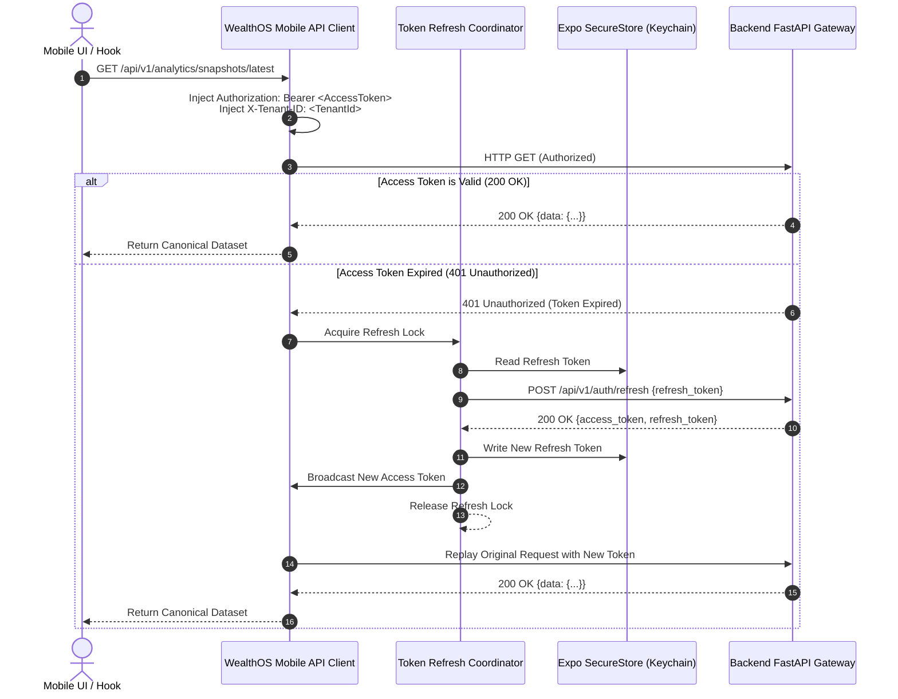

# WealthOS — Stage 9 Mobile API Integration Specification
## Centralized Client Networking, Token Coordination & Error Normalization

**Document Version:** 1.0.0  
**Date:** 2026-11-08  
**Repository:** `Livesh-L-28/WealthOS`  
**Active Branch:** `feature/final-financial-intelligence-production`  
**Approved Baseline Commit (Phase 4):** `e4fe49bb50aa41b790e86dd779efcf4bcc1b1a40`  
**Core Technologies:** TypeScript, `@wealthos/api-client`, `@tanstack/react-query`, Expo SecureStore

---

## 1. Networking Architecture & Client Pipeline

WealthOS Mobile connects to the backend through a hardened API client pipeline that manages tenant scope, automated token refresh, and network resiliency:



---

## 2. Token Refresh Coordinator (Race Condition Prevention)

When multiple queries trigger in parallel (e.g. Dashboard loading Net Worth, Cash Flow, and Recent Transactions simultaneously), an expired access token causes multiple concurrent 401 errors. 

The **Token Refresh Coordinator** serializes token renewal using an atomic in-flight promise pattern:

```typescript
class TokenRefreshCoordinator {
  private refreshPromise: Promise<string | null> | null = null;

  async getValidToken(): Promise<string | null> {
    if (this.refreshPromise) {
      // Re-use active in-flight refresh request
      return this.refreshPromise;
    }

    this.refreshPromise = this.executeRefresh()
      .finally(() => {
        this.refreshPromise = null;
      });

    return this.refreshPromise;
  }

  private async executeRefresh(): Promise<string | null> {
    const refreshToken = await SecureStore.getItemAsync('wealthos_refresh_token');
    if (!refreshToken) {
      return null;
    }

    try {
      const response = await fetch(`${BASE_URL}/api/v1/auth/refresh`, {
        method: 'POST',
        headers: { 'Content-Type': 'application/json' },
        body: JSON.stringify({ refresh_token: refreshToken }),
      });

      if (!response.ok) {
        // Refresh token revoked or expired -> initiate clean logout
        await this.handleSessionTermination();
        return null;
      }

      const data = await response.json();
      await SecureStore.setItemAsync('wealthos_refresh_token', data.refresh_token);
      return data.access_token;
    } catch {
      return null;
    }
  }

  private async handleSessionTermination() {
    await SecureStore.deleteItemAsync('wealthos_refresh_token');
    // Emit global AUTH_EXPIRED event
  }
}
```

---

## 3. Request Header Policy & Idempotency

Every outgoing HTTP request automatically includes standard operational headers:

```http
Authorization: Bearer <jwt_access_token>
X-Tenant-ID: 7a8e1e24-4d89-4a92-8091-6c2e3d93b912
X-Client-Platform: mobile-ios  # or mobile-android
X-Client-Version: 0.2.0
X-Idempotency-Key: a1b2c3d4-e5f6-7890-abcd-ef1234567890  # On POST/PATCH/DELETE
Accept: application/json
Content-Type: application/json
```

---

## 4. Error Normalization & User Feedback

Raw HTTP status codes and API errors are normalized into typed `AppApiError` objects:

| Status Code | Error Code | User-Facing Mobile Feedback |
| :--- | :--- | :--- |
| **400** | `BAD_REQUEST` | "Invalid request parameters. Please check your input." |
| **401** | `UNAUTHORIZED` | "Your session has expired. Please sign in again." |
| **403** | `FORBIDDEN` | "You do not have permission to view or modify this record." |
| **404** | `NOT_FOUND` | "The requested financial record could not be found." |
| **409** | `CONFLICT` | "A conflict occurred with an existing financial record." |
| **422** | `VALIDATION_ERROR`| Displays specific inline field validation messages. |
| **429** | `RATE_LIMITED` | "Too many requests. Please wait a moment and try again." |
| **500+** | `SERVER_ERROR` | "An unexpected error occurred. Our team has been notified." |
| **0** | `OFFLINE` | "No internet connection. Displaying cached financial data." |

---

## 5. Network State Awareness & NetInfo Integration

The application monitors network connectivity via `@react-native-community/netinfo`:
- When offline, mutating requests (e.g. document uploads, manual transactions) are prevented with a clear error prompt rather than failing silently.
- When connection is restored, active TanStack Query queries are automatically refetched to synchronize fresh data.
