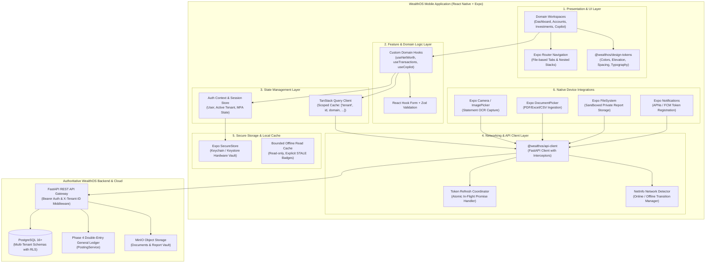

# WealthOS — Stage 9 Mobile Technical Architecture
## Cross-Platform Mobile Client Architecture (React Native + Expo SDK 51)

**Document Version:** 1.0.0  
**Date:** 2026-11-08  
**Repository:** `Livesh-L-28/WealthOS`  
**Active Branch:** `feature/final-financial-intelligence-production`  
**Approved Baseline Commit (Phase 4):** `e4fe49bb50aa41b790e86dd779efcf4bcc1b1a40`  
**Framework:** React Native 0.74.1, Expo SDK ~51.0.0, Expo Router ~3.5.14, TypeScript 5.4+

---

## 1. System Architecture Overview

The WealthOS mobile application is an enterprise-grade, native-first client built using React Native and Expo. It interfaces exclusively with the authorized WealthOS FastAPI backend through standardized REST endpoints and WebSocket/SSE channels.



---

## 2. Seven-Layer Architectural Model

### 2.1 Layer 1: Presentation Layer
- **Expo Router:** File-based navigation hierarchy providing typed routes, native transitions, and deep-link routing.
- **Human-Designed Mobile Components:** Implements cards, metric tiles, status pills, and bottom sheets adhering strictly to the WealthOS dark fintech aesthetic (`#0B0F17` canvas, `#1E293B` cards, `#4F46E5` primary brand).
- **Responsive Layouts:** Safe-area wrapping (`react-native-safe-area-context`), keyboard-avoiding views, and dynamic typography scaling.

### 2.2 Layer 2: Feature & Domain Logic Layer
- Encapsulates UI business logic into composable React hooks (`useAccounts`, `useTransactions`, `usePortfolio`, `useBudgets`, `useGoals`, `useForecasts`, `useCopilot`).
- Form handling via `react-hook-form` with declarative `zod` schemas for client-side input validation prior to network dispatch.

### 2.3 Layer 3: Application State Layer
- **Auth Context:** Tracks user authentication status (`UNAUTHENTICATED`, `AUTHENTICATED`, `MFA_REQUIRED`), active tenant context, and current session ID.
- **Server State (TanStack Query):** Manages caching, background refetching, request deduplication, and window focus refetching.
- **Cache Isolation:** Every query key is tenant-scoped:
  $$\text{QueryKey} = [\text{"tenant"}, \text{tenant\_id}, \text{domain}, \dots\text{params}]$$
  Switching tenants or logging out immediately invalidates and purges the entire query cache.

### 2.4 Layer 4: Networking & API Client Layer
- Leverages the shared `@wealthos/api-client` package with custom mobile interceptors.
- **Token Refresh Coordinator:** Intercepts HTTP 401 responses and triggers a single, synchronized refresh request using the stored refresh token. All queued requests await the new access token, preventing refresh-token race conditions.
- **Idempotency Keys:** Mutating operations (e.g. goal contributions, document reviews, categorization updates) transmit unique `X-Idempotency-Key: UUIDv4` headers.

### 2.5 Layer 5: Secure Storage Layer
- **Expo SecureStore:** Manages high-sensitivity credentials:
  - `wealthos_refresh_token`
  - `wealthos_session_id`
  - `wealthos_biometric_enabled`
- Tokens are encrypted at rest using platform hardware security modules (Apple Secure Enclave on iOS, TEE/StrongBox on Android).
- Zero tokens are stored in unencrypted storage (`AsyncStorage`).

### 2.6 Layer 6: Local Persistence & Offline Read Cache
- Caches essential read-only snapshots (dashboard summary, account balances, recent transactions).
- **Offline Invariant:** Cached data is flagged with an explicit `STALE_OFFLINE` banner indicating the last sync timestamp. Offline financial write operations are strictly disallowed.

### 2.7 Layer 7: Native Device Integrations
- **Expo Camera / ImagePicker:** Captures physical financial statements and invoices for Stage 4 OCR extraction.
- **Expo DocumentPicker:** Selects PDF/Excel/CSV files from device storage.
- **Expo FileSystem:** Securely streams generated financial reports into the application's private sandboxed cache.
- **Expo Notifications:** Handles device push token registration with Apple Push Notification service (APNs) and Firebase Cloud Messaging (FCM).

---

## 3. Directory Layout (`apps/mobile/`)

```text
apps/mobile/
├── app/                              # Expo Router File-Based Navigation
│   ├── _layout.tsx                   # Root layout (Theme, QueryProvider, AuthProvider)
│   ├── index.tsx                     # Entrypoint & splash router
│   ├── (auth)/                       # Authentication Flow
│   │   ├── _layout.tsx
│   │   ├── login.tsx                 # Login screen
│   │   ├── register.tsx              # Registration screen
│   │   └── mfa.tsx                   # MFA TOTP verification
│   ├── (tabs)/                       # Authenticated Primary Bottom Tabs
│   │   ├── _layout.tsx               # Tab bar configuration
│   │   ├── index.tsx                 # Home / Dashboard workspace
│   │   ├── accounts.tsx              # Financial accounts workspace
│   │   ├── transactions.tsx          # Transactions & cash flow
│   │   ├── wealth.tsx                # Investments, assets & liabilities
│   │   └── copilot.tsx               # AI Financial Copilot chat
│   ├── documents/                    # Document Capture & Review
│   │   ├── index.tsx                 # Uploaded documents list
│   │   ├── capture.tsx               # Camera capture screen
│   │   └── [id].tsx                  # Extracted records review
│   ├── planning/                     # Strategic Financial Planning
│   │   ├── budgets.tsx               # Budget monitoring & allocations
│   │   ├── goals.tsx                 # Financial goals & contributions
│   │   └── forecasts.tsx             # Forecasts & scenario modeling
│   ├── reports/                      # Reporting & Exports
│   │   ├── index.tsx                 # Report catalog & generation
│   │   └── [id].tsx                  # Report details & download
│   ├── notifications/                # Notifications Center
│   │   └── index.tsx                 # In-app inbox & preferences
│   ├── integrations/                 # Provider Connections
│   │   ├── index.tsx                 # Connected providers directory
│   │   └── [id].tsx                  # Provider details & sync status
│   └── settings/                     # User Profile & App Security
│       └── index.tsx                 # Profile, tenants, security, logout
├── src/
│   ├── components/                   # Shared Reusable UI Components
│   │   ├── cards/                    # MetricCard, AccountCard, TransactionRow
│   │   ├── feedback/                 # OfflineBanner, ErrorState, LoadingState
│   │   └── forms/                    # FormInput, Button, SelectDropdown
│   ├── hooks/                        # Feature-specific React hooks
│   ├── providers/                    # React Context Providers (Auth, Query)
│   ├── services/                     # Device services (SecureStore, Notifications)
│   └── types/                        # Mobile-specific UI types
├── app.json                          # Expo configuration
├── package.json                      # Dependencies & scripts
└── tsconfig.json                     # TypeScript configuration
```

---

## 4. Mobile Client-Server Invariance

| Concern | Client-Side Responsibility (Mobile) | Server-Side Responsibility (FastAPI + DB) |
| :--- | :--- | :--- |
| **Authentication** | Collects credentials, securely stores refresh token | Generates JWTs, validates password hashes (Argon2), checks MFA |
| **Authorization** | Transmits `X-Tenant-ID`, renders accessible UI | Enforces RBAC permissions and PostgreSQL Row-Level Security |
| **Financial Math** | Formats numbers for display (`Intl.NumberFormat`) | Executes all interest, net worth, IRR, and FIFO computations |
| **Accounting** | Displays transaction history and categories | Posts to double-entry general ledger via `PostingService` |
| **Document OCR** | Captures image, validates MIME/size, uploads bytes | Executes OCR pipelines, parses tables, validates integrity |
| **AI Copilot** | Renders chat messages, streaming tokens, citations | Manages tool execution, context retrieval, and LLM calls |
| **Offline State** | Displays cached read-only records with stale badges | Reconciles incoming requests upon reconnection, checks idempotency |

---

## 5. Performance Targets & Optimization

1. **Cold / Warm Launch:**
   - App interactive within $< 2.0$ seconds on modern iOS/Android reference devices.
   - Session validation and cached dashboard rendered immediately while background refetch executes.
2. **Virtualization & Large Lists:**
   - Transaction and account lists utilize `FlatList` with `windowSize=5`, `maxToRenderPerBatch=10`, and `initialNumToRender=10` to maintain steady 60 fps scrolling.
3. **Memory Footprint:**
   - Clean unmounting of image buffers and document previews.
   - Cache garbage collection time set to 15 minutes (`gcTime: 1000 * 60 * 15`).
