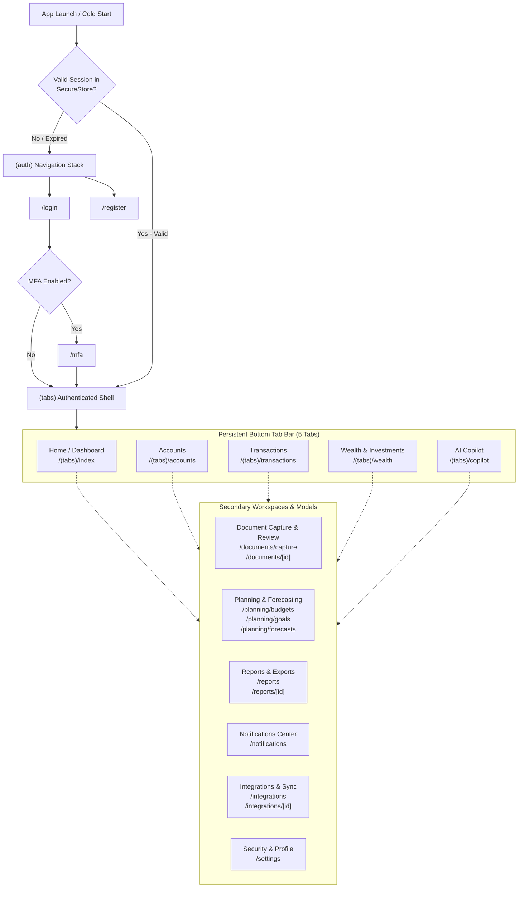

# WealthOS — Stage 9 Mobile Navigation & Routing Specification
## File-Based Routing with Expo Router & Deep-Link Authorization

**Document Version:** 1.0.0  
**Date:** 2026-11-08  
**Repository:** `Livesh-L-28/WealthOS`  
**Active Branch:** `feature/final-financial-intelligence-production`  
**Approved Baseline Commit (Phase 4):** `e4fe49bb50aa41b790e86dd779efcf4bcc1b1a40`  
**Framework:** Expo Router ~3.5.14 (React Navigation 6+ foundation)

---

## 1. Information Architecture & Navigation Flow

WealthOS Mobile organizes functionality into three distinct navigation tiers:
1. **Unauthenticated Flow (`(auth)`):** Onboarding, login, registration, and MFA challenge verification.
2. **Primary Authenticated Flow (`(tabs)`):** 5-tab persistent bottom navigation bar for daily financial monitoring.
3. **Modal & Nested Stacks:** Specialized workflows for document capture, strategic planning, reports, notifications, provider connections, and security settings.



---

## 2. Detailed Route Mapping

### 2.1 Unauthenticated Routes (`app/(auth)/`)
- `login.tsx`: Email/password authentication form.
- `register.tsx`: New user onboarding with password strength indicator.
- `mfa.tsx`: 6-digit TOTP verification challenge or recovery code entry.

### 2.2 Primary Tab Routes (`app/(tabs)/`)
| Route | Label | Icon | Workspace Description |
| :--- | :--- | :--- | :--- |
| `index.tsx` | **Home** | `view-dashboard` | Executive Net Worth summary, income/expenses, recent alerts |
| `accounts.tsx` | **Accounts** | `bank` | Bank accounts, credit cards, cash reserves, balance history |
| `transactions.tsx` | **Transactions** | `swap-horizontal` | Searchable transaction ledger, categories, and cash-flow trends |
| `wealth.tsx` | **Wealth** | `chart-donut` | Investment portfolio, FIFO holdings, assets, liabilities, passive income |
| `copilot.tsx` | **Copilot** | `robot` | Conversational AI financial assistant with grounded tool execution |

### 2.3 Secondary Screen Stacks
- **Document Management (`app/documents/`):**
  - `index.tsx`: List of uploaded financial statements and extraction status.
  - `capture.tsx`: Full-screen native camera viewfinder for receipt and invoice capture.
  - `[id].tsx`: Interactive document review screen displaying extracted transactions and reconciliation matches.
- **Strategic Financial Planning (`app/planning/`):**
  - `budgets.tsx`: Active budget periods, category allocations, utilization progress, and rollover indicators.
  - `goals.tsx`: Multi-goal milestone tracking, required contribution pacing, and contribution action modal.
  - `forecasts.tsx`: Multi-year net worth trajectory charts and "what-if" scenario simulation runner.
- **Reports & Downloads (`app/reports/`):**
  - `index.tsx`: 12-report catalog, generation triggers, and export history.
  - `[id].tsx`: Report viewer and sandboxed download manager (PDF, Excel, CSV).
- **Notifications & Preferences (`app/notifications/`):**
  - `index.tsx`: In-app notification inbox with category filters, unread counts, and quiet-hours toggles.
- **Provider Integrations (`app/integrations/`):**
  - `index.tsx`: Connected accounts directory, DPDP consent statuses, and manual sync triggers.
  - `[id].tsx`: Provider details, credential revocation, and sync job error inspection.
- **Settings & Security (`app/settings/`):**
  - `index.tsx`: Profile details, active tenant switching, biometric unlock configuration, and session termination.

---

## 3. Navigation Guards & Protected Route Enforcers

Route protection is implemented in `app/_layout.tsx` using a custom navigation guard:

```typescript
export function useProtectedRoute(session: SessionState | null, isLoading: boolean) {
  const segments = useSegments();
  const router = useRouter();

  useEffect(() => {
    if (isLoading) return;

    const inAuthGroup = segments[0] === '(auth)';

    if (!session && !inAuthGroup) {
      // Redirect unauthenticated user to login screen
      router.replace('/(auth)/login');
    } else if (session && inAuthGroup) {
      if (session.mfaRequired) {
        router.replace('/(auth)/mfa');
      } else {
        // Authenticated user redirected to primary dashboard
        router.replace('/(tabs)');
      }
    }
  }, [session, segments, isLoading]);
}
```

---

## 4. Deep-Linking Configuration & Authorization Re-check

### 4.1 URL Scheme & Universal Links
- **Custom Scheme:** `wealthos://`
- **Universal Links:** `https://app.wealthos.com`
- **Supported Paths:**
  - `wealthos://accounts/{id}`
  - `wealthos://transactions/{id}`
  - `wealthos://documents/{id}`
  - `wealthos://reports/{id}`
  - `wealthos://notifications`

### 4.2 Deep-Link Security Invariant
> [!WARNING]
> Deep links contain zero implicit authorization.
> When the application resolves `wealthos://accounts/{id}`, the destination screen queries the backend API transmitting the authenticated user's token and active tenant context. If the user does not possess permissions for that account, the API returns HTTP 403 / 404, and the client displays an access-denied state rather than leaking data.
