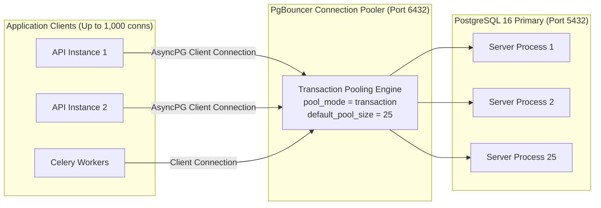

# WealthOS — Connection Pooling Strategy & Capacity Budget

**Programme:** WealthOS Enterprise Architecture & Production Readiness  
**Document:** Connection Pooling Strategy  
**Date:** 2026-11-08  
**Status:** Approved Engineering Standard  
**Author:** Database Architect & SRE Lead  

---

## 1. Connection Budget Calculation & Exhaustion Analysis

PostgreSQL dedicates a dedicated OS process for every open connection, consuming roughly 5–10 MB of RAM per connection. Uncontrolled connection allocation creates memory exhaustion and connection pool timeouts.

### Connection Capacity Calculation Formula

$$\text{Capacity}_{\text{total}} \ge \sum \text{Clients}_{\text{app}} + \text{Workers}_{\text{celery}} + \text{Reservations}_{\text{dba}} + \text{Replication}_{\text{slots}}$$

### Without PgBouncer (Failure Scenario)
If 4 FastAPI API instances scale horizontally with 3 Celery worker pools:
- 4 API instances $\times (10 \text{ pool} + 20 \text{ overflow}) = 120\text{ connections}$
- 3 Celery worker pools $\times 10\text{ concurrency} = 30\text{ connections}$
- DBA / Alembic migrations / Monitoring $= 10\text{ connections}$
- **Total Potential Demand:** **160 connections** $\rightarrow$ **Exceeds PostgreSQL `max_connections = 100`**, triggering catastrophic `FATAL: remaining connection slots are reserved for non-replication superuser connections`.

### With PgBouncer (Hardened Topology)
- API and worker instances connect to PgBouncer.
- PgBouncer multiplexes **1,000 incoming client connections** over a small, highly efficient pool of **25–40 physical server connections** to PostgreSQL.
- Database memory footprint is minimized, query throughput increases, and zero connection exhaustion errors occur.

---

## 2. PgBouncer Architecture & Pooling Mode



### Transaction Pooling Mode (`pool_mode = transaction`)
- **Behavior:** A physical server connection is assigned to a client **only for the duration of a single database transaction**. Once the transaction commits or rolls back, the physical connection returns to the pool immediately.
- **Compatibility with Multi-Tenant RLS:**  
  WealthOS injects tenant context via `SET LOCAL app.current_tenant_id = '...'`. Because `SET LOCAL` is scoped strictly to the current transaction, the setting is discarded as soon as `COMMIT` or `ROLLBACK` executes, guaranteeing **zero tenant context leakage** between pooled transactions.

---

## 3. Production PgBouncer Configuration (`pgbouncer.ini`)

```ini
[databases]
wealthos = host=wealthos_postgres port=5432 dbname=wealthos auth_user=pgbouncer
wealthos_replica = host=wealthos_postgres_replica port=5432 dbname=wealthos auth_user=pgbouncer

[pgbouncer]
logfile = /var/log/pgbouncer/pgbouncer.log
pidfile = /var/run/pgbouncer/pgbouncer.pid
listen_addr = *
listen_port = 6432
auth_type = scram-sha-256
auth_file = /etc/pgbouncer/userlist.txt
admin_users = pgbouncer,postgres

# Connection Pooling Settings
pool_mode = transaction
max_client_conn = 1000
default_pool_size = 25
min_pool_size = 5
reserve_pool_size = 5
reserve_pool_timeout = 5.0
max_db_connections = 50

# Timeouts & Keepalive
server_idle_timeout = 600.0
server_connect_timeout = 15.0
server_login_retry = 1.0
client_idle_timeout = 120.0
client_login_timeout = 15.0
tcp_keepalive = 1
tcp_keepcnt = 3
tcp_keepidle = 30
tcp_keepintvl = 10
```

---

## 4. SQLAlchemy 2.0 Async Client Adjustments

When communicating through PgBouncer in transaction pooling mode:
1. **Disable Prepared Statement Caching:** Prepared statements in asyncpg are per-connection. With transaction pooling, prepared statements must be disabled by passing `statement_cache_size=0`:
   ```python
   engine = create_async_engine(
       db_url,
       connect_args={"statement_cache_size": 0},
       pool_size=10,
       max_overflow=10,
       pool_pre_ping=True,
   )
   ```
2. **Explicit Connection Checkouts:** Always wrap transactions inside `async with session.begin():` to ensure atomic checkout and release.
