# WEALTHOS — DATABASE ER DIAGRAM & SCHEMA RELATIONSHIPS

**Document Reference:** WOS-DB-ERD-001  
**Version:** 1.0.0-RELEASE-CANDIDATE  
**Status:** APPROVED / FROZEN BASELINE  

---

## 1. COMPREHENSIVE MERMAID ENTITY-RELATIONSHIP DIAGRAM

```mermaid
erDiagram
    TENANTS ||--o{ USERS : "has members via memberships"
    TENANTS ||--o{ TENANT_MEMBERSHIPS : contains
    USERS ||--o{ TENANT_MEMBERSHIPS : holds
    USERS ||--o{ USER_SESSIONS : establishes
    TENANTS ||--o{ AUDIT_LOGS : records

    TENANTS ||--o{ CHART_OF_ACCOUNTS : establishes
    CHART_OF_ACCOUNTS ||--o{ CHART_OF_ACCOUNTS : "parent/child"
    CHART_OF_ACCOUNTS ||--o{ FINANCIAL_ACCOUNTS : classifies
    TENANTS ||--o{ FINANCIAL_ACCOUNTS : maintains
    
    TENANTS ||--o{ JOURNAL_ENTRIES : records
    JOURNAL_ENTRIES ||--|{ JOURNAL_LINES : contains
    FINANCIAL_ACCOUNTS ||--o{ JOURNAL_LINES : references
    CHART_OF_ACCOUNTS ||--o{ JOURNAL_LINES : categorizes

    TENANTS ||--o{ CATEGORIES : organizes
    CATEGORIES ||--o{ CATEGORIES : "parent/child"
    TENANTS ||--o{ TRANSACTIONS : logs
    FINANCIAL_ACCOUNTS ||--o{ TRANSACTIONS : affects
    JOURNAL_ENTRIES ||--|| TRANSACTIONS : backs
    CATEGORIES ||--o{ TRANSACTIONS : categorized_as
    TRANSACTIONS ||--o{ TRANSACTION_SPLITS : splits_into
    CATEGORIES ||--o{ TRANSACTION_SPLITS : allocated_to

    TENANTS ||--o{ BROKER_ACCOUNTS : owns
    FINANCIAL_ACCOUNTS ||--|| BROKER_ACCOUNTS : links_cash
    INSTRUMENTS ||--o{ BROKER_ACCOUNTS : "traded within"
    TENANTS ||--o{ INVESTMENT_LOTS : maintains
    BROKER_ACCOUNTS ||--o{ INVESTMENT_LOTS : holds
    INSTRUMENTS ||--o{ INVESTMENT_LOTS : specifies
    
    TENANTS ||--o{ INVESTMENT_TRANSACTIONS : records
    BROKER_ACCOUNTS ||--o{ INVESTMENT_TRANSACTIONS : routes
    INSTRUMENTS ||--o{ INVESTMENT_TRANSACTIONS : targets
    JOURNAL_ENTRIES ||--|| INVESTMENT_TRANSACTIONS : posts_ledger
    
    INVESTMENT_TRANSACTIONS ||--o{ INVESTMENT_LOT_ALLOCATIONS : allocates
    INVESTMENT_LOTS ||--o{ INVESTMENT_LOT_ALLOCATIONS : consumed_by

    TENANTS ||--o{ DIVIDEND_RECORDS : registers
    INSTRUMENTS ||--o{ DIVIDEND_RECORDS : generates
    FINANCIAL_ACCOUNTS ||--o{ DIVIDEND_RECORDS : deposits_to

    TENANTS ||--o{ ASSETS : holds
    ASSETS ||--o{ ASSET_VALUATIONS : valued_by
    TENANTS ||--o{ LIABILITIES : owes
    LIABILITIES ||--o{ AMORTIZATION_SCHEDULES : scheduled_by

    TENANTS ||--o{ DOCUMENTS : vaults
    DOCUMENTS ||--o{ DOCUMENT_EXTRACTIONS : parsed_to
    DOCUMENT_EXTRACTIONS ||--o{ EXTRACTION_LINE_ITEMS : extracts
    EXTRACTION_LINE_ITEMS }o--o| TRANSACTIONS : reconciles

    TENANTS ||--o{ COPILOT_CONVERSATIONS : hosts
    COPILOT_CONVERSATIONS ||--o{ COPILOT_MESSAGES : exchanges
```

---

## 2. RELATIONAL INTEGRITY & FOREIGN KEY POLICIES

| Parent Entity | Child Entity | Foreign Key Column | On Delete Policy | Rationale |
|---|---|---|---|---|
| `tenants` | `users` | `tenant_memberships.tenant_id` | `RESTRICT` | Cannot delete tenant with active users. |
| `tenants` | `financial_accounts` | `financial_accounts.tenant_id` | `RESTRICT` | Preserves financial records against bulk accidental deletion. |
| `financial_accounts` | `journal_lines` | `journal_lines.account_id` | `RESTRICT` | Core accounting invariant: cannot delete an account with posted lines. |
| `journal_entries` | `journal_lines` | `journal_lines.journal_entry_id` | `RESTRICT` | Ensures journal entry lines cannot be partially deleted. |
| `documents` | `document_extractions` | `document_extractions.document_id` | `RESTRICT` | Preserves audit connection between parsed data and raw storage. |
| `document_extractions` | `extraction_line_items`| `extraction_line_items.extraction_id` | `CASCADE` | Intermediate parsing state can be regenerated from document. |
| `investment_lots` | `investment_lot_allocations` | `investment_lot_allocations.lot_id` | `RESTRICT` | Tax lots with historical sale allocations cannot be dropped. |
