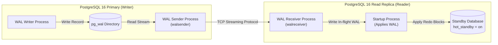

# WealthOS — PostgreSQL Replication Strategy & Dynamic Read Scaling

**Programme:** WealthOS Enterprise Architecture & Production Readiness  
**Document:** Replication Strategy Specification  
**Date:** 2026-11-08  
**Status:** Approved Specification  
**Author:** PostgreSQL Reliability Engineer & SRE Lead  

---

## 1. Replication Architecture Overview

WealthOS utilizes PostgreSQL **Physical Streaming Replication** operating over TLS-encrypted connections. The primary writer streams Write-Ahead Log (WAL) records directly to one or more hot-standby read replicas.



---

## 2. Synchronous vs Asynchronous Replication Policy

| Dimension | Asynchronous Replication (Selected Standard) | Synchronous Replication (`synchronous_commit = on`) |
|---|---|---|
| **Write Latency** | **Minimal (< 2ms)**. Primary commits as soon as local WAL is flushed to NVMe disk. | **Higher (+5–15ms)**. Primary must wait for replica network round-trip and flush acknowledgment. |
| **Availability Risk** | **High Availability**. If replica crashes or network partitions, Primary continues writing unimpeded. | **Availability Hazard**. If replica fails, Primary blocks all incoming writes until timeout or config reload. |
| **Data Loss Risk (RPO)** | **RPO $< 1$ second**. A sudden hardware failure of Primary before WAL stream arrives at replica could lose $< 1$s of un-replicated commits. | **RPO = 0**. Zero committed transactions lost on primary failover. |
| **WealthOS Policy** | **Approved for Standard Multi-Region & Production Scaling**. WAL archive stream to S3 bridges any failover gap. | **Optional for Dual-Node HA in Same Availability Zone** with `synchronous_standby_names = 'FIRST 1 (replica1, replica2)'`. |

---

## 3. Read Replica Routing Policy (`PrimaryReplicaRouter`)

To avoid "dirty reads" or confusing user experiences, WealthOS strictly separates query targets based on write context and freshness requirements:

### Queries Routed Exclusively to Primary
1. Any HTTP `POST`, `PUT`, `PATCH`, `DELETE` requests.
2. Read operations immediately succeeding a financial mutation (e.g. redirected to dashboard after bank sync or transfer creation).
3. Ledger balance verification queries ($\sum\text{Dr} = \sum\text{Cr}$).
4. Authentication credential verification and token revocation blacklist queries.

### Queries Eligible for Read Replicas
1. Financial Planning Monte Carlo simulations and 30-year retirement forecasts.
2. Historical tax calculation reports (prior FY/AY comparison).
3. End-of-month and quarterly audit log exports.
4. Risk score historical trends.
5. AI Copilot read-only data retrievals when user is exploring hypothetical scenarios.

---

## 4. Replication Health & Lag Monitoring

Replication lag must be monitored continuously by the SRE team and Prometheus scrapers:

### SQL Replication Metrics Probe
```sql
SELECT
    client_addr AS replica_ip,
    state,
    sync_state,
    sync_priority,
    pg_wal_lsn_diff(pg_current_wal_lsn(), sent_lsn) AS send_lag_bytes,
    pg_wal_lsn_diff(sent_lsn, write_lsn) AS write_lag_bytes,
    pg_wal_lsn_diff(write_lsn, flush_lsn) AS flush_lag_bytes,
    pg_wal_lsn_diff(flush_lsn, replay_lsn) AS replay_lag_bytes,
    ROUND(EXTRACT(EPOCH FROM (now() - replay_ts))::numeric, 3) AS replay_lag_seconds
FROM pg_stat_replication;
```

### Alert Thresholds
- **Replication Lag Warning:** `replay_lag_seconds > 5.0s` for 3 consecutive minutes.
- **Replication Lag Critical:** `replay_lag_seconds > 30.0s` or `send_lag_bytes > 500MB`.
- **Standby Down Alert:** Number of connected standby nodes drops below minimum required threshold.

