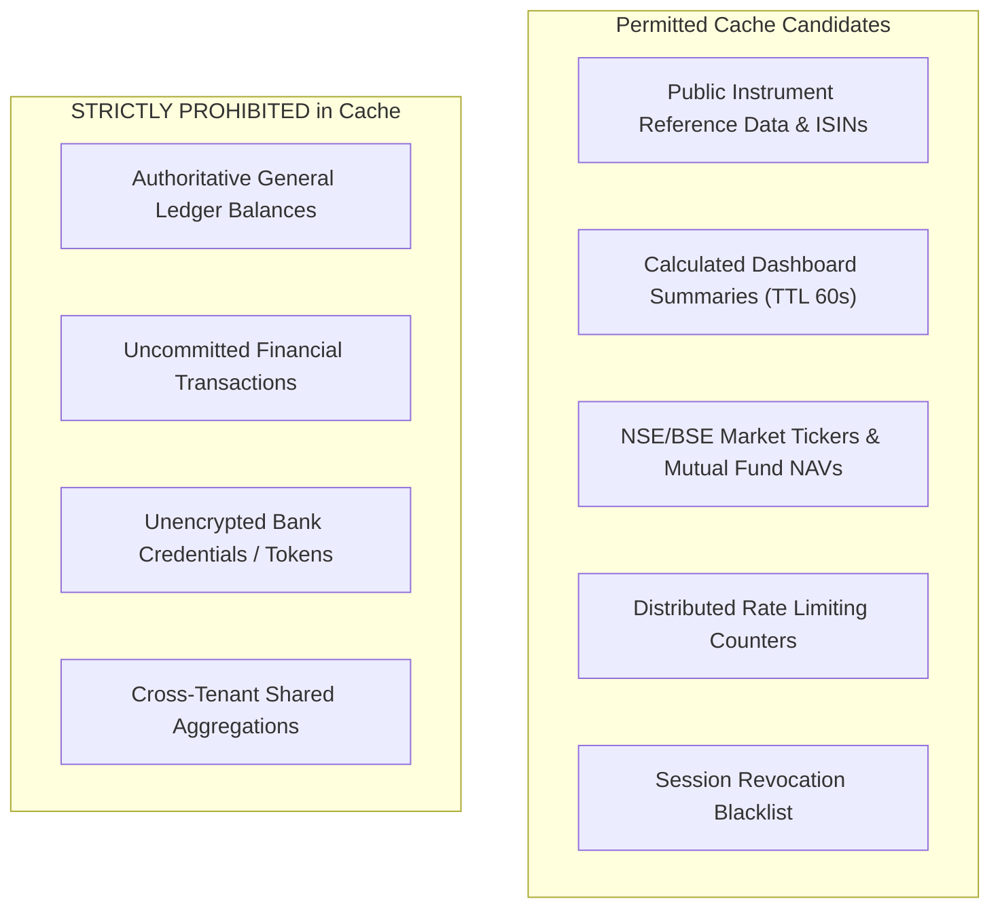

# WealthOS — Redis Caching Architecture & Distributed State Invalidation

**Programme:** WealthOS Enterprise Architecture & Production Readiness  
**Document:** Cache Architecture Specification  
**Date:** 2026-11-08  
**Status:** Approved Engineering Standard  
**Author:** Distributed Systems Architect & Lead Backend Engineer  

---

## 1. Cache Stratification & Approved Candidates

In WealthOS, caching is treated as an optimization, never as an authoritative source of financial truth.



---

## 2. Collision-Resistant Tenant-Scoped Key Conventions

All tenant-specific cache keys adhere to strict, colon-delimited namespacing:

| Key Pattern | Data Stored | TTL | Invalidation Trigger |
|---|---|---|---|
| `blacklist:{jti}` | Revoked JWT access token identifier | Token Remaining Lifetime ($\le 60\text{m}$) | Expiration |
| `totp_used:{user_id}:{code}` | Used TOTP token (replay defense) | 90 seconds | Expiration |
| `tenant:{tenant_id}:dashboard:v1` | Pre-computed net worth & asset allocation | 60 seconds | Transaction created / modified |
| `tenant:{tenant_id}:risk:health_score` | 5-pillar health score snapshot | 300 seconds | Account balance update |
| `market:quote:{symbol}` | Market price & daily % change | 60 seconds | Worker market feed poll |
| `lock:ocr:{document_id}` | Idempotency lock for Celery worker | 300 seconds | Atomic Lua compare-and-delete |

---

## 3. Event-Driven Cache Invalidation Protocol

WealthOS does not rely solely on TTL expiration for financial state changes. When state-modifying actions occur, the application service dispatches an immediate cache eviction:

1. **Transaction Invalidation:** When a transaction or journal entry is posted or reversed:
   ```python
   await redis.delete(f"tenant:{tenant_id}:dashboard:v1")
   await redis.delete(f"tenant:{tenant_id}:risk:health_score")
   ```
2. **Investment Trade Settlement:** When an equity or mutual fund lot is settled or disposed:
   ```python
   await redis.delete(f"tenant:{tenant_id}:portfolio_holdings")
   ```
3. **Session Revocation:** When a user logs out:
   ```python
   await redis.set(f"blacklist:{jti}", "revoked", ex=remaining_ttl)
   ```

---

## 4. Redis Failure Behavior & Graceful Degradation

If the Redis cluster is unreachable or crashes:
1. **Financial Ledger Unaffected:** All general ledger writes and PostgreSQL queries execute without Redis dependencies.
2. **Read-Through Degradation:** If cache lookups fail (`ConnectionError`), the application catches the exception, logs a warning, falls back directly to PostgreSQL, and returns authoritative data.
3. **Session Revocation Security Policy:** If Redis is down during a token revocation check, the token signature, issuer, audience, and expiration claims are validated cryptographically against `SECRET_KEY`, and database session status (`user_sessions.is_active`) is queried to ensure fail-closed security.

