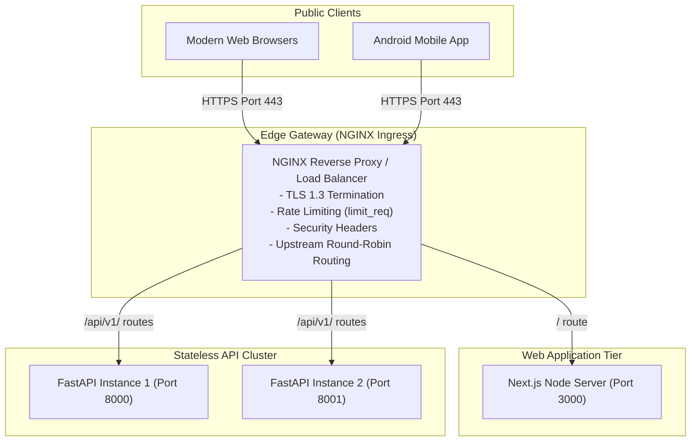

# WealthOS — Load Balancing & Reverse Proxy Architecture Design

**Programme:** WealthOS Enterprise Architecture & Production Readiness  
**Document:** Load Balancing Design Specification  
**Date:** 2026-11-08  
**Status:** Approved Infrastructure Standard  
**Author:** Cloud Infrastructure Engineer & Principal SRE  

---

## 1. Edge Load Balancing Topology

WealthOS deploys an NGINX reverse proxy cluster at the ingress perimeter. The proxy terminates TLS, applies WAF rate-limiting, and distributes HTTP traffic across multiple stateless FastAPI backend instances and Next.js web application servers.



---

## 2. Production NGINX Reverse Proxy Configuration (`nginx.conf`)

```nginx
# Rate Limiting Zones
limit_req_zone $binary_remote_addr zone=auth_limit:10m rate=5r/m;
limit_req_zone $binary_remote_addr zone=general_api_limit:10m rate=30r/s;

# Upstream Application Pools
upstream wealthos_backend {
    least_conn; # Route to instance with fewest active connections
    server wealthos_backend_api_1:8000 max_fails=3 fail_timeout=10s;
    server wealthos_backend_api_2:8000 max_fails=3 fail_timeout=10s;
    keepalive 32;
}

upstream wealthos_web {
    server wealthos_web_app:3000 max_fails=3 fail_timeout=10s;
    keepalive 32;
}

server {
    listen 80;
    server_name wealthos.app *.wealthos.app;
    # Redirect all plain HTTP to HTTPS
    return 301 https://$host$request_uri;
}

server {
    listen 443 ssl http2;
    server_name wealthos.app *.wealthos.app;

    # SSL / TLS 1.3 Strict Configuration
    ssl_certificate /etc/nginx/ssl/live/wealthos.app/fullchain.pem;
    ssl_certificate_key /etc/nginx/ssl/live/wealthos.app/privkey.pem;
    ssl_protocols TLSv1.2 TLSv1.3;
    ssl_ciphers ECDHE-ECDSA-AES128-GCM-SHA256:ECDHE-RSA-AES128-GCM-SHA256:ECDHE-ECDSA-AES256-GCM-SHA384:ECDHE-RSA-AES256-GCM-SHA384;
    ssl_prefer_server_ciphers off;
    ssl_session_cache shared:SSL:10m;
    ssl_session_timeout 1d;

    # Production HTTP Security Headers
    add_header Strict-Transport-Security "max-age=63072000; includeSubDomains; preload" always;
    add_header X-Content-Type-Options "nosniff" always;
    add_header X-Frame-Options "DENY" always;
    add_header X-XSS-Protection "1; mode=block" always;
    add_header Referrer-Policy "strict-origin-when-cross-origin" always;
    add_header Content-Security-Policy "default-src 'self'; script-src 'self' 'unsafe-eval' 'unsafe-inline'; style-src 'self' 'unsafe-inline'; img-src 'self' data: https:; font-src 'self' data:; connect-src 'self' https:;" always;

    client_max_body_size 50M; # Max document upload size

    # Forwarding Headers
    proxy_set_header Host $host;
    proxy_set_header X-Real-IP $remote_addr;
    proxy_set_header X-Forwarded-For $proxy_add_x_forwarded_for;
    proxy_set_header X-Forwarded-Proto $scheme;
    proxy_http_version 1.1;

    # Backend API Routing
    location /api/ {
        limit_req zone=general_api_limit burst=50 nodelay;
        proxy_pass http://wealthos_backend;
        proxy_connect_timeout 5s;
        proxy_read_timeout 60s;
        proxy_send_timeout 60s;
    }

    # Strict Rate Limit on Authentication Endpoints
    location /api/v1/auth/login {
        limit_req zone=auth_limit burst=5 nodelay;
        proxy_pass http://wealthos_backend;
    }

    location /api/v1/auth/register {
        limit_req zone=auth_limit burst=5 nodelay;
        proxy_pass http://wealthos_backend;
    }

    # Health Check Endpoint
    location /health {
        proxy_pass http://wealthos_backend;
        access_log off;
    }

    # Web Frontend Routing
    location / {
        proxy_pass http://wealthos_web;
    }
}
```
