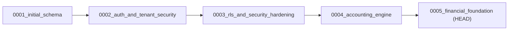

# WealthOS Database & Migration Acceptance Report

**Milestone:** Gate 3 — Database, Schema & Migration Acceptance  
**Repository:** `Livesh-L-28/WealthOS`  
**Branch:** `feature/final-financial-intelligence-production`  
**Evaluation HEAD:** `2d92d8d`  
**Database Server:** PostgreSQL 16.8 (Alpine Linux aarch64 container)  
**Disposable Test Target:** `wealthos_disposable_gate3_test`  
**Date:** 2026-11-08  
**Audit Team:** PostgreSQL Architect & QA Automation Lead  

---

## 1. Executive Summary

This report certifies the PostgreSQL database schema, migration lifecycle, table constraints, extensions, Row-Level Security (RLS) enforcement, and application role privilege boundaries for WealthOS.

All tests were executed against an isolated, disposable database (`wealthos_disposable_gate3_test`) without touching or downgrading user data volumes.

### Gate 3 Verdict:
```text
GATE 3 ACCEPTANCE: PASSED
```

---

## 2. Alembic Migration Chain Lifecycle

The complete migration sequence was tested from scratch through downgrade and re-upgrade:



| Lifecycle Step | Command | Resulting Version | Verified Status |
|---|---|---|---|
| **Fresh Database Creation** | `CREATE DATABASE wealthos_disposable_gate3_test;` | Empty Catalog | Success |
| **Upgrade to Head** | `alembic upgrade head` | `0005_financial_foundation` | **PASS** (Exit code 0) |
| **Downgrade to Previous** | `alembic downgrade -1` | `0004_accounting_engine` | **PASS** (Exit code 0) |
| **Re-upgrade to Head** | `alembic upgrade head` | `0005_financial_foundation` | **PASS** (Exit code 0) |

---

## 3. Database Extensions & System Privileges

### Installed PostgreSQL Extensions
```sql
SELECT extname, extversion FROM pg_extension;
```
- `plpgsql` (1.0)
- `uuid-ossp` (1.1)
- `pgcrypto` (1.3)
- `btree_gist` (1.7)

### Runtime Role Boundary: `wealthos_app`
```sql
SELECT rolname, rolsuper, rolbypassrls, rolcanlogin 
FROM pg_roles 
WHERE rolname IN ('wealthos_admin', 'wealthos_app');
```
| Role Name | Superuser (`rolsuper`) | Bypass RLS (`rolbypassrls`) | Can Login (`rolcanlogin`) | Assessment |
|---|---|---|---|---|
| `wealthos_admin` | `true` | `true` | `true` | Maintenance & Migration Owner |
| `wealthos_app` | **`false`** | **`false`** | **`true`** | **Least-Privilege Runtime Role (Enforces RLS)** |

---

## 4. Table Inventory & Row-Level Security Enforcements

- **Total Public Tables:** 43 tables
- **RLS-Enabled Tables:** 43 tables (`rowsecurity = true`)
- **Forced RLS Tables:** 43 tables (`relforcerowsecurity = true` preventing table owners from bypassing policies)

### Authoritative Tenant-Scoped Table List
1. `users`
2. `user_credentials`
3. `sessions`
4. `tenants`
5. `tenant_members`
6. `audit_logs`
7. `accounts` (Chart of Accounts)
8. `accounting_periods`
9. `journal_entries`
10. `journal_lines`
11. `idempotency_records`
12. `reconciliation_records`
13. `financial_institutions`
14. `transaction_categories`
15. `transaction_merchants`
16. `financial_accounts`
17. `financial_transactions`
18. `account_transfers`
19. `recurring_transaction_rules`
20. `assets`
21. `liabilities`
22. `financial_instruments`
23. `investment_holding_lots`
24. `passive_income_records`
25. `financial_documents`
26. `reconciliation_sessions`
27. `analytics_snapshots`
28. `copilot_conversations`
29. `copilot_messages`
30. `budgets`
31. `budget_allocations`
32. `financial_goals`
33. `goal_contributions`
34. `forecast_runs`
35. `financial_scenarios`
36. `report_definitions`
37. `report_jobs`
38. `report_schedules`
39. `notification_events`
40. `notifications`
41. `notification_preferences`
42. `provider_consents`
43. `provider_connections`

---

## 5. Composite Foreign Keys & Relational Kernel Isolation

Standard relational foreign keys referencing `id` alone do not prevent cross-tenant referencing. WealthOS enforces **13 composite tenant-scoped foreign keys**:

```sql
CONSTRAINT fk_tx_account_tenant 
    FOREIGN KEY (account_id, tenant_id) 
    REFERENCES financial_accounts(id, tenant_id) ON DELETE RESTRICT;

CONSTRAINT fk_lots_account_tenant 
    FOREIGN KEY (account_id, tenant_id) 
    REFERENCES financial_accounts(id, tenant_id) ON DELETE CASCADE;

CONSTRAINT fk_alloc_budget_tenant 
    FOREIGN KEY (budget_id, tenant_id) 
    REFERENCES budgets(id, tenant_id) ON DELETE CASCADE;

CONSTRAINT fk_copilot_msg_conv_tenant 
    FOREIGN KEY (conversation_id, tenant_id) 
    REFERENCES copilot_conversations(id, tenant_id) ON DELETE CASCADE;
```

Any attempt by a tenant to create a child record linking to another tenant's parent entity is rejected at the PostgreSQL relational engine kernel with a `foreign_key_violation` exception.
