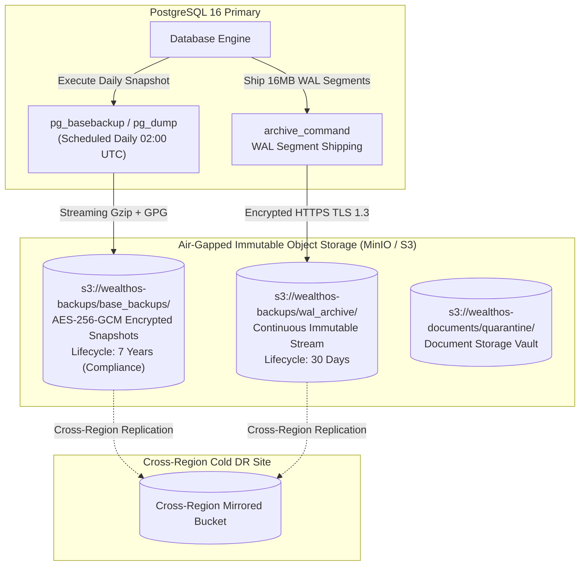

# WealthOS — Enterprise Backup Strategy & Data Protection Architecture

**Programme:** WealthOS Enterprise Architecture & Production Readiness  
**Document:** Backup Strategy Specification  
**Date:** 2026-11-08  
**Status:** Approved Engineering Standard  
**Target RPO:** $< 1.0$ minute (Point-in-Time Recovery)  
**Target RTO:** $< 15$ minutes (Full Cluster Cold Restore) / $< 15$ seconds (Streaming HA Failover)  
**Author:** Principal SRE & Database Architect  

---

## 1. Multi-Tiered Backup Architecture

WealthOS combines continuous Write-Ahead Log (WAL) archiving with daily encrypted base backups and immutable object storage versioning:



---

## 2. Backup Tiers, Schedules & Retention Policies

| Backup Tier | Mechanism | Schedule / Frequency | Retention Period | RPO Target | Storage Class |
|---|---|---|---|---|---|
| **Continuous WAL** | PostgreSQL `archive_command` shipping 16MB WAL segments | Continuous (Real-time upon segment fill or 60s timeout via `archive_timeout`) | 30 Days | **$< 60$ seconds** | S3 Standard / MinIO Hot |
| **Daily Full Snapshot** | Physical `pg_basebackup` (compressed tarball + SHA-256) | Daily at 02:00 UTC | 90 Days | **$< 24$ hours** | S3 Standard-IA |
| **Monthly Archive Dump** | Logical `pg_dump` with schema, roles, and RLS metadata | 1st of every month at 03:00 UTC | 7 Years (Statutory Indian Accounting Standard) | **$< 30$ days** | S3 Glacier Flexible / Cold |
| **Object Storage Docs** | MinIO Bucket Versioning & Object Lock | Continuous on upload | Indefinite / Soft-delete | **0 seconds** | MinIO Distributed |

---

## 3. Cryptographic Protection & Access Governance

1. **Encryption at Rest:**
   - All physical and logical backup artifacts are encrypted using AES-256-GCM before exiting the database host:
     ```bash
     pg_basebackup -Ft -z -D - | gpg --batch --yes --encrypt --recipient ops-backup@wealthos.internal -o /backup/base.tar.gz.gpg
     ```
2. **Access Control & Air-Gapping:**
   - The backup storage bucket uses an IAM role with write-only (`PutObject`) permissions from the database host.
   - The database host has **zero delete or overwrite permissions** (`Deny: s3:DeleteObject*`).
   - Even if the production database host is fully compromised, existing backup snapshots and WAL archives cannot be deleted or ransomed.
3. **Object Lock & Immutability:**
   - S3 / MinIO Object Lock is enabled in Compliance Mode with a 30-day retention lock.

---

## 4. Automated Backup Verification & Health Monitoring

A scheduled automated worker validates the backup chain weekly:
1. Downloads the latest base backup snapshot to an ephemeral staging container (`wealthos_backup_verifier`).
2. Restores the base backup.
3. Replays continuous WAL segments up to the current timestamp.
4. Executes the double-entry accounting integrity assertion:
   ```sql
   SELECT sum(debit) - sum(credit) FROM journal_lines;
   -- Must equal 0.0000 exactly
   ```
5. Executes RLS tenant isolation checks.
6. Emits a Prometheus metric `wealthos_backup_verify_success{database="wealthos"} 1`.
