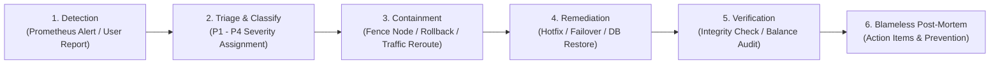

# WealthOS — Incident Response & Blameless Post-Mortem Protocol

**Programme:** WealthOS Enterprise Architecture & Production Readiness  
**Document:** Incident Response Protocol  
**Date:** 2026-11-08  
**Status:** Approved Operational Protocol  
**Standards:** ISO 27001, SOC 2 Type II Incident Handling  
**Author:** Incident Commander & Principal SRE  

---

## 1. Incident Management Lifecycle

When an operational, financial, or security incident occurs, the response follows a disciplined six-stage lifecycle:



---

## 2. War Room & Communications Protocol

For any **P1 (Critical)** or **P2 (High)** incident:
1. **Declare Incident:** The on-call engineer pages the Incident Commander (IC).
2. **Open War Room:** Dedicated Slack channel `#incident-YYYYMMDD-description` and Google Meet / Zoom bridge opened within 5 minutes.
3. **Assign Roles:**
   - **Incident Commander (IC):** Directs the response, coordinates updates.
   - **Operations Lead:** Executes technical commands (database failover, deployment).
   - **Communications Lead:** Updates the internal status page every 15 minutes.
4. **Customer Communication:** External status page updated with factual statements (avoiding technical jargon or premature root-cause assertions).

---

## 3. Blameless Post-Incident Review (PIR) Template

Every P1 or P2 incident requires a published Post-Incident Review within 48 hours:

```markdown
# Incident Post-Mortem: [Incident Title]

**Date:** YYYY-MM-DD  
**Incident Severity:** [P1 / P2]  
**Duration:** [Start Time] to [End Time] (Total: X minutes)  
**Incident Commander:** [Name]  
**Lead SRE / Investigator:** [Name]  

## 1. Executive Summary
Brief high-level explanation of what happened, customer impact, and how it was resolved.

## 2. Customer & Financial Impact
- Total users affected: [Count]
- Total financial transactions affected: [Count]
- Data loss (RPO): [0 seconds / X minutes]
- Recovery time (RTO): [X seconds / minutes]
- Double-entry ledger invariant verified: [YES/NO]

## 3. Incident Timeline (UTC)
- HH:MM - Automated alert fires: [Alert Name]
- HH:MM - Incident Commander assumes command; war room opened.
- HH:MM - Containment action executed: [Action]
- HH:MM - Root cause identified: [Root Cause]
- HH:MM - Remediation applied: [Fix Applied]
- HH:MM - Financial integrity audit verified 0 imbalance; all health probes green.
- HH:MM - Incident officially closed.

## 4. Root Cause Analysis (5 Whys)
1. Why did the issue occur? ...
2. Why did that happen? ...
3. Why was that not prevented? ...
4. Why did testing not catch it? ...
5. Why was there no earlier alert? ...

## 5. What Went Well / What Could Be Improved
- Well: [Fast failover, automated alerts]
- Improved: [Clearer runbook, better connection budget alerts]

## 6. Action Items & Preventive Measures
| Action Item | Type | Owner | Target Date | Jira / Ticket |
|---|---|---|---|---|
| Example: Add alerting for connection pool > 80% | Prevention | Lead SRE | YYYY-MM-DD | WOS-1234 |
```

