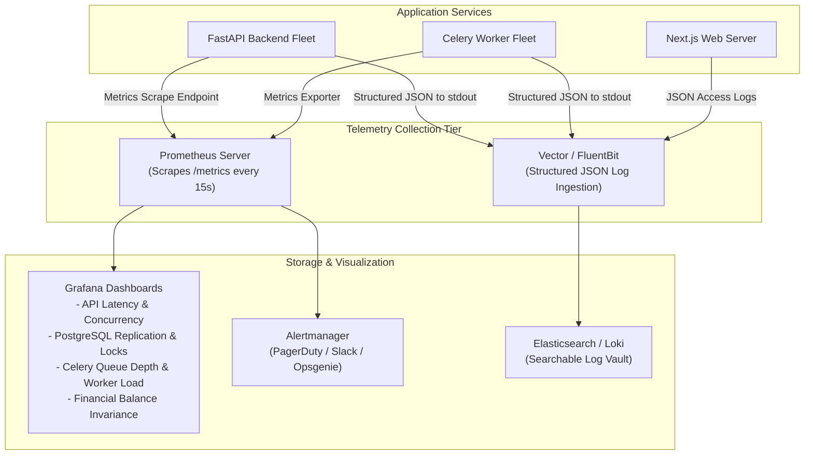

# WealthOS — Centralized Observability & Telemetry Architecture

**Programme:** WealthOS Enterprise Architecture & Production Readiness  
**Document:** Observability Design Specification  
**Date:** 2026-11-08  
**Status:** Approved Operational Standard  
**Standards:** OpenTelemetry, Prometheus Exposition 0.0.4  
**Author:** Principal SRE & Observability Lead  

---

## 1. Unified Telemetry Architecture

WealthOS combines structured JSON logging, Prometheus time-series metrics, distributed tracing correlation IDs, and synthetic integrity monitors:



---

## 2. Structured JSON Logging Standard

Every log entry emitted by WealthOS services is serialized as single-line JSON adhering to the schema:

```json
{
  "timestamp": "2026-11-08T14:30:15.124Z",
  "level": "INFO",
  "logger": "wealthos.api.ledger",
  "service": "wealthos-backend-api",
  "environment": "production",
  "correlation_id": "a9b8c7d6-e5f4-4321-abcd-1234567890ab",
  "tenant_id": "8c2cfb5e-4c8e-5cbe-0cee-3c1e8c4edc7e",
  "action": "journal_entry_posted",
  "status": "success",
  "duration_ms": 14.2,
  "details": {
    "entry_id": "3f2a1b0c-9d8e-7f6a-5b4c-3d2e1f0a9b8c",
    "lines_count": 2,
    "debit_total": "50000.0000",
    "credit_total": "50000.0000"
  }
}
```

### Strict Redaction Policy (Zero PII in Logs)
The logging formatter automatically redacts:
- Passwords, hashes, and PINs (`***REDACTED***`).
- Authorization headers and bearer tokens.
- Permanent Account Numbers (PAN) and Aadhaar numbers.
- Full bank account and credit card numbers (only last 4 digits allowed).
- Uploaded statement PDF byte contents.

---

## 3. Core Metrics Exposition Catalog

Prometheus scrapes the `/metrics` endpoint across five monitoring dimensions:

### 3.1 Application Performance Metrics
- `wealthos_http_requests_total{method, endpoint, status_code}`: Counter of all requests.
- `wealthos_http_request_duration_seconds{method, endpoint}`: Histogram of request latency.
- `wealthos_active_connections`: Gauge of concurrent connected clients.

### 3.2 Database & Connection Pool Metrics
- `wealthos_db_pool_active_connections`: Currently checked-out pooled connections.
- `wealthos_db_pool_overflow_connections`: Current overflow connections.
- `wealthos_db_query_duration_seconds{query_type}`: Histogram of SQL query latency.
- `wealthos_db_replication_lag_seconds`: Standby WAL replay lag behind primary.

### 3.3 Redis & Distributed Cache Metrics
- `wealthos_redis_used_memory_bytes`: RAM utilized by cache and session store.
- `wealthos_redis_cache_hits_total`: Total cache hits.
- `wealthos_redis_cache_misses_total`: Total cache misses.

### 3.4 Asynchronous Worker Metrics
- `wealthos_celery_queue_depth{queue="ocr_heavy|market_data|default"}`: Pending tasks in queue.
- `wealthos_celery_task_duration_seconds{task_name}`: Worker execution duration.
- `wealthos_celery_task_retries_total{task_name}`: Number of retry attempts.

### 3.5 Financial Business Integrity Metrics
- `wealthos_accounting_imbalance_total`: **CRITICAL ALERT GAUGE** $\rightarrow$ Must remain `0.0000` at all times.
- `wealthos_unreconciled_discrepancies_count`: Count of active bank statement discrepancies.
- `wealthos_provider_sync_failures_total`: Counter of external provider API errors.

