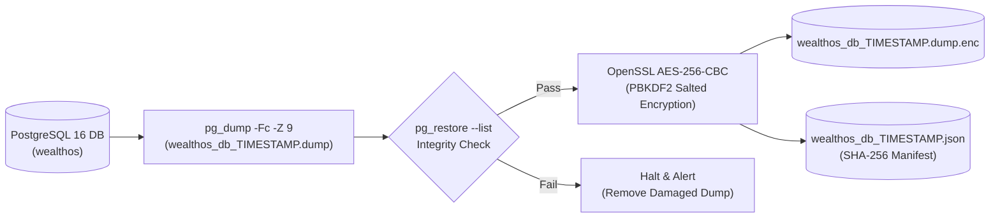

# WealthOS — Production Database Backup Runbook
## Automated PostgreSQL Custom-Format Archiving & AES-256-CBC Encryption

**Document Version:** 1.0.0  
**Date:** 2026-11-08  
**Repository:** `Livesh-L-28/WealthOS`  
**Active Branch:** `feature/final-financial-intelligence-production`  
**Executable Script:** `scripts/backup_database.sh`  

---

## 1. Backup Strategy Overview

WealthOS employs PostgreSQL's native custom-format archive (`pg_dump --format=custom --compress=9`) to produce compact, high-performance database snapshots. Each archive is verified before encryption, encrypted at rest using OpenSSL AES-256-CBC with PBKDF2, and cataloged with a cryptographic SHA-256 manifest.



---

## 2. Backup Execution Procedures

### 2.1 Automated Nightly Cron Job
Configure the root or backup service crontab to execute daily at 01:00 UTC:
```cron
0 1 * * * /Users/livesh/WEALTHOS/scripts/backup_database.sh >> /var/log/wealthos_backup.log 2>&1
```

### 2.2 Manual Execution via CLI
To trigger an on-demand snapshot prior to maintenance or schema updates:
```bash
# Environment variables override defaults as required
export POSTGRES_HOST="localhost"
export POSTGRES_PORT="5432"
export POSTGRES_ADMIN_USER="wealthos_admin"
export POSTGRES_ADMIN_PASSWORD="<vaulted_admin_password>"
export POSTGRES_DB="wealthos"
export BACKUP_DIR="/tmp/wealthos_backups"
export BACKUP_ENCRYPTION_KEY="<air_gapped_backup_key>"

./scripts/backup_database.sh
```

---

## 3. Manifest Verification & Offsite Replication

Each backup execution produces a paired `.json` manifest:
```json
{
  "backup_id": "wealthos_db_20261108_023553Z",
  "timestamp": "20261108_023553Z",
  "database": "wealthos",
  "format": "custom",
  "compression": "zlib-9",
  "encryption": "aes-256-cbc-pbkdf2",
  "raw_file_sha256": "4a7b3...e21",
  "encrypted_file": "/tmp/wealthos_backups/wealthos_db_20261108_023553Z.dump.enc",
  "encrypted_file_sha256": "8f1c2...90a",
  "file_size_bytes": 142058,
  "status": "VERIFIED_VALID"
}
```

Offsite replication synchronizes the encrypted archive to an immutable AWS S3 Glacier or cold-storage bucket:
```bash
aws s3 cp /tmp/wealthos_backups/wealthos_db_*.dump.enc s3://wealthos-offsite-backups/database/
aws s3 cp /tmp/wealthos_backups/wealthos_db_*.json s3://wealthos-offsite-backups/metadata/
```
