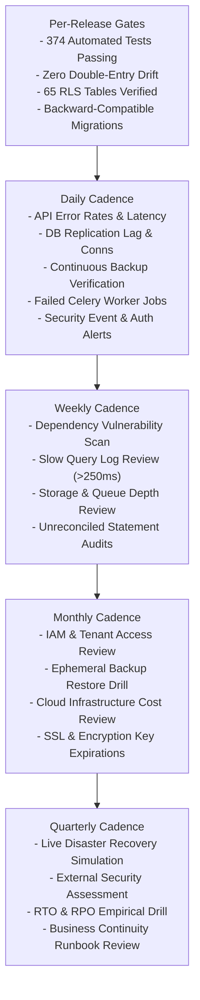

# WealthOS — Continuous Maintenance & Operational Calendar

**Programme:** WealthOS Enterprise Architecture & Production Readiness  
**Document:** Continuous Maintenance Calendar  
**Date:** 2026-11-08  
**Status:** Approved Operational Schedule  
**Compliance Target:** ISO 27001, SOC 2 Type II, RBI IT Governance Guidelines  
**Author:** Principal SRE & Operations Lead  

---

## 1. Operational Cadence Schedule

WealthOS enforces a structured maintenance schedule across daily, weekly, monthly, quarterly, and per-release cycles:

---

## 2. Detailed Task Checklists by Cadence

### Daily Operational Checklist (08:00 UTC)
- [ ] Inspect Prometheus `/metrics` for `wealthos_accounting_imbalance_total == 0`.
- [ ] Review Grafana P95 API latency dashboard ($< 200\text{ms}$).
- [ ] Verify physical replication lag on read replica ($< 2.0\text{ seconds}$).
- [ ] Check S3 backup bucket for automated base backup completion.
- [ ] Inspect Celery dead-letter and failed task queues.
- [ ] Review security audit logs for repeated failed logins or account lockouts.

### Weekly Operational Checklist (Every Monday)
- [ ] Run automated vulnerability scans: `pip-audit` on backend, `npm audit` on frontend.
- [ ] Review PostgreSQL slow-query logs (`log_min_duration_statement = 250ms`).
- [ ] Inspect MinIO object storage quarantine bucket; review rejected uploads.
- [ ] Verify disk storage headroom across PostgreSQL primary, replica, and Redis volumes.
- [ ] Review unresolved bank statement reconciliation discrepancies.

### Monthly Operational Checklist (First Wednesday)
- [ ] Execute automated cold backup restoration against ephemeral test database (`wealthos_backup_verifier`).
- [ ] Review cloud hosting expenditures against budget forecast.
- [ ] Audit user access rights and revoke stale administrative permissions.
- [ ] Verify SSL/TLS certificate validity windows ($> 60\text{ days}$ remaining).
- [ ] Audit soft-deleted user records and verify pseudonymization compliance.

### Quarterly Operational Checklist
- [ ] Conduct live simulated primary database failover exercise per `docs/database/FAILOVER_RUNBOOK.md`.
- [ ] Empirically measure RTO ($< 15\text{s}$) and RPO ($< 60\text{s}$) and record evidence.
- [ ] Conduct comprehensive threat model and penetration test review.
- [ ] Review capacity growth models against active user registration trajectories.

### Every Application Release Gate
- [ ] All 374 automated tests pass with 0 failures (Pytest, Vitest, Playwright).
- [ ] Zero TypeScript static compilation errors (`tsc --noEmit`).
- [ ] Production Next.js build succeeds with static prerendering.
- [ ] Alembic migrations tested against clean and populated schemas using expand-and-contract.
- [ ] Owner approval confirmed before production release or Google Play submission.
