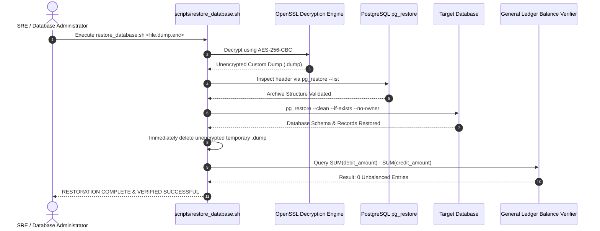

# WealthOS — Production Database Restoration Runbook
## Decryption, pg_restore Execution & Post-Restore Balance Invariant Verification

**Document Version:** 1.0.0  
**Date:** 2026-11-08  
**Repository:** `Livesh-L-28/WealthOS`  
**Active Branch:** `feature/final-financial-intelligence-production`  
**Executable Script:** `scripts/restore_database.sh`  

---

## 1. Restoration Architecture & Principles

Restoration transforms an encrypted `.dump.enc` archive into a fully verified, running PostgreSQL database instance:



---

## 2. Restoration Procedures

### 2.1 Standard Automated Restore
To restore the latest encrypted backup in the backup directory:
```bash
export POSTGRES_HOST="localhost"
export POSTGRES_PORT="5432"
export POSTGRES_ADMIN_USER="wealthos_admin"
export POSTGRES_ADMIN_PASSWORD="<vaulted_admin_password>"
export POSTGRES_DB="wealthos"
export BACKUP_ENCRYPTION_KEY="<air_gapped_backup_key>"

./scripts/restore_database.sh
```

### 2.2 Pointed Restore to Specific Archive
To restore an exact historical snapshot:
```bash
./scripts/restore_database.sh /tmp/wealthos_backups/wealthos_db_20261108_023553Z.dump.enc
```

---

## 3. Post-Restore Financial Integrity Gate

The restore script automatically executes a mathematical general ledger integrity check. The restoration is declared failed if any posted entry is unbalanced:

```sql
SELECT count(*) FROM (
  SELECT je.id
  FROM journal_entries je
  JOIN journal_lines jl ON je.id = jl.journal_entry_id
  WHERE je.status = 'POSTED'
  GROUP BY je.id
  HAVING SUM(jl.debit_amount) <> SUM(jl.credit_amount)
) unb;
```

If the count is greater than zero, the script terminates with exit code 2 and alerts the SRE team. Traffic must remain frozen until forensics are completed.
