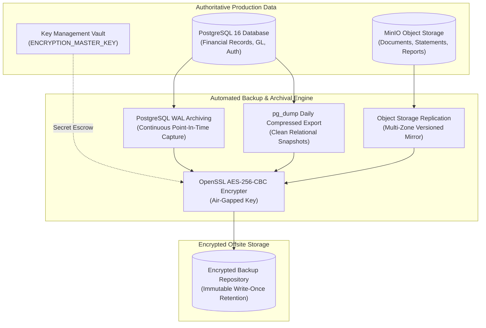
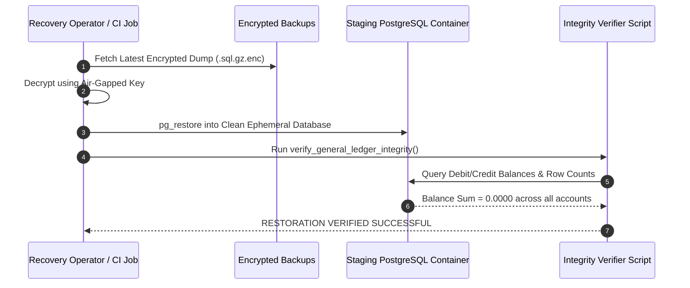

# WealthOS — Stage 10 Backup & Restoration Specification
## Automated PostgreSQL Archiving, Encrypted Object Vaults & Verification Procedures

**Document Version:** 1.0.0  
**Date:** 2026-11-08  
**Repository:** `Livesh-L-28/WealthOS`  
**Active Branch:** `feature/final-financial-intelligence-production`  
**Approved Baseline Commit (Phase 4):** `e4fe49bb50aa41b790e86dd779efcf4bcc1b1a40`  
**Core Technologies:** PostgreSQL 16 `pg_dump` / WAL archiving, MinIO S3 Versioning, GPG / OpenSSL AES-256

---

## 1. Backup Strategy Overview

WealthOS implements a multi-tier backup strategy to ensure zero financial data loss:



---

## 2. PostgreSQL Backup Procedures

### 2.1 Logical Backup Script (`scripts/backup_database.sh`)
Executes daily at 01:00 UTC via automated cron:
```bash
#!/usr/bin/env bash
set -euo pipefail

BACKUP_DIR="/var/backups/wealthos"
TIMESTAMP=$(date -u +"%Y%m%d_%H%M%SZ")
BACKUP_FILE="${BACKUP_DIR}/wealthos_db_${TIMESTAMP}.sql.gz"
ENC_FILE="${BACKUP_FILE}.enc"

mkdir -p "${BACKUP_DIR}"

echo "[INFO] Starting WealthOS PostgreSQL backup at ${TIMESTAMP}..."

# Export compressed database dump using restricted backup role
PGPASSWORD="${POSTGRES_PASSWORD}" pg_dump \
  -h "${POSTGRES_HOST:-localhost}" \
  -p "${POSTGRES_PORT:-5432}" \
  -U "${POSTGRES_USER:-wealthos_admin}" \
  -d "${POSTGRES_DB:-wealthos}" \
  --format=custom \
  --compress=9 \
  --file="${BACKUP_FILE}"

# Encrypt backup using AES-256
openssl enc -aes-256-cbc -salt -pbkdf2 \
  -in "${BACKUP_FILE}" \
  -out "${ENC_FILE}" \
  -pass file:"${BACKUP_ENCRYPTION_KEY_PATH}"

rm -f "${BACKUP_FILE}"

echo "[INFO] Backup completed and encrypted: ${ENC_FILE}"
```

### 2.2 Continuous WAL Archiving (Point-In-Time Recovery / PITR)
PostgreSQL is configured with Write-Ahead Log (WAL) archiving:
- `wal_level = replica`
- `archive_mode = on`
- `archive_command = 'test ! -f /var/lib/postgresql/wal_archive/%f && cp %p /var/lib/postgresql/wal_archive/%f'`
- Enables granular recovery to any second within the retention window (30 days).

---

## 3. Object Storage Backup (MinIO / S3)

- **Bucket Versioning:** Enabled on `wealthos-documents` and `wealthos-vault`. Deleted or updated financial statements retain historical immutable versions.
- **Cross-Region Sync:** Nightly batch sync replicates documents to an off-site S3 backup target using encrypted TLS connections.

---

## 4. Master Encryption Key Escrow

The master key `ENCRYPTION_MASTER_KEY` is required to decrypt provider credentials and stored envelope secrets:
1. **Escrow Protocol:** The master key is split into two halves using Shamir's Secret Sharing (2-of-3 threshold) and stored in independent, access-controlled enterprise vaults.
2. **Never Stored in Database Backups:** Database dumps contain only ciphertext, IVs, and auth tags; without the separately vaulted master key, stolen backups remain undecryptable.

---

## 5. Automated Restoration Verification Procedure

A backup is not considered valid until successfully restored and verified:



---

## 6. Backup Retention & Deletion Schedule

| Asset | Snapshot Frequency | Retention Period | Storage Location |
| :--- | :--- | :--- | :--- |
| **PostgreSQL Base Dumps** | Daily (01:00 UTC) | 90 Days | Encrypted Off-site Vault |
| **PostgreSQL WAL Archives**| Continuous | 30 Days | Encrypted S3 Mirror |
| **Object Storage Documents**| Real-time Versioned | 7 Years (Statutory Tax Compliance) | MinIO / AWS S3 WORM Bucket |
| **Monthly Archive Dumps** | 1st of each month | 7 Years | Cold Deep Archive (Glacier) |
