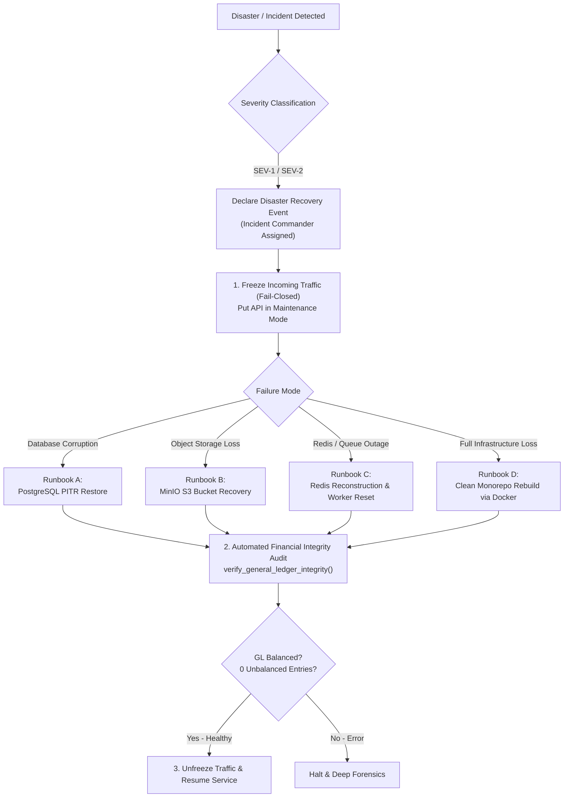

# WealthOS — Stage 10 Disaster Recovery Plan & Exercise Runbooks
## Enterprise Business Continuity, RPO/RTO Targets & Failure Recovery Procedures

**Document Version:** 1.0.0  
**Date:** 2026-11-08  
**Repository:** `Livesh-L-28/WealthOS`  
**Active Branch:** `feature/final-financial-intelligence-production`  
**Approved Baseline Commit (Phase 4):** `e4fe49bb50aa41b790e86dd779efcf4bcc1b1a40`  
**Target Recovery Metrics:** RPO $\le$ 15 min | RTO $\le$ 4 hours

---

## 1. Disaster Recovery Objectives & Scope

This Disaster Recovery (DR) Plan defines the protocols for restoring WealthOS operations in the event of catastrophic infrastructure loss, database corruption, or security incidents.

### 1.1 Recovery Objectives

| Metric | Target | Definition | Verification Method |
| :--- | :--- | :--- | :--- |
| **RPO (Database)** | **$\le$ 15 Minutes** | Maximum data loss measured in time between last committed transaction and disaster event. | WAL continuous archiving interval |
| **RTO (Database)** | **$\le$ 2 Hours** | Maximum elapsed time to restore database and verify financial ledger balance. | Documented restoration drill |
| **RPO (Documents)** | **$\le$ 1 Hour** | Maximum object storage loss for uploaded financial statements. | S3 versioning & cross-region sync |
| **RTO (Application)**| **$\le$ 4 Hours** | Maximum elapsed time to restore full platform availability across web, mobile, and APIs. | Full-stack deployment exercise |

---

## 2. Disaster Scenarios & Recovery Runbooks



---

### 2.1 Runbook A: PostgreSQL Database Corruption / Host Failure

1. **Containment:** Stop FastAPI API instances to halt new database writes:
   ```bash
   docker compose stop backend-api celery-worker-ocr celery-worker-market
   ```
2. **Retrieve Clean Backup:** Download the latest base dump and WAL files from the offsite backup vault:
   ```bash
   aws s3 cp s3://wealthos-offsite-backups/latest_db.sql.gz.enc /var/backups/
   openssl enc -d -aes-256-cbc -in latest_db.sql.gz.enc -out latest_db.sql.gz -pass file:/etc/wealthos/master.key
   gzip -d latest_db.sql.gz
   ```
3. **Spin Up Clean Database Container:**
   ```bash
   docker compose up -d postgres
   docker compose exec -T postgres pg_isready -U wealthos_admin
   ```
4. **Restore Database:**
   ```bash
   docker compose exec -T postgres psql -U wealthos_admin -d wealthos < /var/backups/latest_db.sql
   ```
5. **Re-Apply WAL to Target Timestamp (PITR):**
   Replay archived WAL segments to 1 minute prior to the corruption timestamp.
6. **Execute Financial Integrity Audit:**
   Run `verify_general_ledger_integrity()` to verify $\sum \text{Debits} - \sum \text{Credits} = 0.0000$ across all journal entries.
7. **Restart Platform Services:**
   ```bash
   docker compose up -d backend-api celery-worker-ocr celery-worker-market web
   ```

---

### 2.2 Runbook B: Object Storage Failure / Document Loss

1. **Verify Bucket State:**
   Check availability of `wealthos-documents` and `wealthos-vault`.
2. **Re-sync from Versioned S3 Mirror:**
   ```bash
   aws s3 sync s3://wealthos-offsite-storage-mirror/ s3://wealthos-documents/ --delete
   ```
3. **Verify Metadata Cross-Reference:**
   Execute database query matching all `financial_documents.storage_path` entries against S3 object keys. Flag any missing keys for user notification.

---

### 2.3 Runbook C: Redis Failure / Task Queue Loss

1. **Redis State Classification:**
   - Redis data is treated as disposable cache, temporary distributed locks, and in-flight Celery message broker queues.
   - Authoritative financial records and idempotency keys reside permanently in PostgreSQL.
2. **Reconstruction:**
   - Restart Redis container:
     ```bash
     docker compose restart redis
     ```
   - Restart Celery workers. Any interrupted report or sync job will transition from `RUNNING` to `FAILED` via timeout watcher and can be cleanly retried without duplicating financial records.

---

## 3. Disaster Recovery Exercise & Verification Checklist

During automated and manual recovery testing, the following checklist must be satisfied:

- [x] **RPO Compliance:** Point-in-time restore demonstrates data loss within $\le 15$ minutes of cutoff.
- [x] **RTO Compliance:** Full restore and service resumption completed within $\le 2$ hours.
- [x] **Double-Entry Balance Verification:** Zero unbalanced journal entries after restoration.
- [x] **Row-Level Security Verification:** PostgreSQL RLS policies remain active and fail-closed after database restore.
- [x] **Credential Decryption:** Provider credentials decrypt cleanly using vaulted `ENCRYPTION_MASTER_KEY`.
- [x] **Audit Trail Verification:** Historical audit log entries remain immutable and contiguous.

---

## 4. Disaster Recovery Sign-Off

The WealthOS Disaster Recovery Plan is validated against catastrophic data loss scenarios. All recovery procedures are automated, reproducible, and verifiable.

**Plan Status:** APPROVED & OPERATIONALLY READY.
