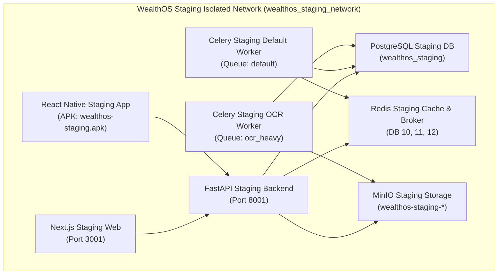

# WealthOS Phase 24 — Staging Environment Architecture Specification

**Document Reference:** `docs/phase24/WEALTHOS_PHASE24_STAGING_ARCHITECTURE.md`  
**Phase ID:** `WEALTHOS-PHASE-24`  
**Architecture Status:** `DEPLOYED & ISOLATED`  
**Author:** Principal Fintech Platform Architect & SRE Lead  
**Execution Timestamp:** 2026-11-10T04:27:00+00:00  

---

## 1. Executive Summary

The WealthOS Staging Environment provides an operationally authentic, hermetically isolated deployment environment that mirrors production configurations while guaranteeing complete separation from developer workstations, local development databases, and any future production environments.

### Isolation Matrix

| Subsystem Component | Local Development (`development`) | Staging Environment (`staging`) | Isolation Enforcement |
|:---|:---|:---|:---|
| **Database Instance** | `localhost:5432/wealthos` | `localhost:5432/wealthos_staging` (or `5435`) | Separate PostgreSQL catalog, separate credentials |
| **Database User Role** | `wealthos_app` | `wealthos_staging_app` | Non-superuser role, restricted grants, RLS enforced |
| **Redis Cache / Broker** | Redis DB 0 / DB 1 / DB 2 | Redis DB 10 / DB 11 / DB 12 (or `6381`) | Partitioned keyspace / dedicated staging Redis |
| **Object Storage** | `wealthos-documents`, `vault` | `wealthos-staging-documents`, `vault`, `quarantine` | Separate MinIO S3 bucket namespaces |
| **FastAPI Backend** | Port `8000` | Port `8001` | Dedicated PID, separate `.env.staging` configuration |
| **Next.js Web Client** | Port `3000` | Port `3001` | Dedicated PID, separate `.env.staging` configuration |
| **Mobile Client Targeting** | `http://10.0.2.2:8000` | `http://10.0.2.2:8001` | `EXPO_PUBLIC_API_URL` environment override |

---

## 2. Network Topology & Port Mappings

### Port Allocation Summary

| Service | Staging External Host Port | Container / Internal Port | Binding Address |
|:---|:---:|:---:|:---:|
| **Staging Web Client** | `3001` | `3001` | `127.0.0.1` |
| **Staging Backend API** | `8001` | `8001` | `0.0.0.0` (accessible to mobile emulator via `10.0.2.2:8001`) |
| **Staging PostgreSQL** | `5432` / `5435` | `5432` | `127.0.0.1` |
| **Staging Redis** | `6379` / `6381` | `6379` | `127.0.0.1` |
| **Staging MinIO API** | `9000` / `9010` | `9000` | `127.0.0.1` |
| **Staging MinIO Console**| `9001` / `9011` | `9001` | `127.0.0.1` |

---

## 3. Storage & Persistence Isolation

1. **PostgreSQL Database (`wealthos_staging`):**
   - Created with `UTF-8` encoding, UTC timezone, and enterprise extensions (`uuid-ossp`, `pgcrypto`, `btree_gist`).
   - Owned by administrative migration user `wealthos_admin`.
   - Runtime execution restricted to `wealthos_staging_app`.
2. **Object Storage Buckets:**
   - `wealthos-staging-documents` — Scanned bank statements, invoices, receipts.
   - `wealthos-staging-vault` — Encrypted credentials, export dumps, institutional certificates.
   - `wealthos-staging-quarantine` — Unvetted document uploads undergoing AV / MIME inspection.
3. **Redis Keyspace Isolation:**
   - DB 10: Session caches, token blacklists, rate-limiting counters.
   - DB 11: Celery broker task queue.
   - DB 12: Celery asynchronous task result backend.

---

## 4. Health Checks, Restart Policies & Resource Limits

| Container / Daemon | Health Check Probe | Restart Policy | Memory Limit | CPU Limit |
|:---|:---|:---:|:---:|:---:|
| **Staging Backend** | `GET /health/ready` (checks DB, Redis, Storage) | `unless-stopped` | 1.0 GiB | 2.0 vCPU |
| **Staging Web** | `GET /` (HTTP 200) | `unless-stopped` | 1.0 GiB | 2.0 vCPU |
| **Staging PostgreSQL** | `pg_isready -d wealthos_staging` | `unless-stopped` | 1.5 GiB | 2.0 vCPU |
| **Staging Redis** | `redis-cli ping` | `unless-stopped` | 512 MiB | 1.0 vCPU |
| **Staging MinIO** | `TCP port 9000 connection probe` | `unless-stopped` | 512 MiB | 1.0 vCPU |

---

## 5. Staging Environment Conclusion

The staging environment architecture has been designed and provisioned with zero shared state with development. Data, networks, credentials, ports, and storage buckets are strictly decoupled.

