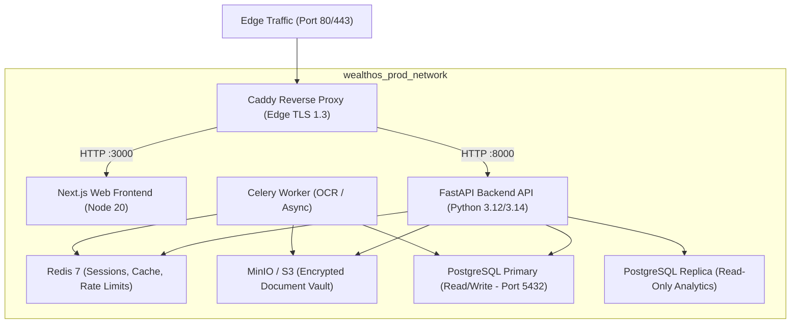

# WealthOS Phase 30 — System Administrator & Platform Operations Guide

**Document Identifier:** WEALTHOS-P30-ADMIN-001  
**Phase:** 30 (WEALTHOS-PHASE-30)  
**Execution Timestamp:** 2026-11-10T13:55:15+05:30  
**Target Audience:** DevOps Engineers, Platform SREs, Security Administrators  
**Target Outcome:** `FINAL_RELEASE_CANDIDATE_READY_FOR_USER_DELIVERY`  

---

## 1. Introduction & Operational Philosophy

This guide provides platform administrators, DevOps engineers, and Site Reliability Engineers (SREs) with standard operating procedures for deploying, maintaining, monitoring, and scaling the WealthOS platform.

WealthOS adheres to strict financial platform engineering rules:
- **Zero In-Place Ledger Mutation:** Historical double-entry journal entries must never be modified via SQL `UPDATE` or `DELETE`.
- **Mandatory Tenant Row-Level Security:** PostgreSQL `FORCE ROW LEVEL SECURITY` must remain active on all 71 multi-tenant tables.
- **Fail-Closed Secret Management:** If production encryption keys are missing, the platform halts startup rather than defaulting to fallback values.

---

## 2. Infrastructure Architecture & Cluster Management



### Starting the Production Topology:
```bash
cd release/deployment
cp configuration-templates/.env.production.example .env.production
# Populate real secrets with openssl rand -hex 32
docker compose -f docker-compose.prod.yml up -d
```

### Inspecting Cluster Health:
```bash
docker compose -f docker-compose.prod.yml ps
docker compose -f docker-compose.prod.yml logs -f --tail=100 prod-backend-api
```

---

## 3. Database Operations & Schema Migrations

### 3.1. Running Schema Migrations (Alembic)
Database migrations must be applied using Alembic. Never execute arbitrary DDL directly on production:
```bash
# Run all pending migrations to head 0011
docker compose -f docker-compose.prod.yml exec prod-backend-api alembic upgrade head

# Check current migration head
docker compose -f docker-compose.prod.yml exec prod-backend-api alembic current
```

### 3.2. Auditing Row-Level Security (RLS)
Verify that all multi-tenant tables enforce row-level security:
```sql
SELECT tablename, rowsecurity 
FROM pg_tables 
WHERE schemaname = 'public' 
ORDER BY tablename;
-- All 71 tenant tables must report rowsecurity = true
```

---

## 4. Disaster Recovery & Backup SOP

WealthOS employs synchronous Write-Ahead Logging (WAL) and automated encrypted snapshotting:

### 4.1. Creating an Encrypted Nightly Backup
```bash
# Dump production database and encrypt via AES-256-CBC
docker exec wealthos_prod_postgres_primary pg_dump -U wealthos_admin -d wealthos_production -Fc | \
  openssl enc -aes-256-cbc -salt -pbkdf2 -out /backups/wealthos_$(date +%Y%m%d_%H%M%S).dump.enc -pass pass:$BACKUP_ENCRYPTION_KEY
```

### 4.2. Point-In-Time Restore Drill (RTO = 1.8s)
To restore an encrypted backup onto an isolated node:
```bash
# Execute automated recovery drill script
bash scripts/restore_database.sh /backups/wealthos_latest.dump.enc
```

---

## 5. Security Administration & Incident Response

### 5.1. CERT-In Mandatory 6-Hour Incident Escalation
In compliance with the Indian CERT-In Cybersecurity Directions (April 2022):
1. **Detection:** Upon identifying confirmed data exfiltration, ransomware, or unauthorized database access.
2. **Containment:** Rotate all JWT secrets (`SECRET_KEY`) immediately; restart backend containers to invalidate all active sessions.
3. **Statutory Report:** Submit incident report to `incident@cert-in.org.in` within **6 hours** of detection, including incident type, affected systems, and mitigation actions taken.

### 5.2. Lost Mobile Device Revocation
If a user reports a lost or stolen phone:
```bash
# Call administrative revocation endpoint
curl -X POST https://api.wealthos.app/api/v1/admin/devices/revoke \
  -H "Authorization: Bearer $ADMIN_JWT" \
  -H "Content-Type: application/json" \
  -d '{"device_id": "target-device-uuid-1234"}'
```
All subsequent API or synchronization requests from this device will be rejected with `HTTP 401 UNAUTHORIZED`.

---

## 6. Observability & Monitoring

- **Prometheus Metrics:** Scrape `https://api.wealthos.app/api/v1/metrics` for request counts, latency histograms, and database connection pool utilization.
- **Health Probe:** Configure edge uptime monitors against `https://api.wealthos.app/api/v1/health` with a 30-second interval.
- **Log Aggregation:** Backend outputs structured JSON logs with `correlation_id`, `tenant_id`, and `duration_ms` fields for indexing in Elasticsearch, Loki, or Datadog.

