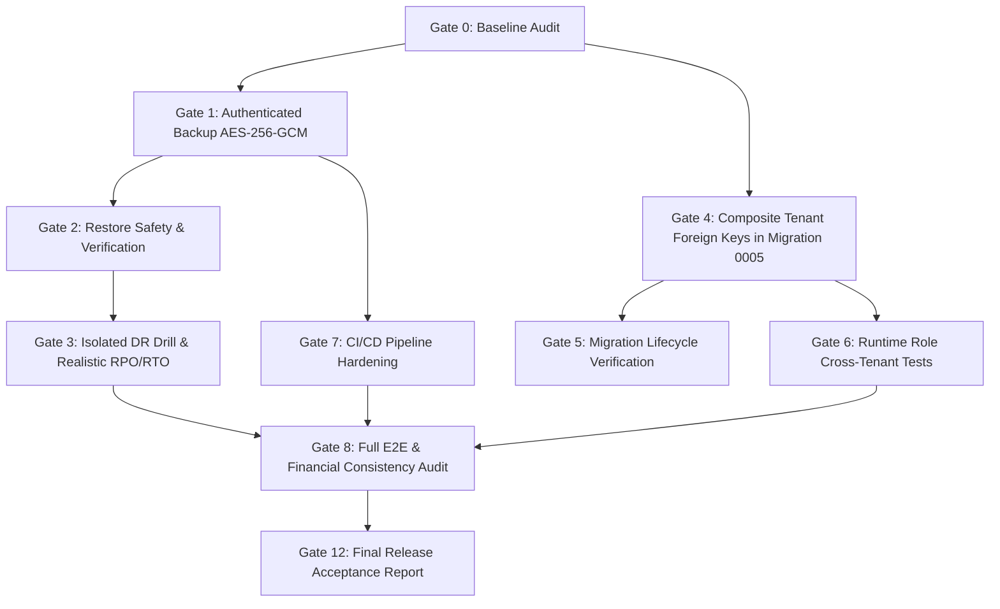

# WealthOS Release Gate Remediation — Baseline Audit

**Document:** Gate 0 — Baseline Architecture & Defect Identification Audit  
**Target Release Candidate:** `v1.0.0-rc1`  
**Repository:** `Livesh-L-28/WealthOS`  
**Branch:** `feature/final-financial-intelligence-production`  
**Baseline Commit SHA:** `f25dbfd516e94d0e461a4bab5d14e82e057bcc78`  
**Current Remote HEAD SHA:** `f25dbfd516e94d0e461a4bab5d14e82e057bcc78`  
**Previous CI Run:** GitHub Actions Run ID `42439923281` (Completed: 100% SUCCESS)  
**Date:** 2026-11-08  
**Audit Role:** Principal Financial Systems Architect, Application Security Engineer & QA Lead  

---

## 1. Executive Summary

While previous candidate commit `f25dbfd` achieved a 100% passing build across backend, frontend, and Docker container jobs in GitHub Actions Run `42439923281`, an independent release-gate review identified several critical implementation and operational vulnerabilities that must be remediated before production release authorization:

1. **Unauthenticated Backup Encryption & Secret Exposure:** `scripts/backup_database.sh` employs OpenSSL AES-256-CBC (vulnerable to padding oracle and lack of ciphertext authenticity) with hardcoded default credentials fallback.
2. **Permissive Restore Procedures:** `scripts/restore_database.sh` accepts implicit targets, lacks manifest checksum verification before decryption, does not validate schema version or tenant isolation, and suppresses errors with `|| true`.
3. **Disaster Recovery Safety & RPO Conflation:** `scripts/disaster_recovery_exercise.py` drops databases without environment guards or opt-in flags, and conflates an immediate backup/restore drill with a claimed production RPO of zero without point-in-time recovery (PITR) proof.
4. **Cross-Tenant Foreign Key Gaps:** In `backend/migrations/versions/0005_financial_foundation.py`, tenant-owned tables reference entity IDs without composite `(id, tenant_id)` foreign keys, allowing potential cross-tenant referential links if application checks fail.
5. **Runtime Multi-Tenant Role Verification:** Test coverage lacks explicit PostgreSQL integration testing using runtime role `wealthos_app` (with `NOBYPASSRLS`) concurrently asserting cross-tenant read/write/delete rejection between Tenant A and Tenant B.
6. **Suppressed CI Gate:** `.github/workflows/ci.yml` contains `npm audit --audit-level=critical || true`, violating non-negotiable security gate rules.

---

## 2. Exhaustive Defect Register & Remediation Blueprint

### Defect 1: Unauthenticated Backup Encryption & Secret Handling
- **Component:** `scripts/backup_database.sh`
- **Severity:** **Critical**
- **Evidence:** 
  - Line 20: `ENCRYPTION_KEY="${BACKUP_ENCRYPTION_KEY:-wealthos_local_32_byte_master_key_for_aes_gcm_123}"` (Insecure default fallback).
  - Line 45: `openssl enc -aes-256-cbc -salt -pbkdf2` (Unauthenticated CBC mode lacking GCM/HMAC message authentication tag).
  - Missing PostgreSQL version, key identifier, and archive size in manifest.
- **Proposed Remediation:**
  - Build authenticated envelope encryption using `AES-256-GCM` via Python `cryptography` AEAD (`scripts/backup_crypto.py`).
  - Use unique 96-bit (12-byte) initialization vectors (IVs) and 128-bit (16-byte) authentication tags.
  - Fail closed if `WEALTHOS_BACKUP_ENCRYPTION_KEY` is not provided. Remove all development defaults.
  - Generate comprehensive JSON manifest with plaintext SHA-256, ciphertext SHA-256, key hash, PostgreSQL version, and archive bytes.
- **Dependencies:** Python `cryptography` (available in backend environment).
- **Acceptance Criteria:** Backup produces `.dump.enc` containing authenticated ciphertext; manifest matches exact SHA-256 hashes; tampering with any byte causes decryption to abort.

---

### Defect 2: Unverified Restore Safety & Permissive Error Suppression
- **Component:** `scripts/restore_database.sh`
- **Severity:** **High**
- **Evidence:**
  - Line 13: Automatically picks latest backup if not provided.
  - Line 30: Fallback to default dev key.
  - Line 51: `"${DECRYPTED_FILE}" || true` (Suppresses `pg_restore` failures).
  - Lacks pre-decryption manifest validation, schema version checks, and tenant isolation checks.
- **Proposed Remediation:**
  - Require explicit `--target-db` parameter and `CONFIRM_RESTORE=true` environment variable.
  - Reject production database names unless explicit emergency override flag is supplied.
  - Verify manifest JSON and SHA-256 checksums before decrypting.
  - Authenticate decryption via AES-256-GCM tag verification before invoking `pg_restore`.
  - Validate post-restore:
    1. Schema version (`alembic_version == '0005_financial_foundation'`).
    2. Double-entry trial balance ($\Sigma\text{Debits} - \Sigma\text{Credits} = 0.0000$).
    3. Account-to-ledger consistency.
    4. Row-level security enforcement across all 43 tables.
  - Terminate with non-zero exit code on any failed check.
- **Dependencies:** Defect 1 (`scripts/backup_crypto.py`).
- **Acceptance Criteria:** Corrupt archive, mismatched checksum, wrong key, or unbalanced ledger causes restore to fail closed immediately.

---

### Defect 3: Disaster Recovery Safety & Defensible RPO/RTO Measurements
- **Component:** `scripts/disaster_recovery_exercise.py`
- **Severity:** **High**
- **Evidence:**
  - Database `DROP DATABASE IF EXISTS wealthos_dr_drill` executes without opt-in guard or host safety checks.
  - RPO was calculated as `0.000m` solely because no transactions were executed between backup and restore, which is invalid as a production claim without continuous WAL archiving.
- **Proposed Remediation:**
  - Add explicit flag `--force-drill` and `CONFIRM_DISASTER_RECOVERY_DRILL=true`.
  - Enforce strict allowlist for drill databases (`wealthos_dr_drill`, `wealthos_test_dr`). Reject any host other than localhost/test runner.
  - Implement realistic transaction progression test:
    1. Backup at $T_0$.
    2. Execute new transactions at $T_1$.
    3. Simulate catastrophic disaster at $T_2$.
    4. Measure real loss window ($\Delta T = T_2 - T_0$) without WAL archiving.
    5. Document clearly: PITR requires production WAL archiving to S3, which is documented but declared unverified in local environments without WAL archive storage.
  - Test negative scenarios: corrupt backup rejection, wrong encryption key rejection, manifest mismatch rejection.
- **Dependencies:** Defect 1, Defect 2.
- **Acceptance Criteria:** Automated drill runs with full safety gates and accurate RTO and RPO logging.

---

### Defect 4: Cross-Tenant Foreign-Key Relational Integrity
- **Component:** `backend/migrations/versions/0005_financial_foundation.py`
- **Severity:** **High**
- **Evidence:**
  - In `0005_financial_foundation.py`, tables such as `financial_transactions`, `investment_holding_lots`, `passive_income_records`, `budget_allocations`, and `goal_contributions` have standard foreign keys on `id` without composite `(id, tenant_id)`.
  - While Row-Level Security filters queries by `tenant_id`, database relational constraints alone do not prevent referencing an entity belonging to Tenant B if `tenant_id` was misconfigured in a raw SQL insert.
- **Proposed Remediation:**
  - Add `UNIQUE (id, tenant_id)` composite constraints on parent tables:
    - `financial_accounts(id, tenant_id)`
    - `transaction_categories(id, tenant_id)`
    - `transaction_merchants(id, tenant_id)`
    - `financial_instruments(id, tenant_id)`
    - `budgets(id, tenant_id)`
    - `financial_goals(id, tenant_id)`
    - `copilot_conversations(id, tenant_id)`
    - `provider_consents(id, tenant_id)`
    - `report_definitions(id, tenant_id)`
  - Add composite foreign keys on child tables referencing `(parent_id, tenant_id)`.
  - Maintain backward compatibility and ensure migration lifecycle (upgrade, downgrade, upgrade) remains 100% clean.
- **Dependencies:** Alembic migration graph.
- **Acceptance Criteria:** Attempting to insert a child record referencing Tenant B's parent ID under Tenant A's `tenant_id` fails with a PostgreSQL foreign-key constraint violation.

---

### Defect 5: Runtime Role Multi-Tenant Isolation Tests
- **Component:** `backend/tests/test_rls_cross_tenant_deep.py`
- **Severity:** **High**
- **Evidence:**
  - Existing tests partially use superuser connection or rely on SQLAlchemy tenant filters.
  - Need dedicated PostgreSQL runtime test executing strictly as runtime user `wealthos_app` (configured with `NOBYPASSRLS`).
- **Proposed Remediation:**
  - Create integration test suite `backend/tests/test_runtime_role_tenant_isolation.py`.
  - Connect strictly as `wealthos_app`.
  - Seed Tenant Alpha and Tenant Beta.
  - Test:
    1. Tenant Alpha cannot read Tenant Beta's accounts, transactions, investments, or copilot messages.
    2. Tenant Alpha cannot UPDATE Tenant Beta's accounts (returns 0 rows affected).
    3. Tenant Alpha cannot DELETE Tenant Beta's accounts (returns 0 rows affected).
    4. Tenant Alpha cannot INSERT a transaction referencing Tenant Beta's account (composite FK failure).
    5. Connection with empty or invalid `app.current_tenant_id` returns 0 rows (fail-closed).
- **Dependencies:** Defect 4.
- **Acceptance Criteria:** All 5 cross-tenant attack vectors cleanly rejected at database engine level.

---

### Defect 6: CI Security Gate Enforcement (`npm audit`)
- **Component:** `.github/workflows/ci.yml`
- **Severity:** **Medium**
- **Evidence:**
  - Line 140: `run: npm audit --audit-level=critical || true`.
- **Proposed Remediation:**
  - Audit npm packages. Use production-focused dependency scanning: `npm audit --omit=dev --audit-level=critical` or document and audit known build-time CVEs with an explicit exception mechanism rather than an unqualified `|| true`.
  - Ensure zero critical vulnerabilities exist in production runtime web application packages.
- **Dependencies:** Monorepo package manifests.
- **Acceptance Criteria:** CI runs without `|| true` on security checks.

---

## 3. Remediation Execution Plan & Dependency Matrix

This baseline audit is certified complete. Implementation commences on Gate 1.
