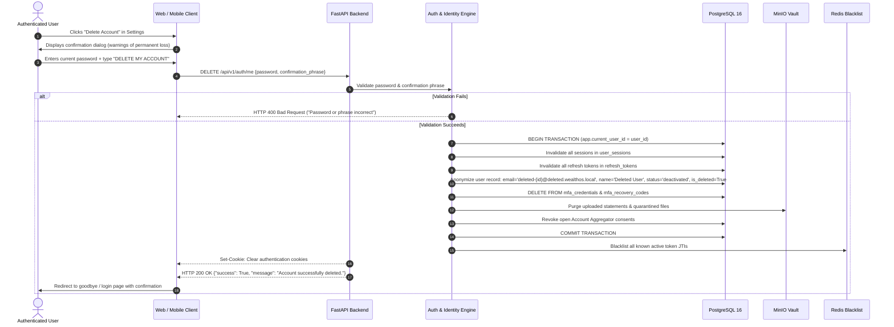

# WealthOS — Account Deletion & Right-to-be-Forgotten Design

**Programme:** WealthOS Enterprise Architecture & Production Readiness  
**Document:** Account Deletion Architecture  
**Date:** 2026-11-08  
**Status:** Approved Engineering Standard  
**Regulatory Compliance:** Google Play User Data Policy (Section 4), GDPR Article 17, India DPDPA 2023  
**Author:** Application Security Lead & Compliance Engineer  

---

## 1. Regulatory & Google Play Policy Mandates

Google Play policy mandates:
> *"If your app allows users to create an account from within the app, it must also allow users to request that their account be deleted. The app must provide an easily discoverable in-app path, and an external web link where users can request account and data deletion without needing to reinstall the app."*

Furthermore, the Indian Digital Personal Data Protection Act (DPDPA 2023) and GDPR Article 17 mandate that financial consumers retain the right to erase their personal data upon request, balanced against statutory financial retention obligations (e.g. Income Tax Act 1961 Section 44AA requiring 6–8 years of accounting book preservation).

---

## 2. In-App Deletion Workflow (`DELETE /api/v1/auth/me`)

---

## 3. Financial Ledger Preservation vs Data Erasure

A critical fintech architectural challenge is reconciling account deletion with double-entry accounting integrity:

### The Balancing Rule
If a user has posted financial transactions to the General Ledger, **deleting ledger journal lines would destroy the double-entry accounting balance ($\sum\text{Dr} - \sum\text{Cr} = 0$) of the entire platform and violate statutory financial audit laws**.

### The WealthOS Solution: Pseudonymization & Anonymization
1. **Personal Identifiable Information (PII) is Purged:**
   - Real email address, phone numbers, full names, IP logs, and browser user-agents are permanently overwritten.
   - Authentication credentials (passwords, TOTP secrets, recovery codes) are permanently deleted.
   - Unprocessed document scans and PDFs in MinIO are deleted.
2. **Immutable Financial Records are Anonymized:**
   - Numerical ledger transactions and journal entries remain in the database with their tenant UUID, ensuring that consolidated historical tax filings, balance sheets, and counterparty records remain mathematically balanced and auditable.
   - The user record that originated those transactions is permanently labeled `Deleted User`.

---

## 4. Public Web Account Deletion Route (`/delete-account`)

To satisfy Google Play Store publishing guidelines, WealthOS provides an unauthenticated, publicly accessible web page:
- **URL:** `https://wealthos.app/delete-account` (and local route `/delete-account`)
- **Features:**
  1. Explains what data is deleted (profile, credentials, documents, personal settings) and what data is anonymized for financial compliance.
  2. Provides an interactive self-service deletion portal for active users.
  3. Provides an alternative email verification request form for users who have uninstalled the app or lost access to their device.
