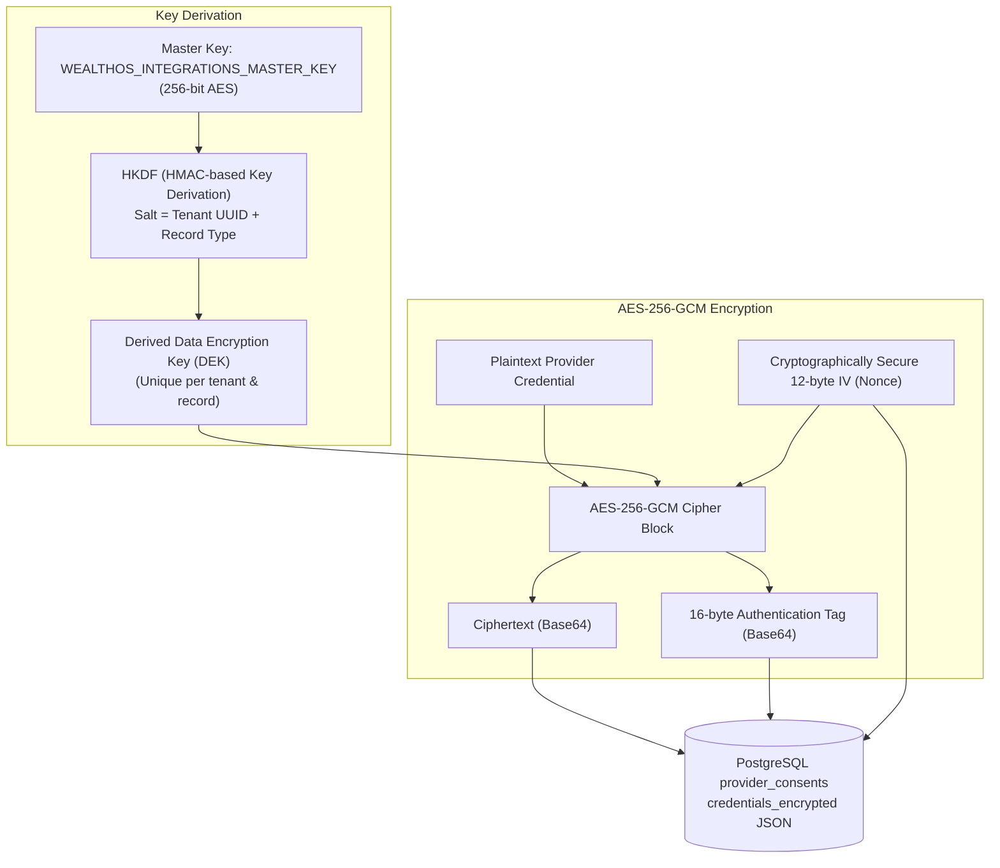

# WealthOS — Secrets Management & Cryptographic Key Lifecycle

**Programme:** WealthOS Enterprise Architecture & Production Readiness  
**Document:** Secrets and Key Management  
**Date:** 2026-11-08  
**Status:** Approved Security Standard  
**Standards:** NIST SP 800-57, FIPS 140-3, ISO 27001  
**Author:** Application Security Lead & Principal Infrastructure Engineer  

---

## 1. Secrets Classification & Storage Hierarchy

WealthOS classifies cryptographic secrets into three distinct tiers:

| Secret Identifier | Classification | Algorithm / Length | Usage | Storage & Injection |
|---|---|---|---|---|
| `SECRET_KEY` | Tier 1 (Critical) | HMAC-SHA256 (min 256 bits) | JWT access token and session signature generation. | Injected via environment / AWS Secrets Manager; zero disk persistence. |
| `ENCRYPTION_MASTER_KEY` | Tier 1 (Critical) | AES-256 (256-bit base64) | Master envelope encryption key for provider credentials and OAuth tokens. | Injected via environment; Hardware Security Module (HSM) / KMS in cloud. |
| `POSTGRES_PASSWORD` | Tier 2 (Confidential) | High-entropy string ($\ge$ 32 chars) | Database connection authentication. | Docker Secrets / Kubernetes Secret. |
| `REDIS_PASSWORD` | Tier 2 (Confidential) | High-entropy string ($\ge$ 32 chars) | Redis authenticated connection. | Docker Secrets / Kubernetes Secret. |
| `MINIO_SECRET_KEY` | Tier 2 (Confidential) | High-entropy string ($\ge$ 32 chars) | Object storage S3 API signature. | Docker Secrets / Kubernetes Secret. |
| `PROVIDER_WEBHOOK_SECRET`| Tier 3 (Integration) | HMAC-SHA256 (256 bits) | Verifying external webhook payloads (AA, NSE). | Stored encrypted in `provider_connections`. |

---

## 2. Envelope Encryption Architecture (AES-256-GCM)

Provider access tokens, bank connection credentials, and CAS upload decryption keys are encrypted at rest using **AES-256-GCM Envelope Encryption**:



### Negative Decryption & Tamper Protection
- If any byte of the `ciphertext`, `iv`, or `tag` is altered in transit or in the database, AES-GCM decryption throws `cryptography.exceptions.InvalidTag`.
- Decryption aborts instantly, preventing chosen-ciphertext and bit-flipping attacks.

---

## 3. Cryptographic Key Rotation Runbook

When rotating `ENCRYPTION_MASTER_KEY` (e.g. during scheduled annual rotation or following a suspected security incident):

```bash
# 1. Generate new 256-bit cryptographically secure key
NEW_KEY=$(python3 -c "import secrets, base64; print(base64.b64encode(secrets.token_bytes(32)).decode())")

# 2. Run automated re-encryption migration script
# Decrypts existing records using CURRENT key, re-encrypts using NEW key in an atomic transaction
python3 backend/scripts/rotate_encryption_keys.py \
  --old-key "$CURRENT_MASTER_KEY" \
  --new-key "$NEW_KEY"

# 3. Update environment configuration with NEW_KEY
# 4. Restart backend API instances with zero downtime
```

