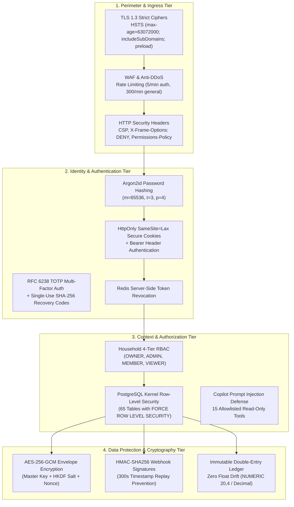

# WealthOS — Security Architecture & Threat Defense Model

**Programme:** WealthOS Enterprise Architecture & Production Readiness  
**Document:** Security Architecture  
**Date:** 2026-11-08  
**Status:** Approved Security Standard  
**Standards:** NIST SP 800-63B, OWASP ASVS v4.0.3 Level 3, ISO 27001, RBI Cybersecurity Framework  
**Author:** Application Security Lead & Principal Software Architect  

---

## 1. Zero-Trust Security Architecture

WealthOS enforces a **Zero-Trust Security Architecture** across every interaction, request, and storage boundary. In WealthOS, no network zone, internal microservice, or authenticated user session is inherently trusted.

---

## 2. Threat Modeling Matrix (STRIDE)

| Threat Category (STRIDE) | Attack Vector / Scenario | WealthOS Architectural Mitigation |
|---|---|---|
| **Spoofing** | Attacker attempts to forge user identity or session tokens. | Argon2id credential hashing; HMAC-SHA256 signed JWTs with expiration, issuer, audience, and unique `jti`. Multi-Factor Authentication (TOTP). |
| **Tampering** | Attacker alters integration credentials, bank sync payloads, or accounting journals. | AES-256-GCM envelope encryption with 16-byte authentication tags. Immutable journal tables preventing in-place updates. Webhook HMAC-SHA256 verification. |
| **Repudiation** | User claims they did not initiate a fund transfer or delete their account. | Cryptographically linked, immutable `security_audit_logs` capturing user ID, IP address, user-agent, correlation ID, timestamp, and action metadata. |
| **Information Disclosure** | Cross-tenant data leakage via missing query filters or SQL injection. | PostgreSQL kernel `ROW LEVEL SECURITY` enforced across 65 tables using restricted runtime role `wealthos_app`. Parameterized SQLAlchemy queries. |
| **Denial of Service** | Credential stuffing, brute-force password guessing, or heavy query flooding. | Redis-backed distributed rate limiters (5 requests/min on login/register in production); PgBouncer connection pooling preventing pool starvation. |
| **Elevation of Privilege** | Household member attempts to view private wealth of owner or execute wire settlements. | 3-tier visibility scopes (`PERSONAL_ONLY`, `HOUSEHOLD_SHARED`, `LIMITED_SHARED`) enforced at the service and query planner level. |

