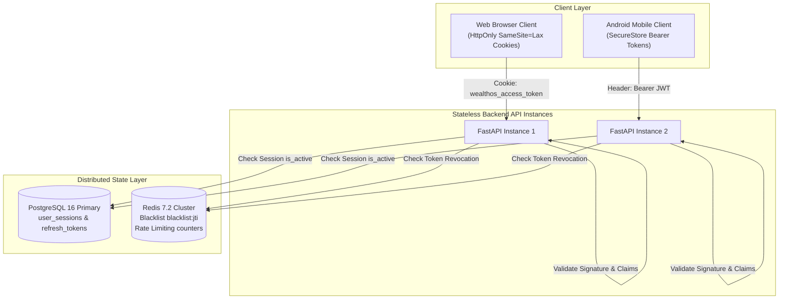

# WealthOS — Session Management & Multi-Instance Token Security Design

**Programme:** WealthOS Enterprise Architecture & Production Readiness  
**Document:** Session Management Design  
**Date:** 2026-11-08  
**Status:** Approved Security Standard  
**Standards:** RFC 6749, RFC 7519, OWASP ASVS v4.0.3 L3  
**Author:** Identity Architect & Application Security Lead  

---

## 1. Multi-Instance Distributed Session Architecture

WealthOS backend instances are strictly stateless. No session state or user authentication context is cached in process memory. Any session created by API Instance 1 is immediately valid and revocable across API Instance 2, Instance 3, and background workers.

---

## 2. Token Lifecycle & Dual Authentication Channels

### 2.1 Access Tokens (Short-Lived)
- **Format:** JSON Web Token (JWT) signed using HMAC-SHA256 (`HS256`).
- **Lifespan:** 15 minutes in production (configurable up to 60 minutes).
- **Claims:**
  - `sub`: User UUID.
  - `sid`: User session UUID in `user_sessions`.
  - `jti`: Unique token UUID for revocation blacklisting.
  - `iss`: `"wealthos:auth"`.
  - `aud`: `"wealthos:api"`.
  - `exp`: Unix expiration timestamp.

### 2.2 Dual Ingress Authentication Channels
1. **Web Browser (Cookie-Based):**
   - Transmitted via `wealthos_access_token` cookie.
   - Attributes: `HttpOnly = True`, `SameSite = "lax"`, `Secure = True` (in prod), `Path = "/"`.
   - **Benefit:** Completely eliminates Cross-Site Scripting (XSS) token exfiltration risks by making tokens inaccessible to JavaScript.
2. **Mobile & API Clients (Header-Based):**
   - Transmitted via standard `Authorization: Bearer <token>` header.
   - Stored in Android Keystore / iOS Keychain via `expo-secure-store`.

---

## 3. Refresh Token Rotation (RTR) & Reuse Detection

WealthOS implements Refresh Token Rotation (RTR) to prevent token theft and replay attacks:

1. **Rotation on Every Use:** When a client presents a refresh token to `/api/v1/auth/refresh`, the presented token is immediately invalidated (`is_revoked = True, revoked_reason = "rotated"`), and a brand-new refresh token is issued.
2. **Reuse Attack Detection:** If a refresh token that was already marked as revoked is submitted again (indicating that an attacker intercepted a prior token):
   - The token rotation engine detects the reuse.
   - The engine **immediately revokes the entire session and token family** (`revoked_reason = "reuse_detected"`).
   - An alert security audit log is dispatched, forcing all legitimate and malicious sessions to terminate.

---

## 4. Distributed Session Revocation Protocols

1. **Single Session Logout (`POST /api/v1/auth/logout`):**
   - Sets `is_active = False` on `user_sessions`.
   - Blacklists current token's `jti` in Redis with TTL matching remaining token lifespan.
   - Clears authentication cookies from client response.
2. **Global Logout (`POST /api/v1/auth/logout-all`):**
   - Atomically terminates all active sessions in `user_sessions`.
   - Revokes all issued refresh tokens for the user account.
   - Forces re-authentication across all mobile devices, tablets, and web browsers.
3. **Password Change / Reset Revocation:**
   - Automatically triggers `logout_all_sessions`, immediately locking out compromised sessions upon credential updates.
