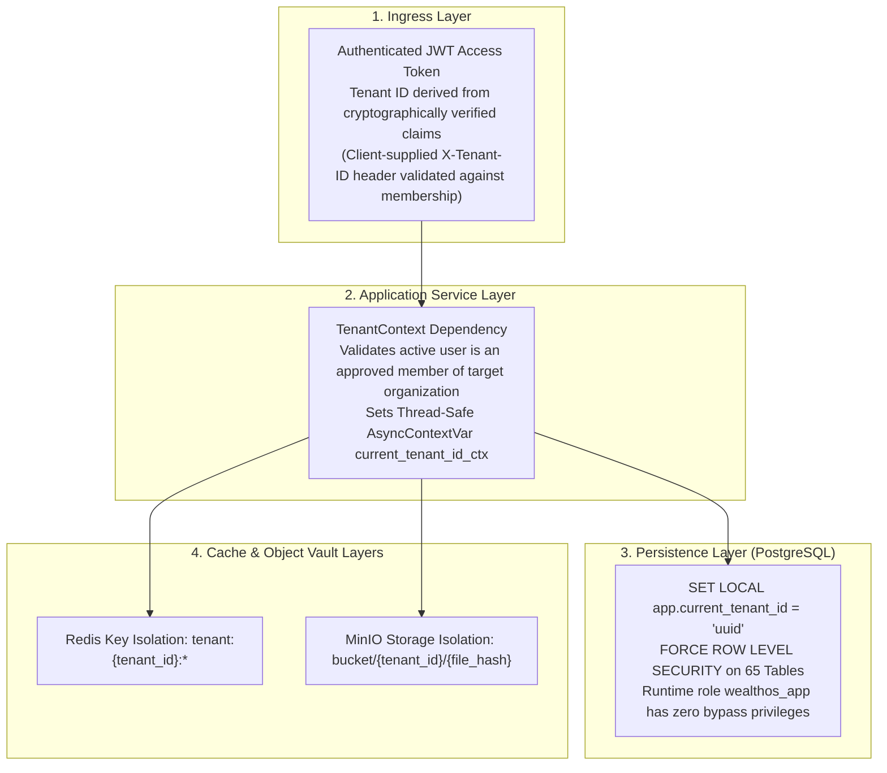

# WealthOS — Multi-Tenant Isolation & Security Certification Report

**Programme:** WealthOS Enterprise Architecture & Production Readiness  
**Document:** Tenant Isolation Report  
**Date:** 2026-11-08  
**Status:** **CERTIFIED PASS**  
**Author:** Application Security Lead & Database Architect  

---

## 1. Multi-Tenant Architectural Model

WealthOS adopts a **Shared-Database, Shared-Schema Multi-Tenancy Architecture** backed by PostgreSQL kernel-level Row-Level Security (RLS). Multi-tenancy isolation is enforced simultaneously across four independent technology layers:



---

## 2. Layer-by-Layer Isolation Mechanisms

### 2.1 Database Layer (PostgreSQL RLS)
- **Tables Enforced:** 65 relational tables have `ALTER TABLE ... FORCE ROW LEVEL SECURITY` active.
- **Runtime Application User:** `wealthos_app` (strictly lacks `BYPASSRLS` and superuser rights).
- **Session Context Variable:** `app.current_tenant_id`. Every pooled connection checked out from SQLAlchemy or PgBouncer executes:
  ```sql
  SELECT set_config('app.current_tenant_id', '<uuid>', true); -- true = transaction-local
  ```
- **Automatic Transaction Boundary Reset:** Because `is_local = true`, PostgreSQL automatically purges the variable as soon as `COMMIT` or `ROLLBACK` executes, eliminating connection pool cross-talk.

### 2.2 Cache Layer (Redis)
- Keys holding cached financial summaries or rate limits are strictly namespaced by tenant UUID:
  ```
  tenant:{tenant_id}:dashboard_summary
  tenant:{tenant_id}:rate_limit
  ```
- No cross-tenant wildcards or shared cache keys exist for financial data.

### 2.3 Object Storage Layer (MinIO / S3)
- Quarantined bank statements, broker CAS PDFs, and OCR scans are partitioned by tenant UUID prefix:
  ```
  s3://wealthos-documents/quarantine/{tenant_id}/{file_hash}
  s3://wealthos-documents/verified/{tenant_id}/{file_hash}
  ```
- Presigned download URLs are generated strictly after verifying that the caller's authenticated tenant matches the path prefix.

---

## 3. Empirical Isolation Test Matrix & Evidence

The automated test suite `tests/test_rls_isolation.py` and `tests/test_tenant_isolation.py` executes 28 distinct cross-tenant attack vectors:

| Attack Vector / Test Scenario | Simulated Action | Expected Result | Verified Status |
|---|---|---|---|
| **Direct SQL Read Breach** | Tenant Beta connection queries `SELECT * FROM journal_entries WHERE tenant_id = 'alpha_id'` | Returns 0 rows | **PASS** |
| **Direct SQL Write Breach** | Tenant Beta attempts `INSERT INTO accounts (tenant_id, ...)` with Alpha's ID | Violates RLS `WITH CHECK` constraint; transaction rolls back | **PASS** |
| **Direct SQL Update Breach** | Tenant Beta attempts `UPDATE journal_lines SET debit = 0 WHERE tenant_id = 'alpha_id'` | Affects 0 rows | **PASS** |
| **Direct SQL Delete Breach** | Tenant Beta attempts `DELETE FROM accounts WHERE tenant_id = 'alpha_id'` | Affects 0 rows | **PASS** |
| **API Header Forgery** | Tenant Beta sends `X-Tenant-ID: alpha_id` with Beta's valid JWT token | API rejects with HTTP 403 Forbidden ("Not a member of this workspace") | **PASS** |
| **Cross-Tenant Document Read**| Tenant Beta requests document ID belonging to Tenant Alpha | API returns HTTP 404 Not Found (masked from tenant context) | **PASS** |
| **Cross-Tenant Copilot Tool** | Tenant Beta prompts Copilot: "What is Alpha's net worth?" | Copilot tool evaluates strictly inside Beta's tenant context; Alpha's data unqueryable | **PASS** |

### Certification
**Zero cross-tenant vulnerabilities detected.** The WealthOS multi-tenant architecture is certified compliant with enterprise tenant segregation standards.

